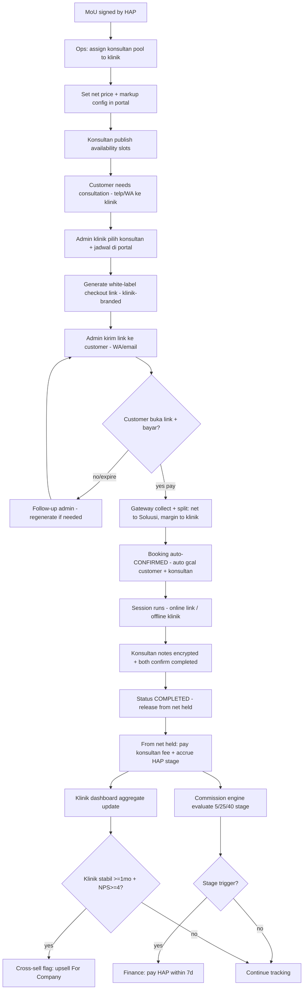
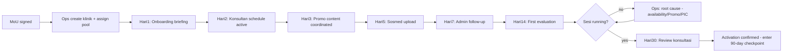
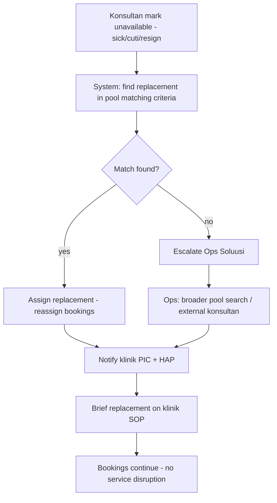
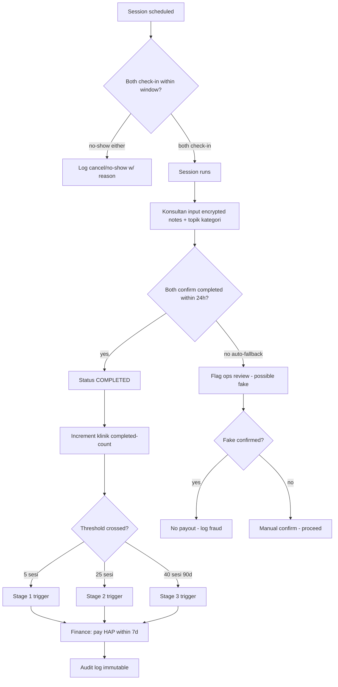
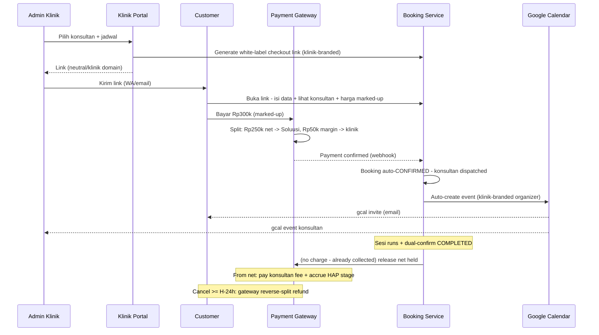
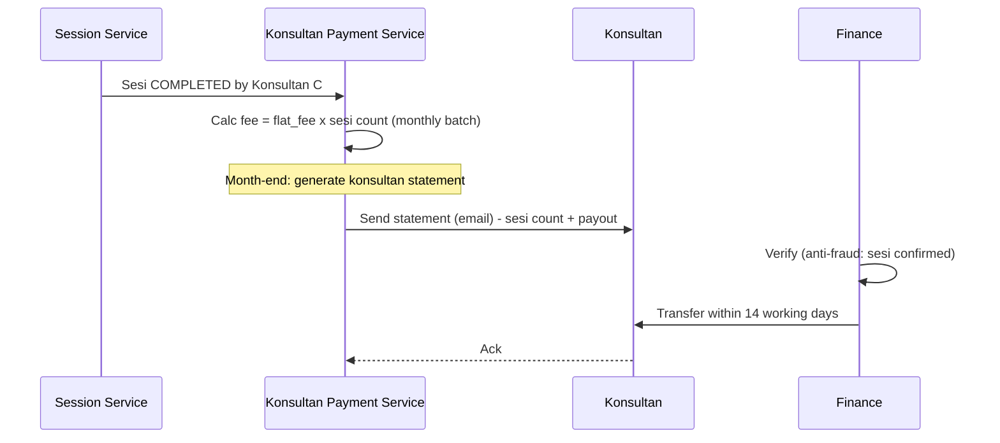
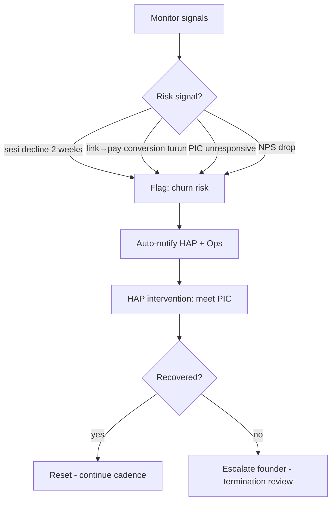

# Soluusi B2B — Klinik Vertical Spec
### For Health Facilities · Consultant-Supply Model (E2E + Full Expansion)

> Versi 1.1 · Agustus 2026
> Vertical priority: **#1 — dibangun pertama**
> Dokumen pendukung: `Soluusi B2B Master Playbook.md`, `Soluusi B2B Platform - PRD.md`
> Status: Draft — asumsi ditandai `[ASSUMED]`, keputusan ditandai `[OPEN]`
> **Revisi model:** v1 post-paid invoice → v1.0 prepaid wallet → **v1.1 white-label link + direct customer payment + split** (current). Lihat §2 & §10.

---

## Daftar Isi
1. Scope & Priority
2. Revenue & Commercial Model
3. Money Flow (per-sesi + milestone)
4. Konsultan Pool Management
5. Pricing & Markup Configuration
6. Pasien Identity & Ownership `[OPEN — critical]`
7. Booking & Scheduling (+ edge cases)
8. Consultation Delivery (online/offline/hybrid)
9. Session Confirmation & Anti-Fraud
10. White-label Checkout & Split Payment (Customer → Soluusi)
11. Konsultan Payment (Soluusi → Konsultan)
12. Voucher & Campaign (Benefit Pasien, Skema 4)
13. MHCU for Klinik (Skema 2)
14. Edukasi for Klinik (Skema 3)
15. Partner Lifecycle (onboarding → activation → account mgmt → churn → termination)
16. Roles & Permissions (Klinik-side)
17. Data, Reporting & Dashboards
18. Compliance & Confidentiality
19. Multi-Cabang Klinik Grup
20. Notifications (Klinik-specific)
21. Escalation & Exception Handling
22. KPIs & Success Metrics
23. Integrations
24. Open Questions / Decisions
25. E2E Flows (mermaid consolidated)

---
---

## 1. Scope & Priority

Klinik vertikal = **vertikal pertama yang dibangun**. Alasan: HAP playbook sudah jalan, ICP paling matang, sales cycle tercepat (vs sekolah/perusahaan), dan ini adalah fondasi revenue model (markup model) yang akan dipakai sebagai pola.

**In-scope MVP (klinik):**
- Konsultan pool supply + klinik pilih
- Booking (online + offline)
- Session + dual-confirm
- Billing: **white-label checkout link** (admin generate → customer pays directly via klinik-branded link, split-payment, no AR)
- White-label: hide Soluusi brand dari customer (domain, receipt, gcal, notif) — see §10.8+
- Google Calendar auto-schedule after payment
- Konsultan payment: Soluusi→konsultan flat/sesi
- HAP commission engine (3-stage)
- Klinik dashboard aggregate
- Voucher (Benefit Pasien diskon 20% + free trial 10 min)

**Out-of-scope MVP (Phase 2):**
- MHCU klinik (Skema 2) — schema supported, module Phase 2
- Edukasi seminar (Skema 3) — manual scheduling MVP, systematize Phase 2
- White-label klinik-branded self-book page (slot-picker Phase 2; checkout link itself = MVP)
- Cross-sell to For Company (wellbeing staf klinik)

---
---

## 2. Revenue & Commercial Model

### Model inti: **Markup model + WHITE-LABEL direct payment, customer bayar via link**
- Soluusi punya **net price** per sesi; klinik **markup** → harga ke customer (klinik set, kena cap §2.2)
- Admin klinik (di klinik portal) **pilih konsultan + jadwal** → sistem **generate white-label checkout link** (klinik-branded, **NO brand Soluusi**)
- Admin **kirim link** ke customer (WA/email) → customer buka link → lihat **nama konsultan + jadwal + harga marked-up** → isi data + **bayar langsung di link**
- Payment gateway (Soluusi-controlled, white-labeled) **collect dari customer** → **split**: net → Soluusi, margin → klinik (auto-remit ke klinik earnings) `[DECIDED — white-label + split, per user]`
- **Soluusi selalu collect net langsung dari customer** → **no AR, no credit risk, no dunning** (lebih aman dari wallet prepaid — customer-funded, bukan klinik-funded)
- Setelah payment confirmed → booking **auto-confirmed** + **auto-add Google Calendar** customer + konsultan
- Klinik **simpan margin markup** otomatis (split). Pasien↔klinik relationship tetap milik klinik; Soluusi hidden

### Markup cap (dari Master Playbook §1.4)
Margin klinik (markup) sebagai fraksi harga pasien dibatasi:

| Harga ke Pasien | Margin Klinik Maks | Soluusi Net Min |
|---|---|---|
| Rp250.000 – Rp299.999 | 10% | 90% |
| Rp300.000 – Rp349.999 | 15% | 85% |
| Rp350.000 – Rp399.999 | 20% | 80% |
| ≥ Rp400.000 | 25% | 75% |

> Tujuan cap: jaga harga pasien wajar & pastikan Soluusi net tidak di-press klinik. Klinik bisa charge lebih rendah dari cap (margin lebih kecil) tapi tidak lebih tinggi.

### Net price — siapa set? `[ASSUMED-3]`
Default: **Soluusi set net price per sesi** (tabel §5). Klinik markup freely tapi kena cap.
Alternative: klinik set patient price, net Soluusi = patient − margin (capped). Hasil ekuivalen; beda sisi pegang reference. `[OPEN-3]`

---
---

## 3. Money Flow (per-sesi + milestone)

### Per-sesi flow (WHITE-LABEL direct payment)
```
[1] Admin klinik (klinik portal) pilih konsultan + jadwal
    → sistem generate white-label checkout link (klinik-branded, hide Soluusi)

[2] Admin kirim link → customer buka → lihat nama konsultan + jadwal + harga Rp300k (marked-up)
    → customer isi data (nama, email, telp) + bayar Rp300k di link

[3] Gateway collect Rp300k → split:
       ├─ Rp250k net → Soluusi (always collected, no credit risk)
       └─ Rp50k margin → klinik earnings (auto-remit / payout)

[4] Payment confirmed → booking auto-confirmed → auto-add gcal customer + konsultan

[5] Sesi berlangsung + dual-confirm COMPLETED
    → dari net Rp250k yang sudah di-pegang Soluusi:
       ├─ Konsultan fee: Rp150k (pay to konsultan, after confirm)
       └─ Soluusi gross: Rp100k → accrue HAP 3-stage milestone
```

### HAP commission milestone (per klinik, 90-day rolling)
**Source: `03 - Soluusi HAP-02 Compensation Framework (Untuk HAP) (5).pdf`**

| Trigger | Payout | Source |
|---|---|---|
| MoU ditandatangani + 5 konsultasi pertama selesai | Stage 1: Rp250.000 | Anti-fraud: MoU palsu tidak worth it di Rp250K. 5 konsultasi = proof nyata klinik aktif |
| 25 konsultasi selesai di klinik tersebut | Stage 2: 1/3 dari Rate Sisa (Total - Stage 1) = Rp250.000 | Milestone tengah: klinik sudah setengah jalan menuju target 40 |
| 40 konsultasi selesai (target penuh 90 hari) | Stage 3: 2/3 dari Rate Sisa (Total - Stage 1) = Rp500.000 | Trigger terkuat: bayaran terbesar untuk "10 langkah terakhir" menuju finish line |
| **Total per klinik** | **Rp1.000.000** | (Rate indikatif HAP, scale by deal) |

**Design principles (dari Compensation Framework PDF):**
1. **Anti-fraud:** Komisi besar hanya cair setelah ada aktivitas konsultasi nyata — bukan sekadar tanda tangan MoU
2. **Cash flow protection:** Soluusi hanya membayar HAP setelah revenue dari konsultasi sudah terkonfirmasi
3. **Motivation architecture:** Struktur back-loaded mendorong HAP tidak hanya mencari MoU, tapi juga mengaktivasi klinik secara penuh

**Mengapa Stage 3 dibayar 2× Stage 2 untuk jumlah konsultasi yang lebih sedikit?**
Efisiensi payout per konsultasi tinggi di Stage 3, menciptakan "goal gradient effect". Stage 2 yang terasa lebih berat per konsultasinya adalah "valley" yang harus dilewati, bukan titik berhenti.

**Payment terms:**
- SLA bayar: Maks 7 hari kerja setelah trigger
- Metode: Transfer bank
- Konfirmasi konsultasi dilakukan otomatis oleh sistem platform Soluusi — HAP tidak perlu melaporkan manual
- Periode 90 hari berjalan sejak tanggal MoU masing-masing klinik
- Konsultasi yang terjadi setelah 90 hari tetap dihitung untuk Stage 2 dan 3 jika belum tercapai — tidak ada hangus

**Team Milestone Bonus (dari Compensation Framework PDF):**
| Milestone Tim | Bonus per HAP | Catatan |
|---|---|---|
| 100 klinik MoU aktif (tim total) | Rp500.000 | ~17 klinik per HAP — tercapai di bulan 2 |
| 200 klinik MoU aktif (tim total) | Rp1.000.000 | ~33 klinik per HAP — target akhir bulan 3 |
| Rp300 juta gross profit konsultasi | Rp1.500.000 | Midpoint menuju target Rp600M |
| **Rp600 juta gross profit (TARGET)** | **Rp3.000.000** | Target penuh Agustus–Desember 2025 |

> Konfirmasi konsultan fee (Rp150k indikatif) & HAP rate — `[OPEN-1]` `[OPEN-2]`.

### Contoh end-to-end angka (1 klinik, 40 sesi psikolog online)
| Line | Amount |
|---|---|
| Pasien total bayar (40 × Rp300k) | Rp12.000.000 |
| Klinik margin (40 × Rp50k) | Rp2.000.000 (keep) |
| Customer pays via gateway → net to Soluusi (40 × Rp250k) | Rp10.000.000 |
| Soluusi → Konsultan fee (40 × Rp150k) | Rp6.000.000 |
| Soluusi gross | Rp4.000.000 |
| Soluusi → HAP commission (3-stage total) | Rp1.000.000 |
| Soluusi net revenue | Rp3.000.000 |

---
---

## 4. Konsultan Pool Management

Inti vertikal ini: **Soluusi supply konsultan ke klinik, klinik pilih yang available.**

### 4.1 Pool assignment (saat onboarding)
- Dari hasil discovery (Playbook §6), klinik nyatain kebutuhan: jenis konsultan (psikolog anak/umum, nutrisionis, fisio), volume estimasi, jam operasional, online/offline pref
- Soluusi **assign pool** konsultan ke klinik (default 3–5 konsultan per jenis, agar ada backup)
- Matching criteria: spesialisasi, lokasi (offline butuh dekat), bahasa, jam availability
- Konsultan di-briefing SOP klinik (jam, sistem rujukan, profile pasien klinik) — oleh Ops Soluusi + HAP

### 4.2 Availability publishing
- Konsultan publish slot availability → Klinik Portal (per minggu, per mode online/offline, per cabang)
- Slot = (konsultan, waktu, mode, lokasi, durasi, status available/booked)
- Klinik staff lihat slot available → pilih → booking

### 4.3 Replacement flow (konsultan unavailable/resign) `[mermaid §25.3]`
- Konsultan mark unavailable (sakit, cuti) → sistem auto-cari replacement dari pool yang matching kriteria
- Notify klinik PIC + HAP → replacement assigned → booking di-reassign
- Jika tidak ada replacement matching → eskalasi Ops Soluusi (Playbook §4.23 "psikolog resign" → Soluusi sediakan pengganti)

### 4.4 Konsultan performance tracking
- Sesi completed count, no-show rate, pasien NPS per konsultan, utilization (slot booked vs available)
- Trigger coaching bila NPS < threshold atau no-show > threshold

### 4.5 Multi-klinik konsultan
- Satu konsultan bisa assigned ke multi-klinik (supply on-demand)
- Calendar conflict prevention: sistem block double-booking across klinik
- Konsultan set availability global → sistem filter per klinik

---
---

## 5. Pricing & Markup Configuration

### 5.1 Net price table (indikatif, Soluusi-set) `[ASSUMED-3]`
| Konsultan Type | Durasi | Online Net | Offline Net |
|---|---|---|---|
| Psikolog umum/klinis | 60 min | Rp250.000 | Rp300.000 |
| Psikolog anak | 60 min | Rp280.000 | Rp350.000 |
| Nutrisionis | 45 min | Rp200.000 | Rp250.000 |
| Fisioterapis | 45 min | Rp220.000 | Rp280.000 |
| Konsultan karir | 60 min | Rp250.000 | — (online only) |

> Indikatif — final rate finance confirm. Offline > online karena konsultan travel/room.
> **B2C reconcile** (Appendix C.5): B2C `consultant_packages` = pricing mechanism (name, price, duration, quota, results JSON, **no online/offline field**). B2C categories seeded = Psikologi/Karir/Bisnis/Keuangan/Hukum/Pajak — BUKAN psikolog/nutrisi/fisio. Klinik B2B butuh kesehatan → **reuse `consultant_packages` + `categories` table, add health categories + mode field**. `[OPEN-22]` Net price di spec ini map ke `consultant_packages.price`.

### 5.2 Konsultan fee (indikatif)
| Konsultan Type | Fee/sesi (flat) |
|---|---|
| Psikolog | Rp150.000 |
| Nutrisionis | Rp120.000 |
| Fisioterapis | Rp130.000 |
| Konsultan karir | Rp150.000 |

> Indikatif. `[OPEN-1]` — final fee model (flat vs % of net) belum lock.

### 5.3 Markup cap enforcement
- Saat klinik set patient price, sistem validate: margin ≤ cap untuk range harga tsb
- Bila margin > cap → reject + suggest max patient price untuk net yang dipilih
- Custom net price (strategic klinik, multi-cabang) → eskalasi (Playbook §4.9) → Super Admin approve

### 5.4 Price change workflow
- Net price update by Soluusi (Super Admin) → effective date
- Existing booking: gunakan net price saat booking dibuat (lock)
- Notify klinik + HAP bila net price change

### 5.5 Voucher interaction (Skema 4)
- Diskon 20% / free trial 10 min → bearer of discount = `[OPEN-4]` (Soluusi absorbs? klinik? shared?)
- Default: voucher menurunkan Soluusi net (Soluusi absorbs untuk akuisisi), klinik margin tetap. Konfirmasi.

---
---

## 6. Pasien Identity & Ownership `[OPEN — critical design fork]`

**Ini keputusan paling penting yang belum di-decide.** Menentukan scope PII, UU PDP compliance, dan booking UX.

### Model A — Pasien registered di Soluusi
- Pasien bikin akun Soluusi (atau reuse dari soluusi.com B2C)
- Soluusi pegang PII pasien (nama, kontak, riwayat sesi)
- Konsultan + pasien bisa follow-up, re-book
- **Cost:** Soluusi jadi data controller pasien PII → full UU PDP burden, consent, DPO, breach risk

### Model B — Pasien anonymous to Soluusi (klinik owns pasien) `[ASSUMED — recommended]`
- Klinik pegang identitas pasien (mereka punya EMR/kasir)
- Soluusi cuma lihat "sesi #X, klinik Y, konsultan Z" + pseudonym untuk konsultan clinical notes
- Konsultan butuh nama pasien untuk clinical → pass via secure field yang **tidak** di-store long-term accessible ke Soluusi staff (atau konsultan-only field)
- **Benefit:** Soluusi bukan controller PII pasien → ringan UU PDP, less breach surface
- **Cost:** no re-book funnel Soluusi-side, no Soluusi pasien retention

### Shift (v1.1 white-label direct payment): **Model C — checkout-guest** `[RECOMMENDED]`
Karena customer **bayar langsung via link** (§2), Soluusi gateway **collect PII customer** di checkout (nama, email, telp) untuk payment receipt + gcal invite. Jadi Model B (fully anonymous) **tidak lagi feasible** — Soluusi pegang transactional PII.

**Model C (recommended, current):**
- Customer **tidak bikin akun** (guest checkout) tapi Soluusi collect: nama, email, telp, payment info di transaksi
- Soluusi = data controller untuk PII checkout (UU PDP applies) — minimize: hanya field perlu (no DOB, no address unless needed)
- Konsultan akses nama pasien via clinical field (encrypted, konsultan-only) — sama seperti Model B
- Klinik tetap "owns relationship" secara komersial (customer kenal klinik, bukan Soluusi — enforced via white-label §10.8)
- **No Soluusi account for customer** → no re-book funnel Soluusi-side (klinik owns repeat booking)
- **B2C divergence**: B2C registers users (Model A, `users` table — avatar, phone, is_active). B2B pilih guest checkout (Model C) untuk white-label simplicity + klinik owns relationship. Deliberate B2B choice. (Appendix C.5/C.6)

`[OPEN-6]` — confirm Model C. UU PDP scope = Soluusi handle checkout PII (consent at checkout, DPO, breach). Klinik still owns longitudinal patient record.

---
---

## 7. Booking & Scheduling

### 7.1 Booking creation paths (v1.1)
1. **Admin klinik generate link** `[DEFAULT MVP]` — admin pilih konsultan + jadwal di klinik portal → generate white-label checkout link → kirim ke customer (WA/email) → customer isi + bayar di link → auto-confirmed + gcal
2. **Customer self-book via link** (Phase 2) — klinik share booking page link → customer pilih konsultan + slot sendiri → bayar (mirror soluusi.com B2C, tetap white-label)
3. Walk-in/staff-book di portal tanpa customer link (Phase 2) — untuk klinik yang mau staff handle full

> **Scheduling decision `[OPEN-21]`** (user asked): admin pick slot di dashboard (MVP, simplest, match klinik coordination) vs customer pick slot dari link (Phase 2, self-serve, mirror soluusi.com). **Recommended MVP: admin pick konsultan + 1 slot → link = pay-and-confirm** (customer just isi + bayar). Phase 2: admin pick konsultan, customer pick slot dari available. Alasan: MVP paling simple + klinik kontrol; self-serve butuh availability engine yang robust.

### 7.2 Booking fields
- Klinik (org + cabang)
- Konsultan (dari assigned pool)
- Mode (online/offline)
- Waktu (slot)
- Durasi (30/45/60 min — dari konsultan type default)
- Patient ref (Model B: pseudonym/klinik ref ID; Model A: pasien account)
- Voucher (optional, Skema 4)
- Status: scheduled → checked-in → in-session → completed / no-show / cancelled
> **B2B-NEW vs B2C** (Appendix C.6): B2C status flow = `waiting → scheduled → done → canceled` (NO check-in / in-session / no-show / dual-confirm — consultant just marks `done`). B2B adds dual-confirm + no-show karena commission fraud risk (§9). Reuse `consultation_sessions` table + status enum extended.

### 7.3 Reschedule & cancel `[OPEN-7]`
- Cutoff time: H-2 jam free reschedule; <2 jam = cancel (status counted)
- Who can: staff klinik, konsultan, pasien (Model A only)
- Cancel reason log (Playbook §4.23)
- No-show: customer sudah bayar via gateway. Refund policy? `[OPEN-7a]` — default: cancel <H-2jam = 50% refund customer (gateway reverse-split), 50% forfeit (konsultan standby); ≥H-2jam = full refund. Tracked; >2 no-show/klinik → review

### 7.4 Walk-in handling
- Walk-in pasien: staff create booking "now" atau "next slot" → konsultan check available real-time
- Offline walk-in: konsultan harus available fisik di klinik (kalau konsultan online-only, gak bisa)

### 7.5 Overbooking prevention
- Slot lock saat booking create (Redis lock, TTL 10 min untuk complete payment/confirm)
- Konsultan calendar sync (Google Calendar) two-way

### 7.6 Multi-cabang
- Klinik grup: slot publish per cabang; konsultan availability per cabang (offline) atau global (online)
- Booking tagged cabang → link domain per grup OR per-cabang subdomain `[OPEN-8]`

---
---

## 8. Consultation Delivery

### 8.1 Mode
- **Online** — Zoom/Meet link auto-generated, sent to pasien (via klinik, Model B) + konsultan
- **Offline** — di klinik (ruang konsultasi klinik) atau lokasi yang disepakati
- **Hybrid** — Phase 2

### 8.2 Session duration
- Default per konsultan type (psikolog 60min, nutrisionis/fisio 45min)
- Variants: first-consultation (60min) vs follow-up (30min) `[OPEN-9]`

### 8.3 Recording
- Online: **no recording by default** (confidentiality). `[OPEN-9a]` — bila pasien + konsultan consent, opt-in recording stored konsultan-only.
- Offline: tidak ada recording.

### 8.4 Check-in flow
- Pre-session window (H-15min): konsultan + pasien check-in
- Dual check-in required untuk start session (anti-fraud)
- Link online open saat both checked-in

---
---

## 9. Session Confirmation & Anti-Fraud

Core anti-fraud principle (Playbook §5.1): komisi cair **hanya setelah sesi nyata terkonfirmasi**, bukan MoU.

> **White-label shift (v1.1, §2):** customer bayar langsung via gateway → Soluusi collect net di muka, **no credit risk sama sekali** (customer-funded, bukan klinik-funded). Anti-fraud sekarang fokus: (a) sesi **benar-benar terjadi** sebelum konsultan fee di-release + HAP komisi di-accrue (insentif semua party = sesi terjadi); (b) HAP/associate tidak bisa klaim sesi fake untuk trigger komisi; (c) **refund fraud** — customer/klinik klaim sesi gak terjadi untuk refund → audit trail §9.2 + dispute §9.3. **Dual-confirm masih wajib.**

### 9.1 Confirmation flow `[mermaid §25.4]`
1. Konsultan + pasien check-in → session starts
2. Konsultan input clinical notes (encrypted, konsultan-only) + topik kategori (anonim untuk aggregate)
3. Both confirm completed within 24h
4. Auto-confirm fallback: bila tidak confirm dalam 24h → flag ops review (possible fake)
5. Status COMPLETED → trigger: increment klinik completed-count + revenue calc + HAP stage evaluation

### 9.2 Audit trail (immutable)
- Who confirmed, when, IP, device fingerprint
- Stored 7 years (compliance)

### 9.3 Dispute resolution
- Pasien claims session didn't happen / quality issue → klinik PIC raise dispute
- Ops Soluusi review audit trail → resolve (credit note / konsultan coaching)
- `[OPEN-10]` — dispute SLA

### 9.4 Refund flow (gateway reverse-split to customer)
- Sesi cancelled ≥ H-24h → **full refund customer** via gateway reverse-split; no konsultan fee
- Sesi cancelled < H-24h or no-show → 50% refund customer, 50% forfeit → konsultan standby compensation `[OPEN-7a]`
- Klinik margin: auto-reversed via split (proportional)
- Soluusi→konsultan: bila cancelled < H-24h → konsultan dapat porsi dari 50% forfeit `[OPEN-10a]`; ≥ H-24h → no fee

---
---

## 10. White-label Checkout & Split Payment (Customer → Soluusi)

> Revisi v1.1: wallet prepaid **superseded** → **white-label checkout link + direct customer payment + split**. Mitigasi risiko lebih baik (customer-funded, no AR) + respect partner (hide Soluusi). Lihat §2 & §3.

### 10.1 Model `[DECIDED — white-label + split, per user]`
- Admin klinik generate **white-label checkout link** di klinik portal (pilih konsultan + jadwal)
- Customer buka link → isi data + **bayar marked-up price langsung** di link (payment gateway, Soluusi-controlled)
- Gateway **split**: net → Soluusi, margin → klinik earnings (auto-remit)
- **No AR, no credit risk** — Soluusi collect net langsung dari customer

### 10.2 Checkout link content (mirror soluusi.com B2C, white-labeled)
- Klinik branding (logo, nama, warna) — **no Soluusi brand**
- Konsultan name + foto/profil ringkas (no Soluusi affiliation link)
- Jadwal (slot yang admin pilih, atau slot-picker Phase 2)
- Harga **marked-up** (yang customer bayar) — net hidden dari customer
- Mode (online: link Zoom/Meet; offline: alamat klinik)
- Form fields: nama, email, telp, date_of_birth, regency_id (kota), gender (+ optional `complaint`/keluhan singkat untuk konsultan) — mirror B2C checkout (Appendix C.6)
- Payment methods: card, VA, e-wallet, qris (gateway-supported)
- Consent: UU PDP notice + AIGC/sesrecording consent (bila applicable)

### 10.3 Split payment (marketplace model)
- **Split-payment = NEW BUILD** (B2C gak punya — single merchant Midtrans Snap, see Appendix C.2; grep zero hit). Build via **Midtrans partner/Connect API** atau **Xendit Marketplace** (`for-user` header). `[OPEN-18]`
- Customer pays Rp300k → auto-split: Rp250k → Soluusi account, Rp50k → klinik account (or klinik earnings balance + periodic payout)
- **Soluusi always gets net** (no credit risk); klinik always gets margin (no invoicing)
- Refund: bila sesi cancel, gateway reverse-split (refund customer, reverse margin + net) `[OPEN-7a]`

### 10.4 Auto-confirm + Google Calendar
- Payment confirmed (gateway webhook) → booking **auto-CONFIRMED** → konsultan dispatched
- System **auto-create gcal event** + invite customer (email) + konsultan
- gcal organizer = **klinik-branded service account** (not soluusi.com) `[OPEN-20]`
- **B2C uses OAuth user** (`soluusi@gmail.com` refresh token, `GoogleCalendarService.php`) — gak viable untuk multi-klinik white-label (per-klinik re-auth pain). **B2B migrate ke service account + domain-wide delegation.** Hardcoded `"Soluusi - {package}"` di event summary/description → parameterize ke klinik brand. (Appendix C.3)
- **FIX B2C bug**: GCal failure leaves session `waiting` walau payment verified — B2B make gcal non-fatal (booking confirmed regardless + retry via queue job). Jangan mirror B2C bug.
- Event title klinik-branded (e.g., "Konsultasi [Klinik Name] - [Konsultan]")
- Reminder: gcal default + WA reminder H-1/H-2h (klinik-branded)

### 10.5 Refund & cancel
- Cancel ≥ H-24h: **full refund customer** via gateway reverse-split; no konsultan fee
- Cancel < H-24h / no-show: 50% refund customer, 50% forfeit → konsultan standby compensation `[OPEN-7a]`
- Dispute: customer claim sesi didn't happen → review audit §9.2 → refund if valid

### 10.6 What this REPLACES (deletion log)
- ~~Post-paid weekly invoice~~ (v1) → ~~prepaid wallet~~ (v1.0) → **direct customer payment + split** (v1.1, current)
- ~~Dunning / overdue / suspend~~ → not needed (customer-funded, gateway-held)
- ~~Klinik earnings invoicing~~ → auto-remit via split
- Net: paling simple, paling aman, paling lazy. Customer pays, system splits, done.

### 10.7 Statement & reporting
- Monthly statement to klinik: sesi count, margin earned (auto-remitted), refund processed
- PDF via email (klinik tax/audit record)
- `[OPEN-12]` PPN/faktur pajak: merchant of record = ? (Soluusi or klinik) — see §10.9

### 10.8 White-label requirements (HIDE Soluusi) `[CRITICAL]`
Tujuan: customer **tidak tahu** ini Soluusi → respect partner B2B, anti client-bypass ke soluusi.com.
- **Domain**: link di **neutral/klinik-branded domain**, BUKAN soluusi.com. Opsi: (a) klinik CNAME `booking.klinikname.id` → Soluusi, (b) neutral white-label domain `konsul-pay.id` / `jadwalkonsul.id` milik Soluusi. `[OPEN-17]`
- **Page branding**: klinik logo, nama, warna, footer. Zero mention "Soluusi" di page, receipt, email, gcal, WA.
- **Receipt**: dari klinik (white-labeled). Merchant of record see §10.9.
- **Email/WA**: from-name + reply-to = klinik. Domain email neutral/klinik.
- **gcal event**: organizer klinik-branded, title klinik-branded.
- **Konsultan profile di link**: nama + ringkas, **no link ke soluusi.com profile**, no "Soluusi" affiliation.
- **Tracking/analytics**: no Soluusi-tracking-pixel yang bocor ke customer.

### 10.9 Merchant of record & tax `[OPEN-18]`
- Opsi A: **Soluusi merchant of record** (Soluusi collect, white-label receipt as klinik) → Soluusi issue faktur ke customer (white-labeled); margin = "commission/rebate" Soluusi→klinik. Paling aman credit-risk, tapi tax flow Soluusi-heavy.
- Opsi B: **Klinik merchant of record** (klinik gateway, split net to Soluusi) → klinik issue faktur; net = "fee payable" klinik→Soluusi. Tapi butuh gateway yang honor split ke Soluusi (or klinik could not remit → credit risk kembali).
- **Recommended: Opsi A** (Soluusi merchant, white-label) — credit-risk-safe + gateway-controlled. Finance/legal verify tax flow.

### 10.10 Anti-circumvention (contractual + technical) `[OPEN-19]`
- Risk: customer lihat nama konsultan → google → nemu soluusi.com → book direct, bypass klinik.
- Technical: white-label §10.8 (no Soluusi leak). Konsultan profile di soluusi.com B2C: consider hide dari public search OR mark as "B2B-partner exclusive" (not bookable direct).
- Contractual: MoU klinik wajib **non-circumvention clause** — klinik & Soluusi mutual (Soluusi gak court klinik's customer direct; klinik gak bypass Soluusi ke konsultan).
- Konsultan-side: konsultan under NDA, gak direct-contact customer klinik outside system.

---
---

## 11. Konsultan Payment (Soluusi → Konsultan)

**Sub-flow ini belum di playbook — perlu design.** Konsultan adalah vendor (NPWP, rekening).

### 11.1 Fee model `[OPEN-1]`
- Default: **flat per sesi** (per konsultan type × mode) — table §5.2
- Alternative: % of net (e.g., 60% of net) — more aligned incentive but variable
- Recommended: flat (simpler, predictable for konsultan)
> **B2C actual** (Appendix C.5): `consultants.profit_sharing` int field exists — suggests % model udah dipakai. Confirm flat vs % vs `profit_sharing` semantics; reuse field or model ulang.

### 11.2 Payout schedule
- Monthly consolidated payout (1×/bulan, sesi completed bulan itu)
- SLA: max 14 hari kerja after month-end
- Bank transfer to konsultan rekening (from SPK/onboarding)

### 11.3 Konsultan onboarding (as vendor)
- NPWP, rekening, KTP, CV/sertifikasi (HIMPSI license for psikolog)
- Sertifikasi verified by Soluusi (for category-A instrument access, §13)
- Signed SPK (agreement with Soluusi)

### 11.4 Konsultan statement
- Monthly: sesi count × fee = payout, + HAP-related n/a (konsultan doesn't get HAP; that's associate)
- Konsultan dashboard: own sesi, payout status, availability calendar

---
---

## 12. Voucher & Campaign (Benefit Pasien, Skema 4)

### 12.1 Voucher types
- Diskon 20% (per sesi, pasien baru)
- Free Trial 10 min (per pasien baru, online)
- Flat Rp off (campaign)
- Free session (special promo)
> **B2C actual** (Appendix C.5): voucher `type` = `diskon` (%) | `potongan` (flat) only. **Free-trial 10 min + free session = NOT in B2C** — build as new type OR drop. `[OPEN-4b]` B2C voucher fields: nominal, kuota, usage, date window, min_transaction, max_discount, discount_percentage.

### 12.2 Voucher bearer `[OPEN-4]`
- Default: **Soluusi absorbs discount** (voucher reduces Soluusi net, klinik margin tetap). Tujuan: akuisisi pasien baru → goodwill ke klinik.
- Alternative: shared (Soluusi 50% / klinik 50% of discount). Confirm.
- Free trial 10 min: konsultan fee prorated? `[OPEN-4a]` — default Soluusi absorbs (akuisisi cost).

### 12.3 Campaign types (Playbook §4.13)
- Promo pembukaan layanan (go-live klinik)
- Campaign Hari Kesehatan / mental health / gizi / fisioterapi
- Voucher khusus mitra

### 12.4 Targeting
- Per klinik, per cabang, per periode, per konsultan type
- Redemption: at booking (staff input voucher code or pasien self-apply)

### 12.5 Usage tracking
- Redeemed count, conversion to paid sesi, pasien baru vs existing

---
---

## 13. MHCU for Klinik (Skema 2) — Phase 2

### 13.1 Use case
Klinik yang punya klien korporat (klinik korporat/occupational health) → tambah layanan skrining mental (MMCI/MMPI/DISC) bundle dengan MCU fisik. Atau klinik biasa yang mau value-add.

### 13.2 Flow (high-level, Phase 2 detail)
1. Klinik PIC create batch skrining (untuk klien korporat mereka)
2. Select instrument (MMCI/MMPI/DISC) — **category-A, run by licensed psikolog Soluusi** (HIMPSI)
3. Partisipan take assessment (link)
4. Auto-score + risk flag
5. Aggregate report → klinik (untuk klien korporat mereka) — aggregate only
6. Individual flag → routed to psikolog Soluusi + klinik's relationship per SOP

### 13.3 Pricing (Phase 2)
- Flat fee per batch (per 100 partisipan) — indikatif Rp1.5–3M
- Atau per-partisipan

### 13.4 Confidentiality (critical)
- Klinik gets aggregate report
- Individual identitas hanya psikolog Soluusi (+ klinik's authorized per SOP)
- UU PDP + HIMPSI compliant

---
---

## 14. Edukasi for Klinik (Skema 3) — MVP manual, Phase 2 systematize

### 14.1 Use case
Seminar/webinar mental health, parenting, burnout — bangun reputasi klinik holistic care.

### 14.2 MVP flow (manual)
- Klinik request → HAP log → Ops assign speaker dari Soluusi pool
- Pricing: per event (flat) or per pax — indikatif
- Scheduling via CRM (no dedicated module MVP)

### 14.3 Phase 2
- Speaker pool module, event scheduling, attendance tracking, feedback

---
---

## 15. Partner Lifecycle

### 15.1 Onboarding (Playbook §4.11) — post-MoU, pre-go-live
- [ ] Konsultan assigned (from discovery)
- [ ] Briefing konsultan SOP klinik
- [ ] Setup akun Klinik Portal + staff
- [ ] Sosialisasi staf (training: cara refer, kode referral, QR)
- [ ] Materi promosi siap (poster, digital)
- [ ] Set net price + markup config in portal
- [ ] White-label domain configured (neutral/klinik) + branding (logo, warna)
- [ ] gcal service account configured (klinik-branded organizer)
- [ ] Test alur end-to-end (1 dummy booking + sesi)
- [ ] Tanggal go-live determined

### 15.2 Aktivasi (Hari 1–30) — Playbook §4.12 `[mermaid §25.2]`
| Hari | Checklist |
|---|---|
| 1 | Onboarding |
| 2 | Konsultan schedule active |
| 3 | Koordinasi konten promosi |
| 5 | Sosmed upload |
| 7 | Follow up admin/PIC |
| 14 | First evaluation |
| 30 | Review konsultasi |

### 15.3 Account management cadence (Playbook §4.14)
- W1–4 post go-live: weekly check-in (HAP)
- After: monthly check-in
- Monitor: sesi vs target, revenue, feedback PIC, isu operasional

### 15.4 Cross-sell trigger (Phase 2)
- Klinik stabil ≥1 bulan + PIC NPS ≥4 → flag upsell For Company (wellbeing staf klinik)
- HAP pitch new vertical → attribution `[OPEN-13]`

### 15.5 Churn risk detection
- Signals: sesi declining 2 consecutive weeks, link→pay conversion declining, margin payout shrinking, PIC unresponsive, NPS drop
- Auto-flag → HAP/Ops intervention
- Playbook §4.26 "top performer: always follow up, don't stop after MoU"

### 15.6 Termination flow
- Notice period (per MoU, indikatif 30 hari)
- Wind-down: complete scheduled sesi, **payout remaining klinik margin**, final statement, data export to klinik, revoke konsultan assignment, deactivate white-label domain
- Post-termination: klinik data retained per UU PDP, konsultan reassigned
- `[OPEN-14]` — termination reasons log + re-activation path

---
---

## 16. Roles & Permissions (Klinik-side)

| Role | Akses | Tidak boleh |
|---|---|---|
| **Partner Admin** (owner/direktur/HR klinik) | Org profile, staff mgmt, markup config, **klinik earnings & payout**, white-label branding config, dashboard aggregate, voucher create, konsultan assignment view | Konten sesi, data customer individual (checkout PII restricted), other klinik |
| **Partner Staff** (resepsionis/PIC) | **Generate checkout link** (pilih konsultan + jadwal), kirim link ke customer, view own cabang sesi aggregate | Klinik earnings/payout, markup config, branding config, other cabang |
| **Konsultan** (Soluusi-side, assigned) | Own calendar, accept/reject booking, session notes (encrypted), confirm completion, view own payout | Other konsultan notes, klinik billing, other klinik pasien |
| **HAP Associate** | CRM pipeline own klinik, klinik stage/ sesi aggregate (own klinik), weekly report auto | Konten sesi, konsultan payout, other associate's klinik |
| **Ops Soluusi** | All klinik ops, onboarding, replacement matching, dispute resolve | Konten sesi clinical (konsultan-only), finance payout approve |
| **Finance** | Split-payment settlement, klinik margin payout, konsultan payout, HAP commission payout, statements | Konten sesi, CRM pipeline detail |
| **Super Admin** | All + config (net price, markup cap, rates) | — |

> **Confidentiality inti:** konten sesi (notes) **hanya** Konsultan + audit. Klinik admin/staff **tidak** lihat konten — only aggregate (sesi count, topik kategori anonim, NPS).

---
---

## 17. Data, Reporting & Dashboards

### 17.1 Klinik dashboard (Partner Admin/Staff)
- Sesi count (this period vs target 40/90d)
- Sesi per konsultan type (utilization)
- Revenue (pasien total, klinik margin kept) — klinik's view
- Konsultan used + availability
- Voucher redeemed
- Rating pasien 1-5 (aggregate, no individual content) — B2C `consultant_ratings` 1-5 int + `consultation_sessions.review_text` (Appendix C.5)
- Topik kategori (anonim: e.g., "stress 30%, parenting 20%...")

### 17.2 HAP associate dashboard
- Pipeline funnel (own klinik)
- MoU kumulatif
- Klinik per stage (Stage 1/2/3 milestone progress)
- Weekly report (auto-generated)
- Commission accrual status

### 17.3 Finance dashboard
- Split-payment volume (cross-klinik, gross collected from customers)
- Klinik margin remitted / pending payout
- Konsultan payout due
- HAP commission payout due
- Refund processed
- Gross profit (cross-klinik)

### 17.4 Konsultan dashboard
- Own sesi (scheduled/completed)
- Own payout status
- Own availability calendar
- Own NPS

### 17.5 Reports (auto)
- Weekly: HAP report (Playbook §4.18) — auto-gen Jumat 17.00
- Monthly: klinik summary (sesi, revenue, stage progress) → email to PIC
- Monthly: konsultan payout statement
- Quarterly: klinik review pack

### 17.6 Export
- CSV/PDF for klinik records (aggregate only)

---
---

## 18. Compliance & Confidentiality

### 18.1 UU PDP (eff. Oct 2024)
- Data residency: Indonesia region
- Consent flow: customer consents at checkout (Model C, v1.1) — Soluusi = controller for checkout PII (nama, email, telp, payment); klinik owns longitudinal record
- Customer data: minimize collected (only checkout fields perlu — no DOB/address unless needed)
- Right to access/delete: customer (checkout PII via Soluusi) + longitudinal via klinik
- DPO contact + breach notification process `[OPEN-15]`

### 18.2 HIMPSI compliance (psikolog instruments)
- MMCI/MMPI = category-A instruments → **only run by licensed psikolog Soluusi**
- Non-psikolog cannot trigger/access instrument raw data
- Psikolog license verified at konsultan onboarding

### 18.3 Sesi confidentiality
- Sesi notes encrypted at rest (KMS, konsultan+pasien key pair)
- Access: konsultan only + Super Admin audit-only
- Klinik admin/staff: aggregate queries only, DB rejects individual content (RLS)
- Audit log all access (who/when/what), immutable, 7-year retention

### 18.4 Audit & logging
- Booking create, session confirm, invoice, payment, payout, voucher redeem, MHCU access — all logged
- Access to sesi notes/MHCU individual — logged with consent reference

---
---

## 19. Multi-Cabang Klinik Grup

### 19.1 Org structure
- Klinik grup = 1 org + multiple cabang
- Each cabang: own PIC (Partner Staff), own konsultan assignment (offline), shared or per-cabang billing

### 19.2 Konsultan assignment
- Offline konsultan: per cabang (butuh fisik dekat)
- Online konsultan: shared across cabang (any cabang can book)

### 19.3 Link & earnings per cabang `[OPEN-8]`
- Default: 1 klinik-branded link domain per grup (all cabang share branding); earnings consolidated per grup
- Alternative: per-cabang subdomain (`booking.cabang.klinikname.id`) + per-cabang earnings tracking (cost-center)

### 19.4 Scale escalation
- >5 cabang → eskalasi (Playbook §4.9) → custom commercial

---
---

## 20. Notifications (Klinik-specific)

### 20.1 Channels
- WhatsApp Business API (primary)
- Email (secondary)

### 20.2 Triggers
| Event | Recipient | Channel | Timing |
|---|---|---|---|
| Booking confirmed | Konsultan + klinik staff | WA/email | immediate |
| Booking reminder | Konsultan + customer | WA (klinik-branded) | H-1, H-2h |
| Session completed | Klinik staff + HAP | WA/email | immediate |
| Payment received (customer paid via link) | Customer + admin klinik | WA/email (klinik-branded) | instant (webhook) |
| gcal invite sent | Customer + konsultan | email (klinik-branded organizer) | on payment confirm |
| Refund processed | Customer + admin klinik | WA/email (klinik-branded) | on trigger |
| Klinik margin payout | Partner Admin | email | monthly / auto-remit |
| HAP stage milestone | HAP associate | WA/email | on trigger |
| Follow-up cadence (post-meeting prospect) | Prospect (via HAP) | WA/email | H+1/3/7/14/21/30 |

### 20.3 Templating
- Per persona + per event, Bahasa Indonesia
- Opt-out for non-transactional (pasien Model A)

---
---

## 21. Escalation & Exception Handling

### 21.1 Escalation matrix (Playbook §4.9, klinik-specific)
Trigger → hubungi tim Soluusi sebelum keputusan ke klinik:
- Negosiasi harga/diskon di luar panduan
- Revisi klausul MoU
- Permintaan harga khusus (custom net price)
- Kerja sama >5 cabang
- Permintaan eksklusivitas
- Integrasi sistem khusus (klinik management software)

### 21.2 Operational exceptions
| Situation | Handler | Flow |
|---|---|---|
| Konsultan no-show/sick | Ops Soluusi | Replacement from pool → notify klinik |
| Pasien no-show | Klinik staff + HAP | Track; >2/klinik → review |
| Konsultan resign mid-term | Ops Soluusi | Reassign all bookings; brief replacement |
| Pasien complaint re konsultan | HAP + Ops | Review notes (konsultan-only access via audit), resolve |
| Refund dispute (customer claims sesi didn't happen) | Finance + HAP | Review audit §9.3 → gateway reverse-split refund |
| Klinik wants change konsultan | HAP | Re-match from pool; update assignment |
| White-label domain/branding issue | Ops Soluusi | Fix config → redeploy; <1 hari SLA |
| Red flag (Playbook §4.8) | HAP | Stop negotiation; log |

---
---

## 22. KPIs & Success Metrics

### 22.1 North Star (klinik vertical)
**Sesi completed per klinik per 90 hari** (target 40) — bukan jumlah MoU.

### 22.2 KPIs
| KPI | MVP target | Scale target | Source |
|---|---|---|---|
| Klinik MoU onboarded | 30 | 200+ | CRM |
| MoU → aktivasi rate (≥1 sesi) | ≥50% | ≥70% | CRM + booking |
| Avg sesi/klinik/90d | 20 | 40 (target) | Booking |
| Klinik capai Stage 3 (40 sesi) | 5 | 100+ | Commission |
| Konsultan utilization (slot booked/available) | — | ≥60% | Booking |
| Link → payment conversion (customer pays after admin sends link) | — | ≥60% | Checkout |
| gcal auto-add success rate | — | ≥98% | Calendar |
| Split-payment accuracy (net/margin correct) | 100% | 100% | Payment |
| Sesi cancel refund rate | — | <10% | Checkout |
| White-label leak rate (Soluusi brand exposed to customer) | 0 | 0 | Audit |
| HAP commission auto-calc accuracy | 100% | 100% | Commission |
| Konsultan payout on-time | ≥90% | ≥98% | Konsultan payment |
| Klinik NPS | — | ≥4.2/5 | In-app |
| Confidentiality breach | 0 | 0 | Audit |
| Churn rate (klinik active → inactive 90d) | — | <15%/quarter | CRM |

### 22.3 Health metrics
- Avg net revenue per klinik
- Avg margin kept by klinik (monitor cap health)
- Voucher redemption → paid sesi conversion
- Konsultan replacement rate (supply health)

---
---

## 23. Integrations

| Integration | Purpose | Phase |
|---|---|---|
| WhatsApp Business API | Klinik-branded notif, reminders, cadence | MVP |
| Email (neutral domain) | Klinik-branded receipts, gcal invite, statements | MVP |
| Zoom / Google Meet | Online session link (klinik-branded) | MVP |
| Google Calendar API | Auto-schedule customer + konsultan (klinik-branded service account) | MVP |
| Payment gateway w/ split (Midtrans/Xendit/Stripe Connect) | Customer direct payment + split net/margin | MVP |
| Object storage (R2/S3) | Sesi files, MoU, materi | MVP |
| Klinik management software (MIK, Klinosys, etc.) | API or manual booking sync | Phase 2 |
| Psychometric instruments (licensed) | MHCU MMCI/MMPI/DISC | Phase 2 |
| soluusi.com B2C API | Share konsultan pool, cross-funnel | Phase 3 |

---
---

## 24. Open Questions / Decisions

| ID | Question | Default assumed | Affects |
|---|---|---|---|
| `[OPEN-1]` | Konsultan fee model: flat/sesi vs % of net? | Flat/sesi | Konsultan payment module |
| `[OPEN-2]` | HAP Total Rate (Rp1M indikatif) final? | Rp1M | Commission engine |
| `[OPEN-3]` | Net price: Soluusi-set vs klinik-set patient price? | Soluusi-set net | Pricing module |
| `[OPEN-4]` | Voucher discount bearer (Soluusi/klinik/shared)? | Soluusi absorbs | Voucher + billing |
| `[OPEN-4a]` | Free trial 10 min: konsultan fee prorated? | Soluusi absorbs | Konsultan payment |
| `[OPEN-6]` | Pasien identity model A vs B vs **C (checkout-guest)**? | **C (recommended, v1.1)** | Data schema, UU PDP, booking |
| `[OPEN-7]` | Reschedule/cancel cutoff & fees? | H-2h free | Booking |
| `[OPEN-7a]` | No-show/cancel <H-2jam: refund to customer %? | 50% refund / 50% forfeit (gateway reverse-split) | Checkout |
| `[OPEN-8]` | Multi-cabang: 1 link domain grup vs per-cabang subdomain? | 1 grup domain, consolidated earnings | White-label |
| `[OPEN-9]` | Session duration variants (first vs follow-up)? | TBD | Booking/pricing |
| `[OPEN-9a]` | Online recording opt-in? | No default | Session |
| `[OPEN-10]` | Dispute SLA? | TBD | Session |
| `[OPEN-10a]` | Konsultan standby compensation on cancel <H-24h? | Dapat porsi dari 50% forfeit | Konsultan payment |
| ~~`[OPEN-11]`~~ | ~~Suspend at overdue~~ | **Superseded (v1.1)** — customer-funded split, no AR, no overdue | — |
| `[OPEN-12]` | PPN/faktur: merchant of record Soluusi vs klinik? | Soluusi merchant (Opsi A) — verify finance/legal | Tax |
| `[OPEN-13]` | Cross-sell attribution commission? | TBD | Cross-sell |
| `[OPEN-14]` | Termination reason log + re-activation path? | TBD | Lifecycle |
| `[OPEN-15]` | DPO contact + breach notification process? | TBD | Compliance |
| ~~`[OPEN-16]`~~ | ~~Wallet expiry~~ | **Superseded (v1.1)** — no wallet, customer pays per-booking | — |
| `[OPEN-17]` | White-label domain: klinik CNAME vs neutral Soluusi domain? | Neutral Soluusi domain (default), CNAME for premium klinik | White-label |
| `[OPEN-18]` | Merchant of record (Soluusi vs klinik) + tax flow? | Soluusi merchant, white-label receipt | Tax/legal |
| `[OPEN-19]` | Anti-circumvention: hide konsultan from soluusi.com public + MoU clause? | Both technical + contractual | White-label/MoU |
| `[OPEN-20]` | gcal service account branding (klinik-branded organizer)? | Dedicated klinik-branded service account | Calendar |
| `[OPEN-21]` | Scheduling: admin-pick slot (MVP) vs customer slot-picker (Phase 2)? | Admin-pick MVP, slot-picker Phase 2 | Booking |
| `[OPEN-4b]` | Voucher free-trial 10 min (NOT in B2C) — build new type or drop? | TBD | Voucher |
| `[OPEN-22]` | Categories: B2C = Psikologi/Karir/Bisnis/Keuangan/Hukum/Pajak; B2B klinik butuh psikolog/nutrisi/fisio — reuse table + add health cats? | Reuse + add health categories | Konsultan model |

---
---

## 25. E2E Flows (mermaid consolidated)

### 25.1 Master E2E (Klinik consultant-supply model)


### 25.2 Onboarding & Activation (Hari 1–30)


### 25.3 Konsultan Replacement Flow


### 25.4 Session Confirmation & Anti-Fraud Flow


### 25.5 White-label Checkout & Split-Payment Flow


### 25.6 Konsultan Payment Flow (Soluusi → Konsultan)


### 25.7 Churn Risk & Exception Flow


---
---

## Appendix A — Traceability
| Spec section | Playbook / PRD ref |
|---|---|
| §2 Revenue model | Playbook §1.4, PRD M6 |
| §4 Konsultan pool | Playbook §4.6 (replacement), PRD M3 |
| §6 Pasien identity | PRD §4.2, §11 (new) |
| §9 Anti-fraud | Playbook §5.1, PRD §8.4 |
| §10 White-label Checkout & Split | PRD M6 (revised: white-label + split, v1.1) |
| §11 Konsultan payment | PRD §15.3 (open) |
| §15 Lifecycle | Playbook §4.11–4.14, §0.5 |
| §18 Compliance | PRD §11 |
| §22 KPIs | Playbook §1.5, PRD §3 |

## Appendix B — Indikatif Pricing Summary
(lihat §5.1 net price, §5.2 konsultan fee, §3 HAP rate — semua indikatif, finance confirm)

---

## Appendix C — soluusi.com B2C audit (ground truth) + B2B deltas

> Audited dari codebase `/Users/mekari/soluusi-main` (Laravel 9 + Sanctum + Socialite + Midtrans + Xendit + google/apiclient). B2B klinik harus mirror B2C e2e tapi white-label + split + B2B-specific anti-fraud. Berikut ground truth B2C + delta B2B. Sumber: `routes/web.php`, `MidtransController`, `GoogleCalendarService`, `app/Models/*`, `database/migrations/*`, `app/Mail/*`.

### C.1 Stack & integrations (B2C actual)
- **Laravel 9** (PHP 8), Sanctum auth, Socialite (Google login)
- **Midtrans** (`midtrans/midtrans-php`) — PRIMARY, **Snap redirect-token** (bukan direct charge). `config/midtrans.php`
- **Xendit** (`xendit/xendit-php`) — **DEAD/stubbed** di B2C (`XenditController` kosong, callback commented out). Hanya config `auth_key`.
- **google/apiclient** 2.15 — Google Calendar + Meet (no Zoom)
- **Intervention/image**, **indoregion** (provinsi/kabupaten → `regency_id` di booking)

### C.2 Payment (B2C actual → B2B delta)
**B2C:** Midtrans Snap, single merchant (Soluusi = merchant of record), `gross_amount = package.price + Rp10.000` admin fee flat. Webhook `POST api/midtrans-callback` → `MidtransController@callback`. **NO signature verification** (trusts `order_id` + `transaction_status` verbatim — security hole). `payment_status` enum(waiting, verified, canceled) tapi callback juga nulis `failed` (gak di enum — loose MySQL bug). Session status: `waiting → scheduled` (on capture/settlement) `→ done` / `→ canceled` (on expire).

**B2B delta (§10):**
- **Split-payment = NEW BUILD** — B2C gak punya split/receiver/commission sama sekali (grep zero hit). Build via **Midtrans partner/Connect API** atau **Xendit Marketplace** (`for-user` header). `[OPEN-18]`
- **FIX: webhook signature verification** (Midtrans `signature_key` verify) — jangan mirror hole B2C. `[SECURITY — wajib]`
- **FIX: `payment_status` enum** — add `failed` properly di Blueprint (B2C loose-enum bug).
- Decide: keep Rp10k admin fee pattern? (B2C adds flat). `[OPEN]`
- Merchant of record = Soluusi (Opsi A) — confirmed sesuai B2C.

### C.3 Google Calendar (B2C actual → B2B delta) — CRITICAL white-label
**B2C:** `app/Services/GoogleCalendarService.php` pakai **OAuth USER** (refresh token `soluusi@gmail.com`, `config/services.php:44-48`). Event: summary `"Soluusi - {packageName}"` (hardcoded), description `"…dibuat oleh Soluusi."` (hardcoded), hangoutsMeet conference, both attendees (client + konsultan), reminders email@60min + popup@30min. `link_meeting` = Meet URI (auto-populated on payment verify). `google_calendar_event_id` stored.

**Latent bug B2C:** GCal failure → session stays `waiting` walau payment verified (status set hanya di try block).

**B2B delta (§10.4, §10.8) — white-label blocker:**
- **OAuth-user gak viable untuk multi-klinik white-label** (per-klinik refresh token, expire/revoke → re-auth pain). **B2B migrate ke service account + domain-wide delegation** (one SA, per-klinik `calendar_id`). `[OPEN-20]` upgraded to architectural decision.
- **Parameterize "Soluusi" strings** → klinik `brand_name` (summary + description).
- **FIX: GCal failure non-fatal** — booking confirmed regardless, gcal retry via queue job. Jangan mirror B2C bug.
- Meet only (no Zoom) — unless klinik minta Zoom.

### C.4 Email (B2C actual → B2B delta) — white-label
**B2C:** 14 mailables (`app/Mail/Client/` 5 + `app/Mail/Konsultan/` 9). **ALL 14 hardcoded `"Soluusi - "` subject prefix** (literal string, bukan config). Global sender (`config/mail.php` env `MAIL_FROM_*`), no per-mailable `from()`. Blade views `resources/views/emails/` carry Soluusi branding.

**B2B delta (§10.8, §20):**
- Replace 14 hardcoded `"Soluusi - "` prefix → `brand_name` from klinik/tenant config.
- Per-tenant `MAIL_FROM_*` atau `Mailable::from()` override di base class.
- Audit 14 blade views for Soluusi logo/wordmark.
- Key mailables to mirror: `Bayar` (pay instruction), `SudahBayar` (receipt, client + konsultan), `LinkMeeting`, reminder, review-request.

### C.5 Konsultan data model (B2C actual → B2B delta)
**B2C tables (reuse di B2B):**
- `consultants`: id, about, **`profit_sharing` int** (fee % mechanism!), bank, account_number, phone, `status` enum(accept/reject/pending/interview/payment), slug, specialty, city, is_active, SoftDeletes. Onboarding: pending → interview → accept/reject.
- `categories` (seeded): **Psikologi, Karir, Bisnis, Keuangan, Hukum, Pajak** — BUKAN psikolog/nutrisi/fisio. `code_category`.
- `consultant_packages`: **pricing mechanism** — name, price (int), duration (minutes), quota, results (JSON). **No online/offline field** (mode elsewhere). FK typo `consultan_id` (replicate or fix).
- `schedules`: **concrete datetime slots** (started_at, ended_at) per consultant — NOT recurring pattern. hasOne ConsultationSession.
- `vouchers`: `type` = `potongan` (flat) | `diskon` (%) — **NO free-trial type.** Fields: nominal, kuota, usage, date window, min_transaction, max_discount, discount_percentage.
- `consultant_ratings`: 1-5 int, NO review text (text di `consultation_sessions.review_text`).
- `consultant_companies`: work history (experience computation). `certificates`, `education`: profile credentials.

**B2B delta:**
- **Categories mismatch**: B2C = Psikologi/Karir/Bisnis/Keuangan/Hukum/Pajak. B2B klinik butuh kesehatan (psikolog/nutrisi/fisio). **Reuse table, add health categories** OR klinik assign dari Psikologi + new health cats. `[OPEN-22]`
- `profit_sharing` int — konsultan fee modeled as % (confirm flat vs %, §11.1 `[OPEN-1]`).
- `consultant_packages` = pricing (§5.1 net price table should map to packages). Mode (online/offline) = B2B addition (B2C gak punya).
- Voucher free-trial 10 min (§12.1) — **NOT in B2C**. Build as new type OR drop. `[OPEN-4b]`
- Rating 1-5 (bukan NPS) — update §17.1.
- Replicate-or-fix gotchas: `INTERVIEW='inteview'` typo, `consultan_id` FK typo, status enum via raw ALTER (fix ke Blueprint di B2B).

### C.6 Booking/session flow (B2C actual → B2B delta)
**B2C customer journey:** browse category → consultant detail → pick package → `get-jadwal-by-package` (AJAX slots) → payment page → `create-va` (creates `consultation_session` + Snap URL) → Midtrans Snap → callback → GCal + status=scheduled → consultant `set-note`/`set-done` → review.

**`consultation_sessions` final schema (key cols):** id, schedule_id, user_id, consultant_id, consultant_package_id, `status` enum(waiting/scheduled/done/canceled), order_number, amount, package_price, voucher_amount, payment (gross str), va_number, `payment_status` enum(waiting/verified/canceled), url_snap, snaptoken, expired_at, completed_at, payment_method, **link_meeting** (Meet URI), **google_calendar_event_id**, **complaint** (TEXT, customer pre-session), note, solution, review_text, rating, voucher_id, order_at, payment_at.

**Customer submits at checkout:** schedule_id, consultant_id, package_uuid, voucher, complaint, + profile (phone_number, date_of_birth, regency_id, gender).

**Status lifecycle B2C:** waiting → scheduled (payment verify OR consultant set-link-meeting) → done (consultant set-note/set-done) → canceled (Midtrans expire). **NO check-in, NO in-session, NO no-show, NO dual-confirm.**

**B2B delta (§7, §9):**
- B2B booking = admin generate link (§7.1) — diverges dari B2C self-serve. Reuse `consultation_sessions` table.
- **Checkout fields**: add DOB, regency, gender (B2C collects these) — update §10.2 + §6 Model C PII list.
- `complaint` field = "keluhan singkat" (§10.2) — matches B2C. Good.
- **Dual-confirm = B2B-NEW** (§9.1) — B2C gak punya (consultant just mark done). B2B adds karena commission fraud risk. Status flow B2B: waiting → scheduled → checked-in → completed (dual-confirm) / no-show. `[B2B-NEW]`
- **No-show policy = B2B-NEW** (§7.3) — B2C gak handle no-show. `[B2B-NEW]`
- Reuse: order_number, snaptoken, expired_at (1h), payment_status, complaint, note, solution, review_text, rating, link_meeting, google_calendar_event_id.

### C.7 B2B-NEW vs B2C-reuse vs B2C-fix summary
| Area | B2C has? | B2B action |
|---|---|---|
| Midtrans Snap payment | ✅ | reuse + add split (NEW) |
| Split-payment | ❌ | **NEW BUILD** (Midtrans Connect / Xendit Marketplace) |
| Webhook signature verify | ❌ | **FIX** (don't mirror hole) `[SECURITY]` |
| gcal OAuth user | ✅ (soluusi@gmail.com) | **MIGRATE to service account** (white-label) |
| gcal "Soluusi" strings | ✅ hardcoded | **parameterize** → klinik brand |
| 14 mail "Soluusi" prefix | ✅ hardcoded | **parameterize** → klinik brand |
| Consultant/Package/Schedule/Voucher tables | ✅ | **reuse** (add health cats, mode field) |
| Categories (Psikologi/Karir/...) | ✅ | reconcile + add health `[OPEN-22]` |
| Voucher free-trial | ❌ | **NEW type** OR drop `[OPEN-4b]` |
| Dual-confirm anti-fraud | ❌ | **B2B-NEW** (commission fraud) |
| No-show policy | ❌ | **B2B-NEW** |
| White-label domain/branding | ❌ | **B2B-NEW** (hide Soluusi) |
| Admin-generate-link booking | ❌ (B2C self-serve) | **B2B-NEW** (MVP) |
| Customer account | ✅ (registered) | **B2B diverges** → guest checkout (Model C) |

---

*Soluusi · Klinik Vertical Spec · Confidential · Internal Use Only*
*Versi 1.1 · Agustus 2026 · Draft — confirm `[OPEN]` items before build*
