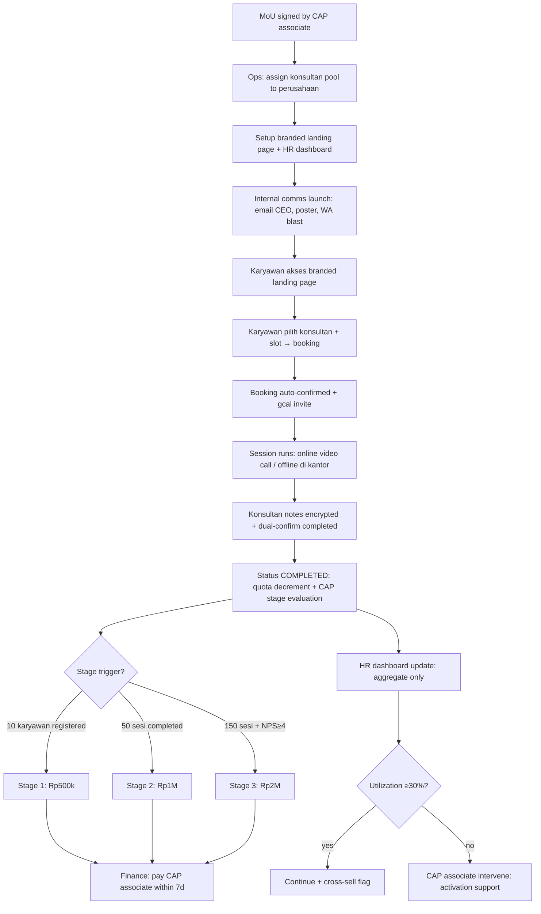
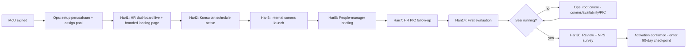
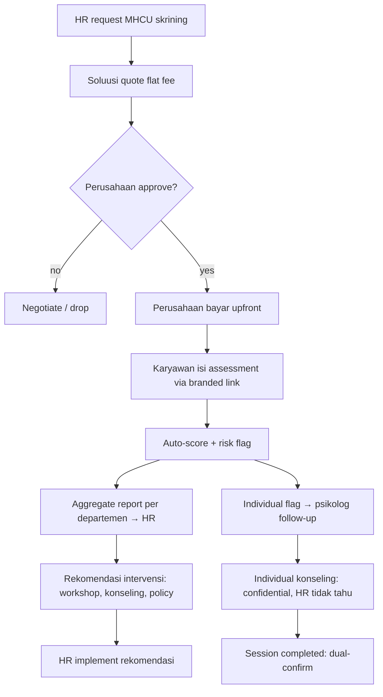
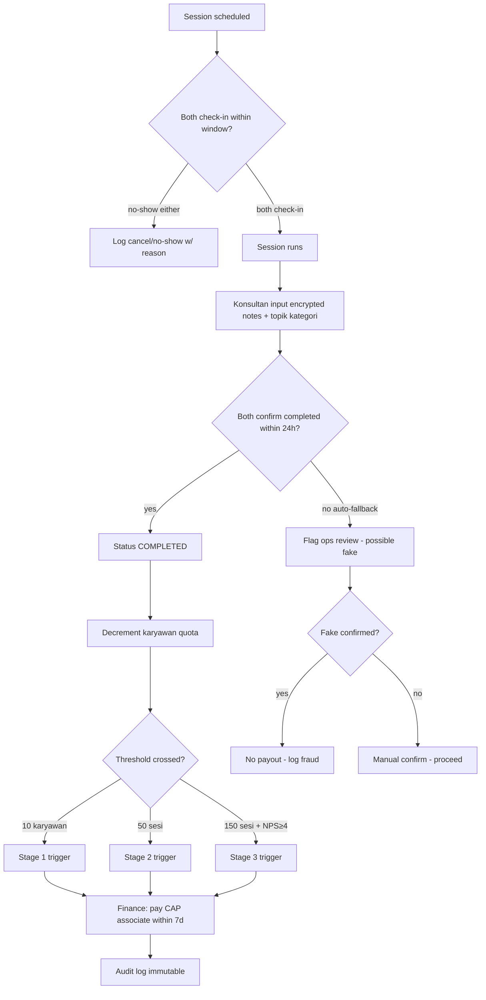
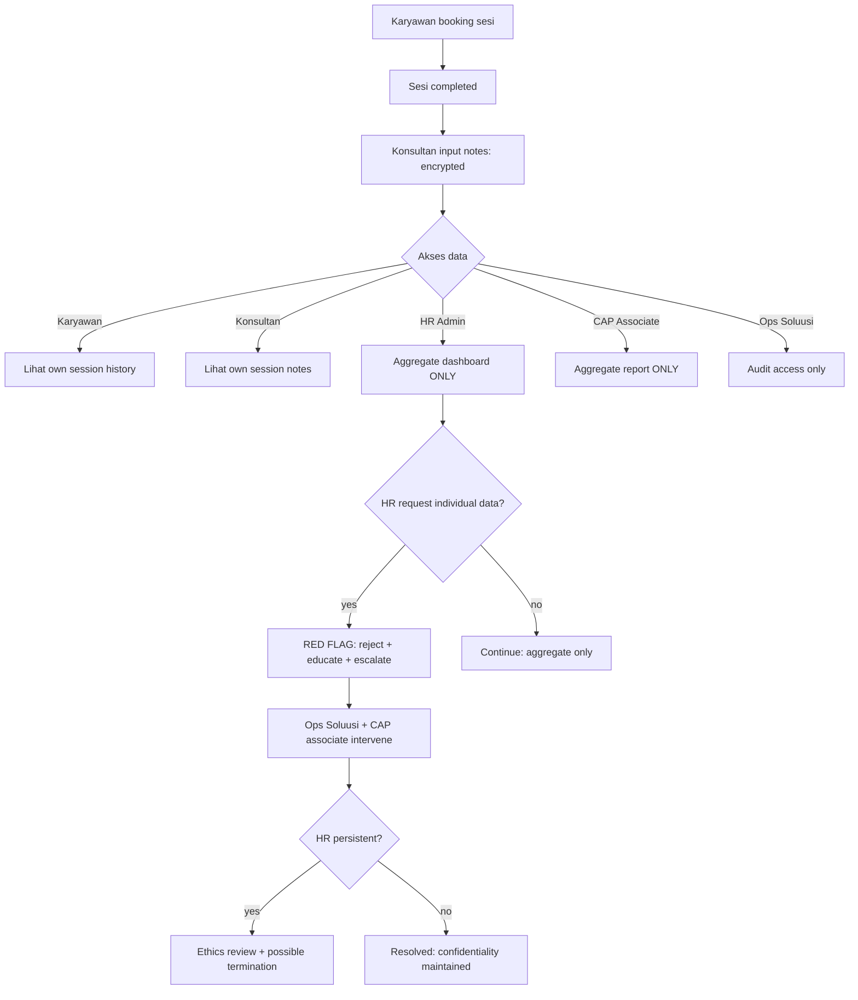
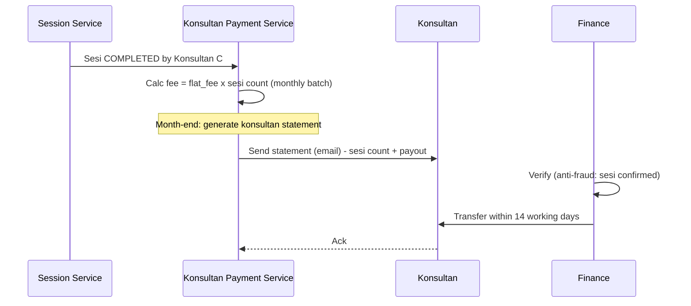
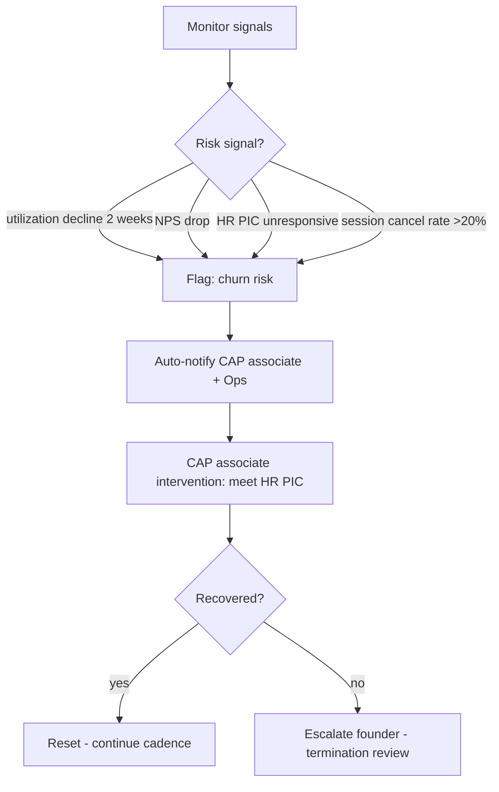

# Soluusi B2B — Perusahaan Vertical Spec
### For Company (CAP) · Employee Wellbeing Platform (E2E + Full Expansion)

> Versi 1.0 · Agustus 2026
> Vertical priority: **#2 — dibangun setelah Klinik**
> Dokumen pendukung: `Soluusi B2B Master Playbook.md`, `Soluusi B2B Platform - PRD.md`, `1. Holistic Employee Wellbeing Program - Soluusi For Company.pdf`, `04 - Soluusi Partnership Playbook HPA.pdf`
> Status: Draft — asumsi ditandai `[ASSUMED]`, keputusan ditandai `[OPEN]`
> **Model komersial:** PEPM subscription + pay-per-use voucher + MHCU flat fee — BUKAN markup model (berbeda dari Klinik/HAP)

---

## Daftar Isi
1. Scope & Priority
2. Revenue & Commercial Model
3. Money Flow (PEPM + per-sesi + MHCU flat)
4. CAP Commission Milestone
5. Konsultan Pool Management (multi-profesional)
6. Pricing (PEPM tiers, voucher, MHCU flat)
7. Employee Identity & Data Privacy
8. Booking & Scheduling
9. Consultation Delivery (online priority, workshop offline)
10. Session Confirmation (adapted dual-confirm)
11. MHCU Korporat (skrining per departemen + aggregate reporting)
12. Wellbeing Program (workshop)
13. EAP (Employee Assistance Program)
14. Konseling Krisis (critical incident response)
15. Partner Lifecycle (MoU → onboarding → activation → checkpoint)
16. Roles & Permissions (CAP, HR admin, karyawan, konsultan)
17. Data, Reporting & Dashboards
18. Compliance & Confidentiality
19. White-label (branded landing page per perusahaan)
20. Activation Support (templates, comms, playbook)
21. Notifications
22. Escalation & Exception Handling
23. KPIs & Success Metrics
24. Integrations
25. Open Questions / Decisions
26. E2E Flows (mermaid consolidated)
27. Technical Implementation Notes

---
---

## 1. Scope & Priority

Perusahaan vertikal = **vertikal kedua yang dibangun** (setelah Klinik/HAP). Alasan: HAP sudah jalan sebagai fondasi revenue model + talent pool, CAP butuh pool yang sama + tambahan konsultan karir. CAP = revenue recurring (PEPM) yang lebih stabil dari HAP (markup per-sesi).

**Data pendukung (dari For Company PDF):**
- 95.4% karyawan menunjukkan indikasi masalah/gangguan kesehatan mental (MMCI + konsultasi 1-on-1)
- 3 pola psikologis teratas: kecenderungan kompulsif, sifat narsistik, perilaku histrionik
- 5 masalah pribadi teratas: Financial, Family, Trauma, Anxiety, Job
- EAP adoption di Indonesia masih rendah (<10% perusahaan punya program formal)

**Framework: Holistic Employee Wellbeing**
3 pilar utama:
1. **Mental Health Support** — konseling, crisis intervention, stress management
2. **Physical Wellbeing** — nutrisionis, fisioterapis, ergonomi
3. **Professional Growth** — konsultan karir, leadership development, outplacement

**In-scope MVP (perusahaan):**
- Konsultan pool supply (psikolog, nutrisionis, fisioterapis, konsultan karir)
- EAP: konseling karyawan on-demand (kuota sesi per karyawan)
- Booking: employee self-service via branded link + HR referral
- Session + dual-confirm (adapted: karyawan + konsultan)
- Billing: **PEPM subscription** (per employee per month) + **pay-per-use voucher** + **MHCU flat fee**
- White-label: branded landing page per perusahaan, hide Soluusi brand dari karyawan
- Google Calendar auto-schedule after booking
- Konsultan payment: Soluusi→konsultan flat/sesi
- CAP commission engine (3-stage, adapted dari HAP)
- HR dashboard **aggregate ONLY** (confidentiality-critical)
- MHCU Korporat: skrining per departemen + laporan agregat + rekomendasi intervensi
- Wellbeing Program: workshop (burnout, stress, parenting, financial wellness)

**Out-of-scope MVP (Phase 2):**
- Karir & Outplacement module (Skema 4) — manual scheduling MVP, systematize Phase 2
- Benefit Keluarga module (Skema 5) — extend EAP ke pasangan/anak karyawan
- Gizi & Fisioterapi on-site (Skema 6) — offline workshop Phase 2
- Konseling Krisis module (Skema 7) — manual response MVP, systematize Phase 2
- Measurement-Based Care (MBC) routine (PHQ-9/GAD-7 tracking) — Phase 2
- HRIS integration (Talenta, SAP SuccessFactors, etc.) — Phase 2

---
---

## 2. Revenue & Commercial Model

### Model inti: **PEPM subscription + pay-per-use voucher + MHCU flat fee**
- **PEPM (Per Employee Per Month):** perusahaan bayar subscription bulanan berdasarkan jumlah karyawan × rate per karyawan. Termasuk kuota sesi konseling per karyawan (misal 2 sesi/bulan). `[DECIDED — PEPM, per user]`
- **Pay-per-use voucher:** perusahaan beli paket voucher sesi (misal 100 sesi/tahun) untuk digunakan karyawan sesuai kebutuhan. Harga per sesi lebih murah dari retail. Cocok untuk perusahaan yang belum siap commit PEPM. `[DECIDED — voucher]`
- **MHCU flat fee:** perusahaan bayar flat fee untuk skrining massal (MMCI/MMPI/DISC) per departemen atau seluruh perusahaan. Termasuk laporan agregat + rekomendasi intervensi. `[DECIDED — flat fee]`
- **Soluusi collect langsung dari perusahaan** (B2B invoice, bukan customer-funded seperti Klinik). Payment terms: net-30 (invoice bulanan untuk PEPM, upfront untuk voucher/MHCU). `[DECIDED — invoice B2B]`
- **Confidentiality CRITICAL:** HR hanya lihat **aggregate data** (jumlah sesi, topik umum anonim). **HR TIDAK tahu siapa yang konseling.** Konten sesi = confidential antara karyawan–konsultan–Soluusi. `[CRITICAL — UU PDP + ethics]`

### Revenue model comparison (Klinik vs Perusahaan)
| Aspek | Klinik (HAP) | Perusahaan (CAP) |
|---|---|---|
| Buyer | Owner/direktur klinik | HR manager / CHRO |
| Revenue | Markup per-sesi (customer bayar) | PEPM + voucher + MHCU flat (perusahaan bayar) |
| Payment flow | Customer → gateway → split | Perusahaan → invoice → Soluusi |
| Confidentiality | Klinik admin = aggregate | HR admin = aggregate ONLY |
| Konsultan pool | Psikolog, nutrisionis, fisio | + Konsultan karir |

### PEPM calculation
```
PEPM = (jumlah karyawan aktif) × (rate per karyawan/bulan)
Rate per karyawan = function(tier, jumlah sesi included, jenis konsultan)

Contoh:
- Tier Starter (50-200 karyawan): Rp15.000/karyawan/bulan → 2 sesi psikolog online/bulan
- Tier Growth (201-500 karyawan): Rp12.000/karyawan/bulan → 2 sesi + 1 workshop/bulan
- Tier Enterprise (500+ karyawan): Rp8.000/karyawan/bulan → unlimited sesi + workshop + MHCU
```

> Rate indikatif — final pricing perlu finance confirm + market benchmark (Riliv, Spring Health PEPM). `[OPEN-1]`

---
---

## 3. Money Flow (PEPM + per-sesi + MHCU flat)

### 3.1 PEPM flow (subscription)
```
[1] Perusahaan sign MoU + pilih tier PEPM (Starter/Growth/Enterprise)
    → sistem create perusahaan account + branded landing page

[2] Invoice bulanan generate (awal bulan)
    → perusahaan bayar net-30 (transfer bank)

[3] Karyawan akses branded landing page → pilih konsultan + booking sesi
    → kuota sesi per karyawan (dari tier PEPM)

[4] Sesi berlangsung + dual-confirm COMPLETED
    → Soluusi pay konsultan fee (flat/sesi)
    → CAP commission accrue (3-stage milestone)

[5] End of month: invoice next bulan + usage report aggregate ke HR
```

### 3.2 Pay-per-use voucher flow
```
[1] Perusahaan beli paket voucher (misal 100 sesi @ Rp250.000/sesi = Rp25.000.000)
    → voucher pool credited ke perusahaan account

[2] Karyawan booking sesi → redeem 1 voucher per sesi
    → voucher balance decrement

[3] Sesi completed → Soluusi pay konsultan fee
    → CAP commission accrue

[4] Voucher habis → perusahaan top-up atau upgrade ke PEPM
```

### 3.3 MHCU flat fee flow
```
[1] Perusahaan request MHCU skrining (per departemen atau seluruh perusahaan)
    → Soluusi quote flat fee (misal Rp3.000.000 per 100 karyawan)

[2] Perusahaan approve + bayar upfront

[3] Karyawan isi assessment (MMCI/MMPI/DISC) via branded link
    → auto-score + risk flag

[4] Soluusi generate aggregate report per departemen
    → laporan + rekomendasi intervensi ke HR (aggregate ONLY)

[5] Individual flag → routed to psikolog untuk follow-up (confidential)
```

### CAP commission milestone (per perusahaan, 90-day rolling)

**Design principles** (adapted dari HAP Compensation Framework):
1. **Anti-fraud** — payout only after real aktivasi + sesi completed (dual-confirmed), not at MoU signing.
2. **Cash flow protection** — payout always a fraction of accumulated Soluusi PEPM/voucher revenue.
3. **Motivation architecture (back-loaded)** — small upfront, big at finish. Prevents CAP chase-and-drop after Stage 1.

| Trigger | Payout | Rationale |
|---|---|---|
| MoU signed + **aktivasi nyata** (HR dashboard live + ≥10 karyawan registered) | **Rp500.000** | Reward activation effort; MoU saja tidak cukup (butuh HR buy-in + employee onboarding) |
| **50 sesi completed** (90 hari rolling) | **Rp1.000.000** | Proof of usage (perusahaan benar-benar pakai, utilization proof) |
| **150 sesi completed** (90 hari) + **NPS ≥4** | **Rp2.000.000** | Scale + satisfaction (back-loaded, NPS filter untuk quality) |
| **Total per perusahaan** | **Rp3.500.000** | (Rate indikatif CAP, scale by deal size) |

**Payment terms**: 7 hari kerja SLA after stage trigger met, transfer bank, auto-confirmed by system.

**Mengapa CAP lebih tinggi dari HAP/SAP (Rp3.5M vs Rp1M)?**
- PEPM = recurring revenue (subscription bulanan, bukan one-off markup)
- Activation effort lebih besar: HR buy-in, employee onboarding, branded landing page setup, internal comms launch
- 90-day utilization target lebih tinggi (150 sesi vs 40 sesi di HAP)
- NPS filter di Stage 3 memastikan quality, bukan hanya quantity

### Contoh end-to-end angka (1 perusahaan, 200 karyawan, Tier Growth, 90 hari)
| Line | Amount |
|---|---|
| PEPM revenue (200 × Rp12.000 × 3 bulan) | Rp7.200.000 |
| Soluusi → Konsultan fee (estimasi 400 sesi × Rp150.000) | Rp60.000.000 |
| **Wait — ini loss.** Recalculate: | |
| Sesi included di PEPM: 200 karyawan × 2 sesi/bulan × 3 bulan = 1.200 sesi | |
| Konsultan fee (1.200 × Rp150.000) | Rp180.000.000 |
| **Problem:** PEPM Rp12.000 × 200 × 3 = Rp7.200.000, tapi konsultan fee Rp180M. **Rate terlalu rendah.** | |
| **Revised rate:** Rp150.000/karyawan/bulan (2 sesi included) → 200 × Rp150.000 × 3 = Rp90.000.000 | |
| Konsultan fee (1.200 × Rp150.000) | Rp180.000.000 |
| **Masih loss.** Need: (a) utilization rate assumption (tidak semua karyawan pakai 2 sesi), (b) rate adjustment. | |
| **Assumption:** 30% utilization → 360 sesi × Rp150.000 = Rp54.000.000 | |
| PEPM revenue (200 × Rp150.000 × 3) | Rp90.000.000 |
| Soluusi gross | Rp36.000.000 |
| CAP commission (Stage 1+2+3) | Rp3.500.000 |
| Soluusi net revenue | Rp32.500.000 |

> **`[OPEN-3]` CRITICAL:** PEPM rate harus cover konsultan fee pada utilization realistic (30-50%). Rate Rp150.000/karyawan/bulan = 2 sesi included → break-even di 50% utilization. Final rate perlu finance model. **Jangan launch dengan rate yang loss.**

---
---

## 4. CAP Commission Milestone

### 4.1 Design principle (adapted dari HAP 3-stage)
- HAP: 3-stage (5/25/40 sesi, total Rp1M) — fokus pada sesi count karena markup model
- CAP: 3-stage (aktivasi/50/150 sesi, total Rp3.5M) — fokus pada **aktivasi + sesi count + NPS** karena PEPM model
- **Perbedaan kunci:** CAP Stage 1 = aktivasi (bukan MoU saja) karena PEPM butuh HR dashboard live + karyawan registered. MoU saja tidak cukup.

### 4.2 Stage detail
| Stage | Trigger | Payout | Rationale |
|---|---|---|---|
| **Stage 1** | MoU signed + HR dashboard live + ≥10 karyawan registered | Rp500.000 | Aktivasi nyata (bukan hanya tanda tangan) |
| **Stage 2** | 50 sesi completed (90 hari rolling) | Rp1.000.000 | Proof of usage (perusahaan benar-benar pakai) |
| **Stage 3** | 150 sesi completed (90 hari) + NPS ≥4 | Rp2.000.000 | Scale + satisfaction (NPS filter untuk quality) |
| **Total** | — | **Rp3.500.000** | — |

### 4.3 Commission tracking
- Track per-CAP-associate (sales person yang handle perusahaan ini)
- 90-day rolling window (reset setelah Stage 3 dicapai atau 90 hari berakhir)
- Auto-calculate di CAP dashboard (mirror HAP commission engine, adapt trigger)
- Finance payout within 7 hari kerja setelah stage trigger

### 4.4 Anti-fraud
- Sesi harus **dual-confirm COMPLETED** (karyawan + konsultan) sebelum count ke stage
- No-show / cancelled sesi **tidak count**
- Audit trail immutable (who confirmed, when, IP)
- CAP associate **tidak bisa** claim sesi fake untuk trigger komisi

---
---

## 5. Konsultan Pool Management (multi-profesional)

### 5.1 Pool composition (perusahaan)
| Konsultan Type | Role di Perusahaan | Min. pool size |
|---|---|---|
| Psikolog klinis | EAP konseling, MHCU skrining, krisis response | 5 |
| Psikolog anak | Benefit Keluarga (konseling anak karyawan) — Phase 2 | 2 |
| Nutrisionis | Wellbeing Program (gizi workshop), konsultasi gizi | 3 |
| Fisioterapis | Wellbeing Program (ergonomi workshop), konsultasi fisio | 3 |
| Konsultan karir | Karir & Outplacement, career coaching | 3 |
| **Total min. pool** | — | **16** |

> Pool lebih besar dari Klinik karena perusahaan = lebih banyak jenis layanan + lebih banyak karyawan. `[ASSUMED]`

### 5.2 Pool assignment (saat onboarding)
- Dari hasil discovery (CAP associate + HR), perusahaan nyatain kebutuhan: jenis konsultan, volume estimasi, preferensi online/offline, departemen prioritas
- Soluusi **assign pool** konsultan ke perusahaan (default 3-5 konsultan per jenis, agar ada backup)
- Matching criteria: spesialisasi, bahasa, jam availability, experience dengan korporat
- Konsultan di-briefing SOP perusahaan (jam kerja karyawan, sistem rujukan HR, confidentiality protocol)

### 5.3 Availability publishing
- Konsultan publish slot availability → CAP Portal (per minggu, per mode online/offline)
- Slot = (konsultan, waktu, mode, durasi, status available/booked)
- Karyawan lihat slot available → pilih → booking (self-service)
- HR **tidak** lihat slot individual karyawan (confidentiality)

### 5.4 Replacement flow (konsultan unavailable/resign)
- Konsultan mark unavailable (sakit, cuti) → sistem auto-cari replacement dari pool yang matching kriteria
- Notify CAP associate + HR PIC → replacement assigned → booking di-reassign
- Jika tidak ada replacement matching → eskalasi Ops Soluusi
- **Confidentiality note:** HR hanya diberitahu "replacement assigned", **tidak** tahu siapa karyawan yang affected

### 5.5 Konsultan performance tracking
- Sesi completed count, no-show rate, karyawan NPS per konsultan, utilization (slot booked vs available)
- Trigger coaching bila NPS < threshold atau no-show > threshold
- **Confidentiality:** NPS = aggregate per konsultan, **tidak** link ke karyawan individual

### 5.6 Multi-perusahaan konsultan
- Satu konsultan bisa assigned ke multi-perusahaan (supply on-demand)
- Calendar conflict prevention: sistem block double-booking across perusahaan
- Konsultan set availability global → sistem filter per perusahaan
- **Priority:** karyawan perusahaan PEPM > voucher > walk-in (prioritas subscription)

---
---

## 6. Pricing (PEPM tiers, voucher, MHCU flat)

### 6.1 PEPM tiers (indikatif) `[OPEN-1]`
| Tier | Karyawan | Rate/karyawan/bulan | Sesi included | Workshop | MHCU |
|---|---|---|---|---|---|
| **Starter** | 50-200 | Rp150.000 | 2 sesi psikolog/bulan | 1x/bulan | — |
| **Growth** | 201-500 | Rp120.000 | 2 sesi + 1 nutrisionis/bulan | 2x/bulan | 1x/tahun |
| **Enterprise** | 500+ | Rp80.000 | Unlimited sesi | Unlimited | 2x/tahun |

> Rate indikatif — perlu finance model + market benchmark. `[OPEN-3]`
> **Break-even analysis:** Rate harus cover konsultan fee pada utilization 30-50%. Rp150.000/karyawan/bulan = 2 sesi × Rp75.000/sesi (net ke konsultan Rp150.000, Soluusi cover 50% dari PEPM). **Verify dengan finance.**

### 6.2 Konsultan fee (indikatif)
| Konsultan Type | Fee/sesi (flat) |
|---|---|
| Psikolog klinis | Rp150.000 |
| Psikolog anak | Rp150.000 |
| Nutrisionis | Rp120.000 |
| Fisioterapis | Rp130.000 |
| Konsultan karir | Rp150.000 |

> Indikatif. `[OPEN-4]` — final fee model (flat vs % of PEPM) belum lock.

### 6.3 Pay-per-use voucher pricing
| Paket | Jumlah Sesi | Harga/sesi | Total |
|---|---|---|---|
| **Starter** | 50 sesi | Rp300.000 | Rp15.000.000 |
| **Growth** | 100 sesi | Rp250.000 | Rp25.000.000 |
| **Enterprise** | 200 sesi | Rp200.000 | Rp40.000.000 |

> Voucher = 1 sesi 60 menit dengan psikolog/nutrisionis/fisio/konsultan karir. Harga lebih murah dari retail (Rp350.000) karena bulk discount. Valid 12 bulan dari purchase.

### 6.4 MHCU flat fee pricing
| Paket | Jumlah Karyawan | Harga | Include |
|---|---|---|---|
| **Departemen** | ≤50 karyawan | Rp3.000.000 | MMCI/MMPI + laporan agregat + rekomendasi |
| **Perusahaan Kecil** | 51-200 karyawan | Rp8.000.000 | MMCI/MMPI + laporan per departemen + workshop follow-up |
| **Perusahaan Besar** | 201-500 karyawan | Rp15.000.000 | MMCI/MMPI/DISC + laporan detail + workshop + 3 bulan follow-up |
| **Enterprise** | 500+ karyawan | Custom quote | Full package + dedicated psikolog |

> MHCU = Mental Health Check-Up. Instrument: MMCI (Million Clinical Multiaxial Inventory), MMPI (Minnesota Multiphasic Personality Inventory), DISC. **Category-A instruments** → hanya psikolog berlisensi HIMPSI yang bisa run. `[OPEN-5]` — license confirmation.

### 6.5 Price change workflow
- PEPM rate update by Soluusi (Super Admin) → effective date (awal bulan berikutnya)
- Existing subscription: gunakan rate saat签约 (lock sampai renew)
- Notify perusahaan + CAP associate bila rate change
- Voucher price: lock at purchase, tidak berubah sampai expire

---
---

## 7. Employee Identity & Data Privacy

### 7.1 Confidentiality principle (CRITICAL)
**Ini keputusan paling penting di vertikal Perusahaan.** Menentukan scope PII, UU PDP compliance, dan booking UX.

- **Konten sesi = confidential** antara karyawan–konsultan–Soluusi
- **HR hanya lihat aggregate data** (jumlah sesi, topik umum anonim, NPS aggregate)
- **HR TIDAK tahu siapa yang konseling** (no individual session data)
- **Red flag:** bila HR minta akses data individual → eskalasi wajib (ethics violation)
- **UU PDP compliant:** employee data privacy, consent at booking, right to access/delete

### 7.2 Employee identity model
**Model: Employee self-registration (branded landing page)**
- Karyawan register di **branded landing page** perusahaan (white-label, hide Soluusi)
- Soluusi collect PII karyawan: nama, email (company email), telp, department, position
- **Confidentiality boundary:** PII karyawan = Soluusi hold, **tidak** share ke HR
- HR hanya lihat: jumlah karyawan registered (count), **bukan** nama individual
- Konsultan akses nama karyawan via clinical field (encrypted, konsultan-only)

### 7.3 Data classification
| Data Type | Access | Retention |
|---|---|---|
| Employee PII (nama, email, telp) | Karyawan + Konsultan + Soluusi (encrypted) | 7 tahun (compliance) |
| Session content (notes, diagnosis) | Karyawan + Konsultan only (encrypted) | 7 tahun |
| Aggregate stats (session count, topik) | HR admin + CAP associate | Indefinite (reporting) |
| MHCU individual result | Psikolog only (encrypted) | 7 tahun |
| MHCU aggregate report | HR admin + CAP associate | Indefinite |

### 7.4 Consent flow
- Employee consent at registration (branded landing page): UU PDP notice + confidentiality agreement
- Consent untuk session recording (optional, opt-in)
- Consent untuk MHCU assessment (separate consent, category-A instrument)
- Right to access/delete: karyawan bisa request via Soluusi support

### 7.5 Confidentiality enforcement (technical)
- **Row-level security (RLS):** HR admin query = aggregate only, DB reject individual content
- **Encryption at rest:** session notes + MHCU individual result encrypted (KMS)
- **Audit log:** all access to individual data logged (who/when/what), immutable, 7-year retention
- **Access control:** HR admin role **tidak** punya permission ke individual session data (role-based)

---
---

## 8. Booking & Scheduling

### 8.1 Booking creation paths
1. **Employee self-service via branded link** `[DEFAULT MVP]` — karyawan buka branded landing page perusahaan → pilih konsultan + slot → booking → auto-confirmed
2. **HR referral** — HR recommend karyawan untuk konseling (misal post-MHCU flag) → HR generate referral link → karyawan buka link → booking
3. **CAP associate referral** — CAP associate recommend setelah discovery → generate link → karyawan booking

> **Scheduling decision:** Employee self-service (MVP, mirror soluusi.com B2C) vs HR-pick slot (tidak recommended, confidentiality risk). **Recommended MVP: employee self-service** (karyawan pilih konsultan + slot sendiri). HR **tidak** involved di scheduling individual.

### 8.2 Booking fields
- Perusahaan (org + department)
- Konsultan (dari assigned pool)
- Mode (online/offline)
- Waktu (slot)
- Durasi (30/45/60 min — dari konsultan type default)
- Employee ref (nama, email perusahaan, department — confidential)
- Voucher (optional, pay-per-use)
- Status: scheduled → checked-in → in-session → completed / no-show / cancelled

### 8.3 Reschedule & cancel
- Cutoff time: H-2 jam free reschedule; <2 jam = cancel (status counted)
- Who can: karyawan, konsultan
- **HR tidak bisa reschedule/cancel sesi karyawan** (confidentiality)
- Cancel reason log
- No-show: karyawan sudah punya kuota sesi (PEPM) atau voucher. No-show = sesi hangus (tidak refund, tidak restore kuota). Tracked; >2 no-show/karyawan → review

### 8.4 Overbooking prevention
- Slot lock saat booking create (Redis lock, TTL 10 min untuk complete booking/confirm)
- Konsultan calendar sync (Google Calendar) two-way

### 8.5 Quota management (PEPM)
- Setiap karyawan dapat kuota sesi per bulan (dari tier PEPM, misal 2 sesi/bulan)
- Quota reset setiap awal bulan
- Unused quota **tidak** roll-over ke bulan berikutnya (use-it-or-lose-it)
- Karyawan bisa lihat sisa kuota sendiri (di branded landing page)
- **HR tidak bisa lihat kuota individual karyawan** (confidentiality)

---
---

## 9. Consultation Delivery (online priority, workshop offline)

### 9.1 Mode
- **Online** — Zoom/Meet link auto-generated, sent to karyawan + konsultan (primary mode, 90% sesi)
- **Offline** — di kantor perusahaan (ruang meeting/konsultasi) atau lokasi yang disepakati (workshop, MHCU on-site)
- **Hybrid** — Phase 2

### 9.2 Session duration
- Default per konsultan type (psikolog 60min, nutrisionis/fisio/konsultan karir 45min)
- Variants: first-consultation (60min) vs follow-up (30min) `[OPEN-6]`

### 9.3 Recording
- Online: **no recording by default** (confidentiality). `[OPEN-7]` — bila karyawan + konsultan consent, opt-in recording stored konsultan-only.
- Offline: tidak ada recording.
- Workshop: recording allowed (for internal company use, with participant consent)

### 9.4 Check-in flow
- Pre-session window (H-15min): konsultan + karyawan check-in
- Dual check-in required untuk start session (anti-fraud)
- Link online open saat both checked-in

### 9.5 Workshop delivery (Wellbeing Program)
- Format: group session (10-50 peserta), online (Zoom) atau offline (office meeting room)
- Duration: 60-120 menit
- Topics: burnout, stress management, parenting, financial wellness, nutrisi, ergonomi
- Facilitator: konsultan dari pool (psikolog untuk mental health, nutrisionis untuk gizi, fisio untuk ergonomi)
- Attendance tracking: optional (karyawan bisa skip tanpa penalty)
- Feedback: post-workshop survey (NPS, topik relevance)

---
---

## 10. Session Confirmation (adapted dual-confirm)

### 10.1 Confirmation flow
1. Konsultan + karyawan check-in → session starts
2. Konsultan input clinical notes (encrypted, konsultan-only) + topik kategori (anonim untuk aggregate)
3. Both confirm completed within 24h
4. Auto-confirm fallback: bila tidak confirm dalam 24h → flag ops review (possible fake)
5. Status COMPLETED → trigger: increment perusahaan completed-count + quota decrement + CAP stage evaluation

### 10.2 Audit trail (immutable)
- Who confirmed, when, IP, device fingerprint
- Stored 7 years (compliance)

### 10.3 Dispute resolution
- Karyawan claims session didn't happen / quality issue → karyawan raise dispute via branded landing page
- Ops Soluusi review audit trail → resolve (credit note / konsultan coaching)
- **HR tidak involved** di dispute individual (confidentiality)

### 10.4 No-show policy
- Karyawan no-show (tidak check-in within 15min) → sesi hangus (kuota decrement, tidak refund)
- Konsultan no-show → replacement assigned + sesi reschedule (kuota tidak decrement)
- Track no-show rate per karyawan; >2 no-show → flag CAP associate untuk follow-up (wellness check)

---
---

## 11. MHCU Korporat (skrining per departemen + aggregate reporting)

### 11.1 Use case
Perusahaan yang mau understand mental health landscape karyawan → MHCU skrining massal (MMCI/MMPI/DISC) per departemen atau seluruh perusahaan. Output: **laporan agregat** + rekomendasi intervensi.

### 11.2 Flow
1. HR request MHCU skrining (per departemen atau seluruh perusahaan)
2. Soluusi quote flat fee (lihat §6.4)
3. Perusahaan approve + bayar upfront
4. Karyawan isi assessment via branded link (confidential, individual result tidak ke HR)
5. Auto-score + risk flag (normal/low/middle/high)
6. **Aggregate report** per departemen → HR (jumlah karyawan per risk level, topik umum, rekomendasi)
7. **Individual flag** (high risk) → routed to psikolog Soluusi untuk follow-up (confidential, HR tidak tahu siapa)
8. Rekomendasi intervensi: workshop topic, konseling focus area, policy suggestion

### 11.3 Confidentiality (critical)
- HR hanya dapat **aggregate report** (per departemen: 30% high risk, 40% middle risk, 30% low risk)
- **Individual identitas + result** hanya psikolog Soluusi + karyawan yang bersangkutan
- **HR tidak bisa** request individual result (ethics violation, red flag)
- UU PDP + HIMPSI compliant (category-A instrument = licensed psikolog only)

### 11.4 Pricing (lihat §6.4)
- Flat fee per batch (per departemen atau per perusahaan)
- Include: assessment instrument + auto-score + aggregate report + rekomendasi intervensi
- Optional add-on: workshop follow-up, 3-month monitoring

### 11.5 Instruments
| Instrument | Type | Licensed to | Use case |
|---|---|---|---|
| **MMCI** | Category-A | Psikolog berlisensi HIMPSI | Clinical multi-axial assessment |
| **MMPI** | Category-A | Psikolog berlisensi HIMPSI | Personality + psychopathology |
| **DISC** | Non-category | Any trained facilitator | Behavioral style (non-clinical) |
| **PHQ-9** | Screening | Any trained facilitator | Depression screening |
| **GAD-7** | Screening | Any trained facilitator | Anxiety screening |
| **Burnout Assessment** | Screening | Any trained facilitator | Burnout risk |

> `[OPEN-5]` — MMCI/MMPI license confirmation: Soluusi punya license atau psikolog partner yang punya?

---
---

## 12. Wellbeing Program (workshop)

### 12.1 Use case
Workshop/seminar wellbeing untuk karyawan — topik: burnout, stress, parenting, financial wellness, nutrisi, ergonomi. Bisa standalone (one-off) atau bundle dengan PEPM subscription.

### 12.2 Workshop catalog
| Topik | Durasi | Facilitator | Mode |
|---|---|---|---|
| **Burnout Prevention** | 90 min | Psikolog | Online/offline |
| **Stress Management** | 90 min | Psikolog | Online/offline |
| **Parenting & Work-Life Balance** | 90 min | Psikolog | Online/offline |
| **Financial Wellness** | 90 min | Konsultan karir/finansial | Online/offline |
| **Healthy Eating & Nutrition** | 60 min | Nutrisionis | Online/offline |
| **Ergonomi & Fisioterapi** | 60 min | Fisioterapis | Offline (office) |
| **Mindfulness & Meditation** | 60 min | Psikolog | Online/offline |
| **Team Building & Communication** | 120 min | Konsultan karir | Offline (office) |

### 12.3 Pricing
- Included di PEPM tier (Growth: 2x/bulan, Enterprise: unlimited)
- Standalone: Rp5.000.000 - Rp15.000.000 per workshop (tergantung jumlah peserta, topik, facilitator)
- Custom workshop: quote based on company need

### 12.4 Booking flow
1. HR request workshop (topik, tanggal, jumlah peserta, mode online/offline)
2. Soluusi assign facilitator dari pool
3. Confirm jadwal + send invitation ke karyawan (via HR)
4. Workshop delivery + attendance tracking (optional)
5. Post-workshop feedback survey (NPS, topik relevance)

### 12.5 MVP flow (manual)
- HR request → CAP associate log → Ops assign facilitator
- Scheduling via CRM (no dedicated module MVP)
- Attendance tracking: manual (Zoom participant list atau sign-in sheet offline)

### 12.6 Phase 2
- Workshop scheduling module (calendar, facilitator availability, room booking)
- Attendance tracking automated (QR code check-in, Zoom integration)
- Feedback analytics (NPS trend, topik popularity)

---
---

## 13. EAP (Employee Assistance Program)

### 13.1 Definition
EAP = program konseling on-demand untuk karyawan. Karyawan bisa akses konseling kapan saja (dalam kuota PEPM atau voucher) untuk masalah: mental health, karir, finansial, keluarga, dll.

### 13.2 Scope
- **Konseling individual:** 1-on-1 sesi dengan psikolog/nutrisionis/fisio/konsultan karir
- **Topik:** stress, anxiety, burnout, trauma, relationship, parenting, financial, career, physical health
- **Mode:** online (video call) atau offline (di kantor atau lokasi konsultan)
- **Confidentiality:** konten sesi = confidential, HR tidak tahu siapa yang konseling

### 13.3 Access channel
- **Branded landing page:** karyawan login → pilih konsultan → booking
- **Hotline/WhatsApp:** karyawan chat/call → CAP associate route ke konsultan (manual MVP)
- **HR referral:** HR recommend (post-MHCU flag atau performance issue) → generate referral link → karyawan booking

### 13.4 Utilization target
- Industry benchmark: 5-10% utilization rate (karyawan yang pakai EAP per tahun)
- Soluusi target: 30% utilization (lebih tinggi karena multi-profesional + online access)
- Monitor utilization per perusahaan; <10% → CAP associate intervene (activation support)

### 13.5 EAP vs klinik (perbedaan)
| Aspek | EAP (Perusahaan) | Klinik (HAP) |
|---|---|---|
| User | Karyawan (registered di perusahaan) | Pasien klinik (walk-in/rujukan) |
| Access | Self-service via branded link | Admin klinik generate link |
| Payment | PEPM subscription (perusahaan bayar) | Markup per-sesi (pasien bayar) |
| Confidentiality | HR tidak tahu siapa konseling | Klinik admin tidak tahu konten sesi |
| Konsultan pool | Psikolog + nutrisionis + fisio + karir | Psikolog + nutrisionis + fisio |

---
---

## 14. Konseling Krisis (critical incident response)

### 14.1 Use case
Perusahaan mengalami insiden kritis (karyawan meninggal, kecelakaan kerja, PHK massal, kekerasan di tempat kerja) → butuh **immediate psychological support** untuk karyawan affected.

### 14.2 Response flow (manual MVP)
1. HR contact Soluusi (hotline/WhatsApp) → request crisis counseling
2. CAP associate escalate to Ops Soluusi (priority queue)
3. Ops assign psikolog krisis (available within 24h)
4. Psikolog on-site (offline) atau online (group debriefing)
5. Session: group debriefing (affected employees) + individual follow-up (high-risk individuals)
6. Report: aggregate summary ke HR (jumlah peserta, general themes, recommendations) — **no individual data**

### 14.3 Pricing
- Crisis response: flat fee Rp10.000.000 - Rp25.000.000 per incident (tergantung jumlah affected employees, duration, on-site/online)
- Include: 1x group debriefing + 30 hari individual follow-up (unlimited sesi untuk affected employees)
- Not included in PEPM (separate invoice)

### 14.4 Phase 2 (systematize)
- Crisis request form (branded landing page)
- Auto-assign psikolog krisis (on-call rotation)
- Incident tracking module (log, report, follow-up schedule)

---
---

## 15. Partner Lifecycle (MoU → onboarding → activation → checkpoint)

### 15.1 Onboarding (post-MoU, pre-go-live)
- [ ] Konsultan assigned (from discovery)
- [ ] Briefing konsultan SOP perusahaan (confidentiality protocol, jam kerja karyawan, department structure)
- [ ] Setup akun HR Portal + branded landing page
- [ ] Sosialisasi HR + internal comms (template email CEO/HR launch, poster)
- [ ] People-manager playbook (cara refer tanpa stigmatize)
- [ ] Set PEPM tier + voucher config + MHCU package
- [ ] White-label domain configured (branded landing page) + branding (logo, warna perusahaan)
- [ ] gcal service account configured (Soluusi organizer, white-labeled)
- [ ] Test alur end-to-end (1 dummy booking + sesi)
- [ ] Tanggal go-live determined

### 15.2 Aktivasi (Hari 1–30)
| Hari | Checklist |
|---|---|
| 1 | Onboarding + HR dashboard live |
| 2 | Konsultan schedule active |
| 3 | Internal comms launch (email CEO/HR, poster, WA blast) |
| 5 | People-manager briefing (cara refer karyawan) |
| 7 | Follow up HR PIC (utilisasi awal) |
| 14 | First evaluation (session count, feedback) |
| 30 | Review konsultasi + NPS survey |

### 15.3 Account management cadence
- W1–4 post go-live: weekly check-in (CAP associate)
- After: monthly check-in
- Monitor: sesi vs target, utilization rate, NPS, feedback HR PIC, isu operasional

### 15.4 Cross-sell trigger (Phase 2)
- Perusahaan stabil ≥1 bulan + NPS ≥4 → flag upsell:
  - Add MHCU (jika belum)
  - Add workshop (jika PEPM only)
  - Add Benefit Keluarga (Phase 2)
  - Add Karir & Outplacement (Phase 2)
- CAP associate pitch new module → attribution `[OPEN-8]`

### 15.5 Churn risk detection
- Signals: utilization declining 2 consecutive weeks, NPS drop, HR PIC unresponsive, session cancel rate >20%
- Auto-flag → CAP associate intervention
- Playbook: "top performer: always follow up, don't stop after MoU"

### 15.6 Termination flow
- Notice period (per MoU, indikatif 30 hari)
- Wind-down: complete scheduled sesi, **final invoice**, final aggregate report, data export to perusahaan (aggregate only), revoke konsultan assignment, deactivate branded landing page
- Post-termination: perusahaan data retained per UU PDP, konsultan reassigned
- `[OPEN-9]` — termination reasons log + re-activation path

---
---

## 16. Roles & Permissions (CAP-side)

### 16.1 Role matrix
| Role | Akses | Tidak boleh |
|---|---|---|
| **CAP Associate** (sales) | CRM pipeline own perusahaan, perusahaan stage/sesi aggregate (own perusahaan), weekly report auto, commission accrual status | Konten sesi, data karyawan individual, other associate's perusahaan |
| **HR Admin** (perusahaan PIC) | Org profile, employee count, **aggregate dashboard** (session count, topik anonim, NPS aggregate), MHCU aggregate report, workshop request, voucher purchase | Konten sesi, data karyawan individual, other perusahaan |
| **Karyawan** (end-user) | Own booking, own session history, own MHCU result, branded landing page access | Other karyawan data, HR dashboard, aggregate report |
| **Konsultan** (Soluusi-side, assigned) | Own calendar, accept/reject booking, session notes (encrypted), confirm completion, view own payout | Other konsultan notes, perusahaan billing, karyawan individual data (except own session) |
| **Ops Soluusi** | All perusahaan ops, onboarding, replacement matching, dispute resolve | Konten sesi clinical (konsultan-only), finance payout approve |
| **Finance** | PEPM invoice, voucher billing, MHCU invoice, konsultan payout, CAP commission payout, statements | Konten sesi, CRM pipeline detail |
| **Super Admin** | All + config (PEPM rate, voucher price, MHCU fee, rates) | — |

### 16.2 Confidentiality enforcement
- **HR Admin** role **tidak** punya permission ke individual session data (role-based access control)
- DB query untuk HR dashboard = aggregate only (GROUP BY department, COUNT session, AVG NPS)
- **Red flag:** bila HR Admin coba access individual data → log + alert Ops Soluusi + CAP associate
- **Karyawan** hanya bisa lihat data sendiri (row-level security)

---
---

## 17. Data, Reporting & Dashboards

### 17.1 HR dashboard (aggregate ONLY)
- Total sesi count (this period vs target)
- Sesi per departemen (utilization rate per dept)
- Sesi per konsultan type (psikolog vs nutrisionis vs fisio vs karir)
- Quota usage (total sesi used vs total sesi included di PEPM)
- Workshop attendance (optional, aggregate)
- NPS aggregate (average rating, no individual feedback)
- Topik kategori (anonim: e.g., "stress 30%, parenting 20%, financial 15%...")
- MHCU aggregate result (per departemen: % high/middle/low risk)

> **CRITICAL:** HR dashboard **tidak** menampilkan: nama karyawan yang konseling, konten sesi, individual MHCU result, individual NPS feedback.

### 17.2 CAP associate dashboard
- Pipeline funnel (own perusahaan)
- MoU kumulatif
- Perusahaan per stage (Stage 1/2/3 milestone progress)
- Weekly report (auto-generated)
- Commission accrual status
- Utilization rate per perusahaan (alert bila <10%)

### 17.3 Finance dashboard
- PEPM revenue (per perusahaan, per bulan)
- Voucher sales + redemption rate
- MHCU revenue (per project)
- Konsultan payout due
- CAP commission payout due
- Gross profit (per perusahaan, cross-perusahaan)

### 17.4 Konsultan dashboard
- Own sesi (scheduled/completed)
- Own payout status
- Own availability calendar
- Own NPS (aggregate, no individual feedback)

### 17.5 Karyawan landing page (branded)
- Own quota (sisa sesi bulan ini)
- Own booking history
- Own MHCU result (individual, confidential)
- Konsultan list (available, with profile)
- Workshop catalog (upcoming, register)

### 17.6 Reports (auto)
- Weekly: CAP report (session count, utilization, NPS) → auto-gen Jumat 17.00
- Monthly: perusahaan summary (sesi, revenue, stage progress) → email to HR PIC
- Monthly: konsultan payout statement
- Quarterly: perusahaan review pack (aggregate trends, recommendations)

### 17.7 Export
- CSV/PDF untuk perusahaan records (aggregate only)
- **Individual data export** hanya untuk karyawan yang bersangkutan (via request)

---
---

## 18. Compliance & Confidentiality

### 18.1 UU PDP (eff. Oct 2024)
- Data residency: Indonesia region
- Consent flow: karyawan consent at registration (branded landing page) — Soluusi = controller for employee PII (nama, email, telp, department)
- Employee data: minimize collected (only necessary fields — noNIK, no address unless needed)
- Right to access/delete: karyawan bisa request via Soluusi support
- DPO contact + breach notification process `[OPEN-10]`

### 18.2 HIMPSI compliance (psikolog instruments)
- MMCI/MMPI = category-A instruments → **only run by licensed psikolog Soluusi**
- Non-psikolog cannot trigger/access instrument raw data
- Psikolog license verified at konsultan onboarding

### 18.3 Sesi confidentiality
- Sesi notes encrypted at rest (KMS, konsultan+karyawan key pair)
- Access: konsultan only + Super Admin audit-only
- HR admin: aggregate queries only, DB rejects individual content (RLS)
- Audit log all access (who/when/what), immutable, 7-year retention

### 18.4 Employee data protection
- **No individual session data ke HR** (enforced via role-based access control + RLS)
- **No individual MHCU result ke HR** (aggregate report only)
- **No employee list ke konsultan** (konsultan hanya lihat karyawan yang booking dengan mereka)
- **Red flag protocol:** bila HR request individual data → escalate to Ops Soluusi + CAP associate + ethics review

### 18.5 Audit & logging
- Booking create, session confirm, invoice, payment, payout, voucher redeem, MHCU access — all logged
- Access to sesi notes/MHCU individual — logged with consent reference
- HR dashboard query — logged (aggregate only, but log untuk audit)

---
---

## 19. White-label (branded landing page per perusahaan)

### 19.1 White-label requirements (HIDE Soluusi)
Tujuan: karyawan **tidak perlu tahu** ini Soluusi → respect partner B2B, anti client-bypass ke soluusi.com.

- **Domain:** branded landing page di **perusahaan domain** atau **neutral Soluusi domain**. Opsi: (a) perusahaan CNAME `wellbeing.perusahaanname.com` → Soluusi, (b) neutral white-label domain `wellbeing-soluusi.com` milik Soluusi. `[OPEN-11]`
- **Page branding:** perusahaan logo, nama, warna, footer. Zero mention "Soluusi" di page, receipt, email, gcal, WA.
- **Receipt:** dari perusahaan (white-labeled). Merchant of record = Soluusi (PEPM invoice B2B, bukan customer payment).
- **Email/WA:** from-name + reply-to = perusahaan. Domain email neutral/perusahaan.
- **gcal event:** organizer Soluusi (white-labeled), title perusahaan-branded.
- **Konsultan profile di landing page:** nama + ringkas, **no link ke soluusi.com profile**, no "Soluusi" affiliation.
- **Tracking/analytics:** no Soluusi-tracking-pixel yang bocor ke karyawan.

### 19.2 Branded landing page content
- Hero: perusahaan logo + tagline wellbeing
- Program overview: EAP, MHCU, Workshop (perusahaan-specific package)
- Konsultan list: profile (nama, foto, spesialisasi, rating) — no Soluusi affiliation
- Booking CTA: pilih konsultan → slot picker → confirm
- Employee login: email perusahaan + password (atau SSO jika perusahaan punya)
- Quota display: sisa sesi bulan ini (untuk karyawan yang login)
- Workshop catalog: upcoming workshop, register button

### 19.3 Setup per perusahaan
- Perusahaan logo + brand guideline (warna, font)
- Domain setup (CNAME atau neutral subdomain)
- Email template customization (from-name, reply-to)
- gcal organizer branding
- Konsultan pool assignment (perusahaan-specific)

---
---

## 20. Activation Support (templates, comms, playbook)

### 20.1 Template komunikasi internal
Soluusi provide template untuk HR launch EAP ke karyawan:

| Template | Channel | Timing |
|---|---|---|
| **Email CEO launch** | Email | Hari 1 go-live |
| **Email HR detail** | Email | Hari 1 go-live |
| **Poster digital** | Office display + WA blast | Hari 1-7 |
| **WA blast karyawan** | WhatsApp | Hari 1, 7, 30 |
| **People-manager playbook** | PDF guide | Hari 1 (untuk HR + manager) |
| **FAQ karyawan** | PDF/landing page | Hari 1 |

### 20.2 People-manager playbook
Guide untuk manager cara refer karyawan ke EAP tanpa stigmatize:
- **Do:** "Kami punya program wellbeing, bisa akses kapan saja. Confidential."
- **Don't:** "Kamu perlu konseling, ini referral."
- **When to refer:** performance drop, absenteeism, behavioral change, post-MHCU flag
- **How to refer:** share branded landing page link, **tidak** ask "sudah konseling belum?"

### 20.3 Aktivasi checklist (CAP associate)
- [ ] HR dashboard live + branded landing page ready
- [ ] Internal comms launched (email CEO, poster, WA blast)
- [ ] People-manager playbook distributed
- [ ] FAQ karyawan published
- [ ] Konsultan schedule active
- [ ] Test booking end-to-end (1 dummy sesi)
- [ ] Go-live date confirmed

### 20.4 Dukungan Soluusi untuk mitra perusahaan
- Materi promosi digital (poster, WA blast template, email template)
- Publikasi media sosial (Soluusi promote perusahaan partnership, dengan approval)
- Materi promosi di kantor (display meja resepsionis, mini standing card, poster)
- Voucher & campaign (promo pembukaan, campaign Hari Kesehatan Mental)
- Aktivasi layanan (pendampingan implementasi awal, monitoring utilisasi, evaluasi perkembangan)

---
---

## 21. Notifications

### 21.1 Channels
- WhatsApp Business API (primary)
- Email (secondary)
- In-app notification (branded landing page)

### 21.2 Triggers
| Event | Recipient | Channel | Timing |
|---|---|---|---|
| Booking confirmed | Karyawan + konsultan | WA/email | immediate |
| Booking reminder | Karyawan + konsultan | WA (perusahaan-branded) | H-1, H-2h |
| Session completed | Karyawan + konsultan | WA/email | immediate |
| Quota reminder (sisa 1 sesi) | Karyawan | WA/email | H-7 hari sebelum akhir bulan |
| Workshop reminder | Registered peserta | WA/email | H-1, H-2h |
| MHCU assessment reminder | Karyawan (belum isi) | WA/email | H-3, H-1 sebelum deadline |
| PEPM invoice | HR Admin | email | Awal bulan |
| Voucher balance low (<10%) | HR Admin | WA/email | on trigger |
| CAP stage milestone | CAP associate | WA/email | on trigger |
| Follow-up cadence (post-meeting prospect) | Prospect (via CAP) | WA/email | H+1/3/7/14/21/30 |
| Churn risk alert | CAP associate | WA/email | on trigger (utilization <10% 2 minggu) |

### 21.3 Templating
- Per persona + per event, Bahasa Indonesia
- White-labeled (perusahaan brand, bukan Soluusi)
- Opt-out untuk non-transactional (karyawan bisa unsubscribe dari promotional)

---
---

## 22. Escalation & Exception Handling

### 22.1 Escalation matrix (CAP-specific)
Trigger → hubungi tim Soluusi sebelum keputusan ke perusahaan:
- Negosiasi harga/diskon di luar panduan (PEPM rate, voucher price, MHCU fee)
- Revisi klausul MoU
- Permintaan harga khusus (custom rate)
- Kerja sama >500 karyawan (enterprise custom)
- Permintaan eksklusivitas
- Integrasi sistem khusus (HRIS, SSO)
- **Red flag:** HR request individual employee data → escalate immediately (ethics violation)

### 22.2 Operational exceptions
| Situation | Handler | Flow |
|---|---|---|
| Konsultan no-show/sick | Ops Soluusi | Replacement from pool → notify karyawan |
| Karyawan no-show | CAP associate | Track; >2 no-show → wellness check follow-up |
| Konsultan resign mid-term | Ops Soluusi | Reassign all bookings; brief replacement |
| Karyawan complaint re konsultan | CAP associate + Ops | Review notes (konsultan-only access via audit), resolve |
| HR request individual data | Ops Soluusi + CAP associate | **Reject + educate** (confidentiality policy); escalate if persistent |
| Perusahaan wants change konsultan | CAP associate | Re-match from pool; update assignment |
| White-label domain/branding issue | Ops Soluusi | Fix config → redeploy; <1 hari SLA |
| Crisis incident (karyawan meninggal, kecelakaan, PHK massal) | Ops Soluusi (priority) | Immediate response: assign psikolog krisis, on-site/online debriefing |
| Red flag (Playbook §4.8) | CAP associate | Stop negotiation; log |

---
---

## 23. KPIs & Success Metrics

### 23.1 North Star (perusahaan vertical)
**Utilization rate per perusahaan** (target 30%) — bukan jumlah MoU. Utilization = (karyawan yang pakai EAP) / (total karyawan registered).

### 23.2 KPIs
| KPI | MVP target | Scale target | Source |
|---|---|---|---|
| Perusahaan MoU onboarded | 10 | 100+ | CRM |
| MoU → aktivasi rate (≥10 karyawan registered) | ≥70% | ≥85% | CRM + booking |
| Avg utilization rate per perusahaan | 20% | 30% (target) | Booking |
| Perusahaan capai Stage 3 (150 sesi + NPS≥4) | 3 | 50+ | Commission |
| Konsultan utilization (slot booked/available) | — | ≥60% | Booking |
| Employee NPS (post-session) | — | ≥4.2/5 | In-app |
| HR NPS (post-MHCU, post-workshop) | — | ≥4.0/5 | Survey |
| Session cancel/no-show rate | — | <10% | Booking |
| White-label leak rate (Soluusi brand exposed) | 0 | 0 | Audit |
| CAP commission auto-calc accuracy | 100% | 100% | Commission |
| Konsultan payout on-time | ≥90% | ≥98% | Konsultan payment |
| Confidentiality breach | 0 | 0 | Audit |
| Churn rate (perusahaan active → inactive 90d) | — | <15%/quarter | CRM |
| **Turnover reduction** (pre-post EAP) | — | -10% | HR data (self-report) |
| **Absenteeism reduction** (pre-post EAP) | — | -15% | HR data (self-report) |
| **Engagement score improvement** (pre-post EAP) | — | +10% | HR survey (self-report) |

### 23.3 Health metrics
- Avg PEPM revenue per perusahaan
- Avg voucher redemption rate
- Workshop attendance rate
- MHCU completion rate (karyawan yang isi assessment / total karyawan)
- Konsultan replacement rate (supply health)

---
---

## 24. Integrations

| Integration | Purpose | Phase |
|---|---|---|
| WhatsApp Business API | Perusahaan-branded notif, reminders, cadence | MVP |
| Email (neutral domain) | Perusahaan-branded receipts, gcal invite, statements | MVP |
| Zoom / Google Meet | Online session link (perusahaan-branded) | MVP |
| Google Calendar API | Auto-schedule karyawan + konsultan (Soluusi organizer, white-labeled) | MVP |
| Payment gateway (Midtrans/Xendit) | PEPM invoice payment, voucher purchase, MHCU flat fee | MVP |
| Object storage (R2/S3) | Sesi files, MoU, materi workshop, MHCU report | MVP |
| HRIS (Talenta, SAP SuccessFactors, etc.) | Employee data sync, SSO, attendance tracking | Phase 2 |
| Psychometric instruments (licensed) | MHCU MMCI/MMPI/DISC | MVP (manual), Phase 2 (automated) |
| soluusi.com B2C API | Share konsultan pool, cross-funnel | Phase 3 |
| SSO (SAML/OIDC) | Employee login via perusahaan SSO | Phase 2 |

---
---

## 25. Open Questions / Decisions

| ID | Question | Default assumed | Affects |
|---|---|---|---|
| `[OPEN-1]` | PEPM rate final (Starter/Growth/Enterprise)? | Rp150k/120k/80k per karyawan/bulan | Pricing, revenue model |
| `[OPEN-2]` | CAP commission total rate (Rp3.5M indikatif) final? | Rp3.5M | Commission engine |
| `[OPEN-3]` | **CRITICAL:** PEPM rate cover konsultan fee at realistic utilization (30-50%)? | Need finance model | Pricing, viability |
| `[OPEN-4]` | Konsultan fee model: flat/sesi vs % of PEPM? | Flat/sesi | Konsultan payment |
| `[OPEN-5]` | MHCU instrument licensing (MMCI/MMPI): Soluusi license or psikolog partner? | Psikolog partner license | MHCU module |
| `[OPEN-6]` | Session duration variants (first vs follow-up)? | TBD | Booking/pricing |
| `[OPEN-7]` | Online recording opt-in? | No default | Session |
| `[OPEN-8]` | Cross-sell attribution commission (CAP associate upsell)? | TBD | Cross-sell |
| `[OPEN-9]` | Termination reason log + re-activation path? | TBD | Lifecycle |
| `[OPEN-10]` | DPO contact + breach notification process? | TBD | Compliance |
| `[OPEN-11]` | White-label domain: perusahaan CNAME vs neutral Soluusi domain? | Neutral Soluusi domain (default), CNAME for enterprise | White-label |
| `[OPEN-12]` | Employee login: email+password or SSO (SAML/OIDC)? | Email+password MVP, SSO Phase 2 | Booking/auth |
| `[OPEN-13]` | Quota roll-over: use-it-or-lose-it or roll-over (max 1 bulan)? | Use-it-or-lose-it | Quota management |
| `[OPEN-14]` | Workshop attendance: mandatory or optional? | Optional | Workshop |
| `[OPEN-15]` | Crisis counseling SLA: response time target? | 24h | Crisis module |
| `[OPEN-16]` | HRIS integration priority (Talenta vs SAP vs other)? | Talenta (Mekari ecosystem) | Phase 2 |
| `[OPEN-17]` | Measurement-Based Care (MBC): adopt Spring Health pattern (PHQ-9/GAD-7 routine)? | Phase 2 | MHCU module |
| `[OPEN-18]` | Benefit Keluarga scope (pasangan + anak or just pasangan)? | Pasangan + anak (≤17 tahun) | Phase 2 |
| `[OPEN-19]` | Karir & Outplacement: standalone module or part of EAP? | Standalone (Skema 4) | Phase 2 |

---
---

## 26. E2E Flows (mermaid consolidated)

### 26.1 Master E2E (Perusahaan PEPM model)


### 26.2 Onboarding & Activation (Hari 1–30)


### 26.3 MHCU Korporat Flow


### 26.4 Session Confirmation & Anti-Fraud Flow


### 26.5 Confidentiality Boundary Flow


### 26.6 Konsultan Payment Flow (Soluusi → Konsultan)


### 26.7 Churn Risk & Exception Flow


---
---

## 27. Technical Implementation Notes

### 27.1 Model reuse (dari Klinik/HAP)
**Reuse verbatim:**
- `Consultant`, `ConsultantPackage`, `Schedule`, `ConsultationSession`, `Voucher`, `ConsultantRating`, `Category`, `Skill`, `ConsultantCategory`, `ConsultantSkill`, `Education`, `ConsultantEducation`, `Certificate`, `SocialMedia`, `ConsultantSocialMedia`, `Company`, `ConsultantCompany`, `Departement`, `Benefit`, `Subcategory`, `ConsultantSubcategory`, `Output`, `Payment`, `Province`, `Regency`, `District`, `Village`, `User`, `Role`, `SocialAccount`, `Model` (base)

**Reuse dengan adaptasi:**
- `ConsultationSession`: tambah field `perusahaan_id` (FK ke `perusahaans`), `department` (string), `position` (string), `employee_id` (internal ref, encrypted)
- `Voucher`: reuse untuk pay-per-use voucher (tambah field `perusahaan_id`)
- `ConsultantPackage`: tambah field `mode` (online/offline), extend categories (karir, finansial)

### 27.2 Model baru (Perusahaan-specific)
| Tabel | Field utama | Purpose |
|---|---|---|
| `perusahaans` | id, uuid, nama, logo, domain, brand_color, hr_email, hr_phone, employee_count, tier (starter/growth/enterprise), pepm_rate, mou_at, is_active, associate_id | Perusahaan master data |
| `perusahaan_admins` | id, perusahaan_id, user_id, role (hr_admin/hr_staff) | HR admin/staff access |
| `karyawans` | id, uuid, perusahaan_id, nama, email, telp, department, position, employee_id (encrypted), registered_at, is_active | Karyawan registry (confidential) |
| `pepm_subscriptions` | id, perusahaan_id, tier, rate, start_date, end_date, status (active/expired), invoice_id | PEPM subscription tracking |
| `vouchers_perusahaan` | id, perusahaan_id, jumlah_sesi, harga_sesi, total_harga, purchased_at, expired_at, redeemed_count, balance | Pay-per-use voucher pool |
| `mhcu_projects` | id, perusahaan_id, instrument (MMCI/MMPI/DISC), departemen, jumlah_karyawan, flat_fee, status (pending/in-progress/completed), started_at, completed_at | MHCU project tracking |
| `mhcu_results` | id, mhcu_project_id, karyawan_id (encrypted), result_json, risk_level (normal/low/middle/high), psikolog_id | MHCU individual result (confidential) |
| `mhcu_reports` | id, mhcu_project_id, departemen, aggregate_json, rekomendasi_text, generated_at | MHCU aggregate report (HR access) |
| `workshops` | id, perusahaan_id, topik, facilitator_id, mode (online/offline), tanggal, durasi, jumlah_peserta, status (scheduled/completed/cancelled) | Workshop scheduling |
| `workshop_attendances` | id, workshop_id, karyawan_id, attended (boolean), feedback_json | Workshop attendance + feedback |
| `cap_commissions` | id, perusahaan_id, associate_id, stage (1/2/3), trigger_date, payout_amount, paid_at, paid_status | CAP commission tracking |
| `crisis_incidents` | id, perusahaan_id, incident_type, tanggal, jumlah_affected, psikolog_id, status (pending/in-progress/resolved), report_json | Konseling Krisis tracking |
| `confidentiality_logs` | id, perusahaan_id, user_id, action (access_attempt/request), detail, timestamp, resolved (boolean) | Red flag logging |

### 27.3 Migration strategy
- **Copas migration** dari soluusi-main (domain konsultasi) → verbatim (preserve B2C typo)
- **Tabel baru** prefix `perusahaan_` atau domain baru (tidak collide dengan B2C/Klinik)
- **Model namespace:** `App\Models\Perusahaan\...` sub-namespace (mirror `App\Models\Klinik\...`)

### 27.4 Route structure
```php
Route::prefix('perusahaan')->middleware('perusahaan.auth')->group(function () {
    // HR Portal
    Route::get('/dashboard', [HRDashboardController::class, 'index']);
    Route::get('/aggregate-report', [HRDashboardController::class, 'aggregateReport']);
    Route::post('/mhcu/request', [MHCUController::class, 'request']);
    Route::post('/workshop/request', [WorkshopController::class, 'request']);
    Route::get('/voucher/purchase', [VoucherController::class, 'purchase']);

    // Branded landing page (white-label)
    Route::get('/{perusahaan_domain}', [LandingPageController::class, 'show']);
    Route::post('/{perusahaan_domain}/booking', [BookingController::class, 'create']);
    Route::get('/{perusahaan_domain}/konsultan', [KonsultanController::class, 'index']);
    Route::get('/{perusahaan_domain}/workshop', [WorkshopController::class, 'index']);

    // Karyawan self-service (login required)
    Route::middleware('karyawan.auth')->group(function () {
        Route::get('/my-bookings', [KaryawanBookingController::class, 'index']);
        Route::get('/my-quota', [KaryawanQuotaController::class, 'show']);
        Route::get('/my-mhcu', [KaryawanMHCUController::class, 'show']);
    });
});
```

### 27.5 Config baru
- `config/perusahaan.php` (PEPM rate, voucher price, MHCU fee, tier config)
- `config/whitelabel.php` (extend dari Klinik: tambah perusahaan domain, brand config)
- `config/confidentiality.php` (red flag rules, escalation matrix, audit log retention)

### 27.6 Mail (white-label parameterize)
- Reuse 14 mailables dari Klinik → parameterize "Soluusi" → perusahaan brand
- Tambah mailables baru:
  - `Perusahaan/PEPMInvoice.php` (invoice bulanan ke HR)
  - `Perusahaan/VoucherBalance.php` (voucher balance low alert)
  - `Perusahaan/MHCUReport.php` (aggregate report ke HR)
  - `Perusahaan/WorkshopReminder.php` (workshop reminder ke peserta)
  - `Karyawan/BookingConfirmation.php` (booking confirmation ke karyawan)
  - `Karyawan/QuotaReminder.php` (quota reminder ke karyawan)
  - `Karyawan/MHCUReminder.php` (MHCU assessment reminder)

### 27.7 Google Calendar (white-label)
- Reuse service account dari Klinik → extend untuk perusahaan
- Event title: perusahaan-branded (e.g., "EAP Session - [Perusahaan Name] - [Konsultan]")
- Organizer: Soluusi service account (white-labeled, no Soluusi brand)
- Attendees: karyawan (company email) + konsultan

### 27.8 Payment gateway
- **PEPM:** invoice B2B (transfer bank, bukan gateway). Generate invoice PDF → email ke HR.
- **Voucher:** Midtrans Snap (perusahaan bayar via gateway, voucher pool credited).
- **MHCU:** Midtrans Snap (perusahaan bayar upfront via gateway).
- **Split payment:** tidak perlu (Soluusi collect langsung dari perusahaan, bukan customer-funded seperti Klinik).

### 27.9 Confidentiality enforcement (technical)
- **Row-level security (RLS):** HR admin query = aggregate only (GROUP BY, COUNT, AVG). DB reject individual content access.
- **Encryption at rest:** session notes + MHCU individual result encrypted (KMS key per perusahaan).
- **Audit log:** middleware log all access to individual data (user_id, action, timestamp, IP).
- **Red flag detection:** middleware detect HR admin query individual data → log + alert Ops.

### 27.10 Smoke check (Perusahaan-specific)
```php
// ponytail: one smoke per Ponytail rule. Framework: phpunit (already in deps).
public function test_perusahaan_scaffold_boots_and_core_domain_writes()
{
    $this->assertNotNull(config('perusahaan.pepm_rate.starter'));

    $perusahaan = Perusahaan::factory()->create([
        'nama' => 'PT Test Indonesia',
        'tier' => 'starter',
        'pepm_rate' => 150000,
        'employee_count' => 200,
    ]);

    $karyawan = Karyawan::factory()->create([
        'perusahaan_id' => $perusahaan->id,
        'email' => 'employee@test.co.id',
        'department' => 'Engineering',
    ]);

    $konsultan = Consultant::factory()->create(['status' => 'accept']);
    $pkg = ConsultantPackage::factory()->create(['consultan_id' => $konsultan->id]);
    $sched = Schedule::factory()->create(['consultant_id' => $konsultan->id]);

    $ses = ConsultationSession::create([
        'consultant_id' => $konsultan->id,
        'schedule_id' => $sched->id,
        'package_uuid' => $pkg->uuid,
        'perusahaan_id' => $perusahaan->id,
        'karyawan_id' => $karyawan->id,
        'payment_status' => 'verified', // PEPM, sudah paid
        'status' => 'waiting',
    ]);

    $this->assertDatabaseHas('consultation_sessions', ['id' => $ses->id]);

    // Confidentiality check: HR admin cannot access individual session
    $hrAdmin = User::factory()->create(['role' => 'hr_admin']);
    $this->actingAs($hrAdmin)
        ->get("/perusahaan/dashboard/session/{$ses->id}")
        ->assertForbidden();
}
```

---
---

## Appendix A — Traceability
| Spec section | Playbook / PRD / PDF ref |
|---|---|
| §2 Revenue model | `1. Holistic Employee Wellbeing Program - Soluusi For Company.pdf` (PEPM, voucher, MHCU) |
| §4 CAP commission | Adapted dari HAP 3-stage (`04 - Soluusi Partnership Playbook HPA.pdf` §11) |
| §5 Konsultan pool | Playbook §4.6 (replacement), PRD M3 |
| §7 Employee identity | PRD §4.2, §11 (new), UU PDP |
| §10 Anti-fraud | Playbook §5.1, PRD §8.4 |
| §11 MHCU Korporat | `1. Holistic Employee Wellbeing Program - Soluusi For Company.pdf` (MHCU section) |
| §12 Wellbeing Program | `1. Holistic Employee Wellbeing Program - Soluusi For Company.pdf` (Workshop section) |
| §13 EAP | `1. Holistic Employee Wellbeing Program - Soluusi For Company.pdf` (EAP section) |
| §14 Konseling Krisis | `1. Holistic Employee Wellbeing Program - Soluusi For Company.pdf` (Crisis section) |
| §15 Lifecycle | Playbook §4.11–4.14, §0.5 |
| §18 Compliance | PRD §11, UU PDP, HIMPSI |
| §23 KPIs | Playbook §1.5, PRD §3, `1. Holistic Employee Wellbeing Program - Soluusi For Company.pdf` (KPI section) |

## Appendix B — Indikatif Pricing Summary
(lihat §6.1 PEPM tiers, §6.2 konsultan fee, §6.3 voucher pricing, §6.4 MHCU flat fee — semua indikatif, finance confirm)

## Appendix C — Competitor Positioning (Perusahaan)
| Dimensi | Soluusi CAP | Riliv | Bicarakan | KALM | Naluri | Spring Health (ref) |
|---|---|---|---|---|---|---|
| Vertikal | **Klinik + Sekolah + Company** | Company | Company | Company | Company | Company |
| Profesional | **Psi + Nutr + Fisio + Karir** | Psi | Psi | Psi | Coach | Psi + Coach |
| Online+Offline | **Ya (hybrid)** | Online | Online | Online | Online | Online + in-person |
| Model komersial | **PEPM + Voucher + MHCU flat** | PEPM subs | PEPM subs | PEPM subs | PEPM subs | PEPM subs |
| MHCU skrining | **Ya (MMCI/MMPI/DISC)** | limited | limited | no | no | MBC (PHQ-9/GAD-7) |
| Confidentiality HR dashboard | **Aggregate-only** | aggregate | aggregate | aggregate | aggregate | aggregate + MBC |
| GTM | **Associate network (CAP)** | self-serve sales | self-serve | self-serve | self-serve | enterprise sales |
| Marketplace B2C funnel | **soluusi.com** | app | web | web | web | no B2C |
| Cross-vertikal upsell | **Ya (1 mitra → 2 vertikal)** | no | no | no | no | no |
| **Differentiator** | **Multi-profesional + hybrid + flexible model** | Brand + B2C app | Established B2B | — | Wellness coaching | MBC + ROI dashboard |

---

*Soluusi · Perusahaan Vertical Spec · Confidential · Internal Use Only*
*Versi 1.0 · Agustus 2026 · Draft — confirm `[OPEN]` items before build*
