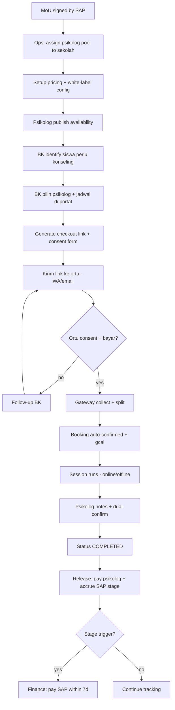
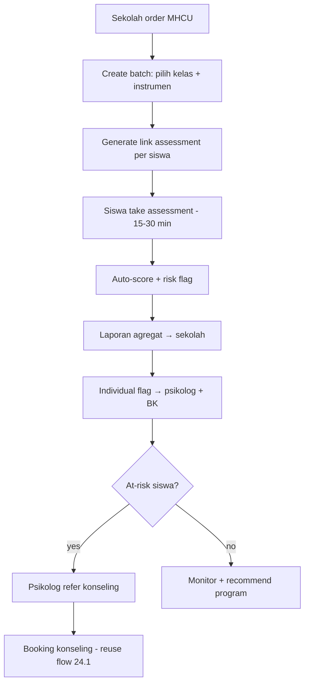
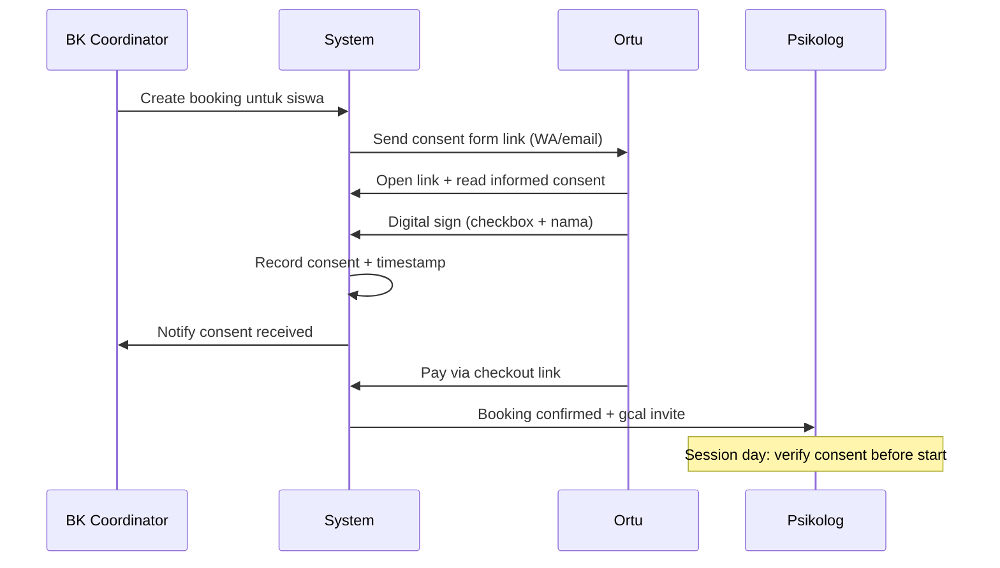

# Soluusi B2B — Sekolah Vertical Spec
### For School · School Wellbeing Program (E2E + Full Expansion)

> Versi 1.0 · Agustus 2026
> Vertical priority: **#2 — dibangun setelah Klinik**
> Dokumen pendukung: `Soluusi B2B - Klinik Vertical Spec.md` (template), `Soluusi B2B Master Playbook.md`
> Status: Draft — asumsi ditandai `[ASSUMED]`, keputusan ditandai `[OPEN]`

---

## Daftar Isi
1. Scope & Priority
2. Revenue & Commercial Model
3. Money Flow (per-program + milestone)
4. Psikolog Pool Management
5. Pricing
6. Student Identity & Data Privacy
7. Booking & Scheduling
8. Consultation Delivery
9. Session Confirmation & Anti-Fraud
10. MHCU Sekolah (Skrining Massal)
11. Edukasi & Parenting (Seminar/Workshop)
12. Wellbeing Guru & Staf
13. Konsultan Karir (Tes Minat-Bakat)
14. Partner Lifecycle
15. Roles & Permissions
16. Data, Reporting & Dashboards
17. Compliance & Confidentiality
18. Multi-Cabang / Yayasan
19. Notifications
20. Escalation & Exception Handling
21. KPIs & Success Metrics
22. Integrations
23. Open Questions / Decisions
24. E2E Flows (mermaid)
25. Technical Implementation Notes

---

## 1. Scope & Priority

Sekolah vertikal = **vertikal kedua**. Alasan: blue ocean (no dedicated player di Indonesia), ICP jelas (SMP/SMA swasta menengah-atas + sekolah internasional), sales cycle medium (yayasan decision), dan reuse infrastruktur Klinik.

**Data pendukung (dari School Mental Health Program PDF):**
- 95.4% guru di sekolah swasta menunjukkan indikasi masalah/gangguan kesehatan mental (MMCI + konsultasi 1-on-1)
- 3 pola psikologis teratas: kecenderungan kompulsif, sifat narsistik, perilaku histrionik
- 5 masalah pribadi teratas: Financial, Family, Trauma, Anxiety, Job
- Remaja di Indonesia: >80% mengalami gangguan mental tidak mendapat bantuan profesional (UNICEF 2021)

**Framework: Whole School Wellbeing (UK Department of Education)**
4 pilar utama:
1. **Student Wellbeing & Development** — ketahanan emosional, kebiasaan sehat, kepercayaan diri
2. **Teacher Wellbeing & Growth** — alat praktis untuk kelola stress, pertumbuhan pribadi
3. **Parent Partnership & Family Support** — empower keluarga untuk lingkungan belajar positif
4. **Safe & Positive School Culture** — komunitas inklusif, saling mendukung

**In-scope MVP (sekolah):**
- Psikolog pool supply + sekolah pilih (rujukan BK atau program)
- Konseling siswa (online + offline) — rujukan BK atau parent request
- MHCU sekolah (skrining massal + laporan agregat per kelas)
- Edukasi/parenting seminar (manual scheduling MVP)
- Wellbeing guru & staf (konseling + skrining burnout)
- Konsultan karir (tes minat-bakat siswa kelas akhir)
- Benefit keluarga (diskon konsultasi ortu)
- SAP commission engine (3-stage, adapted)
- Sekolah dashboard aggregate (confidentiality-first)
- SAP dashboard (commission tracking)

**Out-of-scope MVP (Phase 2):**
- Self-serve student booking portal
- Integrasi rapor digital / LMS sekolah
- Kurikulum SEL (Social-Emotional Learning) terstruktur
- Cross-sell ke For Company (wellbeing guru/staf sebagai corporate)

---

## 2. Revenue & Commercial Model

### Model inti: **Subscription + Pay-per-Use + Flat Fee (BUKAN markup model)**

Berbeda dari Klinik (markup model), Sekolah punya 3 model komersial:

#### Model A: Subscription Siswa (program wellbeing menyeluruh)
- Sekolah bayar **per siswa per tahun**
- Include: 1× skrining massal (MHCU) + kuota sesi konseling siswa
- Soluusi handle konsultan, sekolah handle koordinasi BK
- Paling cocok untuk sekolah yang mau program wellbeing terstruktur

#### Model B: Pay-per-Sesi (tanpa commitment)
- Siswa/ortu bayar per sesi dengan **harga khusus mitra** (diskon 20% dari harga publik)
- Tanpa commitment tahunan
- Sekolah refer siswa ke Soluusi via checkout link (white-label sekolah)
- Paling cocok untuk sekolah yang belum siap program penuh

#### Model C: MHCU Flat (skrining massal saja)
- Sekolah beli **paket skrining per gelombang** (per 100 siswa)
- Include: instrumen + auto-score + laporan agregat + rekomendasi
- Tidak include konseling (upsell ke Model A/B bila ada follow-up)
- Paling cocok untuk sekolah yang butuh data awal

### Confidentiality (CRITICAL)
- **Laporan ke sekolah = AGGREGATE ONLY** (per kelas/sekolah)
- **Identitas siswa berisiko** hanya diakses BK + psikolog Soluusi (confidential)
- **Informed consent + parent consent** wajib untuk siswa di bawah umur
- Sekolah TIDAK bisa akses konten sesi individual

---

## 3. Money Flow (per-program + milestone)

### Per-sesi flow (Model B: Pay-per-Sesi)
```
[1] BK refer siswa → atau ortu langsung booking
    → sistem generate checkout link (sekolah-branded)

[2] Ortu/siswa buka link → isi data + bayar Rp240k (diskon 20% dari Rp300k)
    → gateway collect → split:
       ├─ Rp200k net → Soluusi
       └─ Rp40k margin → sekolah earnings (auto-remit)

[3] Sesi berlangsung + dual-confirm COMPLETED
    → dari net Rp200k:
       ├─ Konsultan fee: Rp150k
       └─ Soluusi gross: Rp50k → accrue SAP milestone
```

### Subscription flow (Model A)
```
[1] Sekolah sign MoU → pilih paket (Rp15-35rb/siswa/tahun)
    → bayar upfront per semester/tahun
    → include: 1× MHCU + kuota sesi (misal 10% dari total siswa)

[2] MHCU dijalankan → laporan agregat
    → siswa flagged → refer konseling (kuota subscription)

[3] Sesi konseling berjalan → track kuota
    → bila kuota habis → upsell pay-per-sesi atau renew subscription

[4] Soluusi gross dari subscription → accrue SAP milestone
```

### MHCU Flat flow (Model C)
```
[1] Sekolah order MHCU → pilih instrumen (MMCI/MMPI/DISC)
    → pilih jumlah peserta → harga flat (Rp1.5-3jt per 100 siswa)

[2] Siswa take assessment (link) → auto-score → laporan agregat

[3] Soluusi gross = flat fee - (konsultan scorer fee + operational)
    → accrue SAP milestone
```

### SAP commission milestone (per sekolah, 90-day rolling)

**Design principles** (same as HAP Compensation Framework):
1. **Anti-fraud** — payout only after real sesi completed (dual-confirmed), not at MoU signing.
2. **Cash flow protection** — payout always a fraction of accumulated Soluusi gross revenue.
3. **Motivation architecture (back-loaded)** — small upfront, big at finish. Prevents SAP chase-and-drop after Stage 1.

| Trigger | Payout | Rationale |
|---|---|---|
| MoU signed + **5 sesi completed** (aktivasi awal) | **Rp250.000** | Reward activation effort; small to prevent MoU-only farming |
| **25 sesi completed** (1/3 of remaining milestone) | **Rp250.000** (≈ 1/3 sisa) | Mid-program retention proof; unlocks after konselor demonstrates sustained usage |
| **40 sesi completed within 90 hari** (2/3 of remaining milestone) | **Rp500.000** (≈ 2/3 sisa) | Full program delivered; back-loaded to reward completion |
| **Total per sekolah** | **Rp1.000.000** | (Rate indikatif SAP, scale by deal size) |

> **"Sesi/aktivasi"** = konseling siswa + MHCU batch + seminar (1 seminar = 3 sesi ekuivalen untuk tracking). SAP rate mirrors HAP structure (5/25/40 trigger, same Rp amounts) because effort profile is comparable; school volume is smaller per account but retention is longer. `[OPEN-S1]`

**Payment terms**: 7 hari kerja SLA after stage trigger met, transfer bank, auto-confirmed by system (no manual claim needed).

### Contoh end-to-end angka (1 sekolah Model B, 30 sesi psikolog online)
| Line | Amount |
|---|---|
| Ortu total bayar (30 × Rp240k) | Rp7.200.000 |
| Sekolah margin (30 × Rp40k) | Rp1.200.000 (keep) |
| Net to Soluusi (30 × Rp200k) | Rp6.000.000 |
| Soluusi → Konsultan fee (30 × Rp150k) | Rp4.500.000 |
| Soluusi gross | Rp1.500.000 |
| Soluusi → SAP commission (3-stage total) | Rp1.000.000 |
| Soluusi net revenue | Rp500.000 |

---

## 4. Psikolog Pool Management

### 4.1 Pool assignment (saat onboarding)
- Dari discovery (Playbook), sekolah nyatain kebutuhan: jenis konsultan (psikolog anak/remaja, konsultan karir), volume estimasi, mode (online/offline)
- Soluusi **assign pool** psikolog ke sekolah (default 2–3 psikolog + 1 konsultan karir)
- Matching criteria: spesialisasi (anak/remaja), lokasi (offline butuh dekat), pengalaman sekolah
- Psikolog di-briefing SOP sekolah (jam, sistem rujukan BK, confidentiality siswa) — oleh Ops Soluusi + SAP

### 4.2 Availability publishing
- Psikolog publish slot availability → Sekolah Portal (per minggu, per mode)
- BK lihat slot available → refer siswa → booking
- Atau: ortu langsung booking via link (Model B)

### 4.3 Replacement flow
- Psikolog unavailable → sistem auto-cari replacement dari pool matching
- Notify BK + SAP → replacement assigned → booking di-reassign
- Bila tidak ada replacement → eskalasi Ops Soluusi

### 4.4 Psikolog performance tracking
- Sesi completed, no-show rate, student feedback (aggregate), utilization
- Trigger coaching bila feedback rendah atau no-show tinggi

### 4.5 Multi-sekolah psikolog
- Satu psikolog bisa assigned ke multi-sekolah (supply on-demand)
- Calendar conflict prevention: block double-booking across sekolah

---

## 5. Pricing

### 5.1 Subscription (Model A, indikatif)
| Tier | Harga/siswa/tahun | Include |
|---|---|---|
| Basic | Rp15.000 | 1× MHCU (DASS-21) + kuota konseling 5% siswa |
| Standard | Rp25.000 | 1× MHCU (MMCI) + kuota konseling 10% siswa + 1× seminar parenting |
| Premium | Rp35.000 | 1× MHCU (full battery) + kuota konseling 15% siswa + 2× seminar + wellbeing guru |

> Indikatif — final rate finance confirm. Minimum 200 siswa per sekolah.

### 5.2 Pay-per-Sesi (Model B, indikatif)
| Konsultan Type | Durasi | Harga Normal | Harga Mitra Sekolah (diskon 20%) |
|---|---|---|---|
| Psikolog anak/remaja | 60 min | Rp300.000 | Rp240.000 |
| Psikolog umum | 60 min | Rp250.000 | Rp200.000 |
| Konsultan karir | 60 min | Rp300.000 | Rp240.000 |

> Sekolah margin dari selisih harga normal vs harga mitra? `[OPEN-S2]` — atau sekolah dapat flat referral fee per sesi?

### 5.3 MHCU Flat (Model C, indikatif)
| Instrumen | Harga per 100 siswa | Include |
|---|---|---|
| DASS-21 (skrining awal) | Rp1.500.000 | Auto-score + laporan agregat |
| MMCI (comprehensive) | Rp2.500.000 | Auto-score + laporan agregat + rekomendasi |
| MMPI (clinical) | Rp3.000.000 | Auto-score + laporan agregat + psikolog review |
| DISC (behavioral) | Rp2.000.000 | Auto-score + laporan agregat |

> Harga flat, bukan per-siswa. Min. order 100 siswa.

### 5.4 Konsultan fee (indikatif)
| Konsultan Type | Fee/sesi (flat) |
|---|---|
| Psikolog anak/remaja | Rp150.000 |
| Psikolog umum | Rp130.000 |
| Konsultan karir | Rp150.000 |
| Seminar speaker | Rp500.000/sesi (90 min) |

### 5.5 Benefit Keluarga (diskon ortu)
- Ortu siswa dapat diskon 20% konsultasi di Soluusi (reuse B2C platform)
- Voucher code khusus sekolah → auto-apply di checkout B2C
- Soluusi absorbs diskon (akuisisi cost) `[OPEN-S3]`

---

## 6. Student Identity & Data Privacy

### 6.1 Data model
- **Siswa = guest** (tidak bikin akun Soluusi) — sama seperti Model C Klinik
- Data collected: nama, kelas, tanggal lahir, nama ortu, kontak ortu, consent status
- **Parent consent** wajib untuk siswa < 18 tahun (UU PDP + ethical guideline)
- Consent flow: digital signature ortu di form online atau physical form scan

### 6.2 Confidentiality rules (CRITICAL)
| Data | Siapa akses |
|---|---|
| Identitas siswa + kontak | BK + psikolog Soluusi (confidential) |
| Konten sesi (notes) | Psikolog only (encrypted) |
| Laporan MHCU individual | Psikolog + BK (flagged at-risk only) |
| Laporan MHCU agregat | Sekolah (per kelas/sekolah) |
| Statistik sesi (count, topik anonim) | Sekolah dashboard |

### 6.3 Red lines
- Sekolah **TIDAK** bisa minta konten sesi individual → tolak + eskalasi
- Sekolah **TIDAK** bisa minta daftar siswa yang konseling → hanya aggregate count
- Psikolog **WAJIB** lapor ke BK bila ada risiko keselamatan (self-harm, abuse) — ini exception confidentiality
- Data siswa **TIDAK** di-share ke B2C platform atau marketing

### 6.4 UU PDP compliance
- Data residency: Indonesia
- Consent: parent consent at registration (informed consent form)
- Right to access/delete: ortu request via sekolah → Soluusi process
- Retention: data siswa dihapus 1 tahun setelah lulus/berhenti
- DPO contact + breach notification `[OPEN-S4]`

### 6.5 HIMPSI compliance
- Instrumen category-A (MMCI, MMPI) hanya dijalankan oleh psikolog berlisensi
- Non-psikolog tidak bisa akses raw data instrumen
- Lisensi psikolog verified at onboarding

---

## 7. Booking & Scheduling

### 7.1 Booking creation paths
1. **BK refer** `[DEFAULT MVP]` — BK pilih psikolog + jadwal di sekolah portal → generate checkout link → kirim ke ortu → ortu bayar → auto-confirmed
2. **Ortu self-book** (Phase 2) — sekolah share booking page link → ortu pilih psikolog + slot sendiri → bayar
3. **Walk-in di BK** — siswa datang ke BK → BK book "now" atau "next slot"

### 7.2 Booking fields
- Sekolah (org)
- Siswa (nama, kelas, NIS — internal ref)
- Ortu (nama, kontak — for consent & receipt)
- Psikolog (dari assigned pool)
- Mode (online/offline)
- Waktu (slot)
- Durasi (60 min default)
- Consent status (parent consent yes/no)
- Status: scheduled → checked-in → completed / no-show / cancelled

### 7.3 Parent consent flow
1. BK create booking → sistem generate consent form link
2. Link kirim ke ortu (WA/email)
3. Ortu buka link → baca informed consent → digital sign (checkbox + nama)
4. Consent recorded → booking confirmed (jika sudah bayar)
5. Tanpa consent → sesi tidak bisa dimulai (psikolog check consent status)

### 7.4 Reschedule & cancel
- Cutoff: H-24h free reschedule; <24h = cancel (no refund untuk pay-per-sesi)
- Who can: BK, psikolog, ortu (via BK)
- No-show: ortu sudah bayar → refund 50% (gateway reverse-split), 50% forfeit → psikolog standby

### 7.5 Overbooking prevention
- Slot lock saat booking create (Redis lock, TTL 10 min)
- Psikolog calendar sync (Google Calendar) two-way

---

## 8. Consultation Delivery

### 8.1 Mode
- **Online** — Zoom/Meet link auto-generated, sent to siswa/ortu + psikolog
- **Offline** — di sekolah (ruang BK) atau lokasi yang disepakati
- **Hybrid** — Phase 2

### 8.2 Session duration
- Default: 60 min (psikolog), 45 min (konsultan karir)
- First consultation: 60 min (includes assessment)
- Follow-up: 45 min

### 8.3 Recording
- **No recording by default** (confidentiality + child protection)
- Exception: psikolog butuh recording untuk supervision → consent ortu + siswa + encrypted storage

### 8.4 Check-in flow
- Pre-session window (H-15min): psikolog + siswa check-in
- Psikolog verify parent consent status before starting
- Dual check-in required untuk start session

---

## 9. Session Confirmation & Anti-Fraud

### 9.1 Confirmation flow
1. Psikolog + siswa check-in → session starts
2. Psikolog input clinical notes (encrypted, psikolog-only) + topik kategori (anonim)
3. Both confirm completed within 24h
4. Auto-confirm fallback: bila tidak confirm dalam 24h → flag ops review
5. Status COMPLETED → trigger: increment sekolah completed-count + revenue calc + SAP stage evaluation

### 9.2 Audit trail (immutable)
- Who confirmed, when, IP, device fingerprint
- Stored 7 years (compliance)

### 9.3 Dispute resolution
- Ortu claims session didn't happen / quality issue → sekolah PIC raise dispute
- Ops Soluusi review audit trail → resolve (credit note / psikolog coaching)

---

## 10. MHCU Sekolah (Skrining Massal)

### 10.1 Use case
- Sekolah butuh data kondisi wellbeing siswa (prevention, early detection)
- Wajib untuk akreditasi sekolah (some accreditation bodies require wellbeing program)
- Output: laporan agregat per kelas + flag siswa at-risk

### 10.2 Flow
1. Sekolah PIC create batch skrining (pilih kelas, instrumen, tanggal)
2. Sistem generate link assessment per siswa
3. Siswa take assessment (online, 15-30 min) — di lab komputer atau HP
4. Auto-score + risk flag (red/yellow/green)
5. Laporan agregat → sekolah (per kelas: distribusi skor, prevalensi risiko)
6. Individual flag → routed ke psikolog Soluusi + BK (confidential)
7. Rekomendasi intervensi → sekolah (workshop, konseling, refer specialist)

### 10.3 Instruments
| Instrument | Purpose | Duration | Category |
|---|---|---|---|
| DASS-21 | Depression, Anxiety, Stress screening | 10 min | B (non-psikolog) |
| MMCI | Comprehensive mental health | 30 min | A (psikolog only) |
| MMPI | Clinical personality | 45 min | A (psikolog only) |
| DISC | Behavioral style | 20 min | B (non-psikolog) |

> Category-A instruments hanya bisa di-score dan di-interpretasi oleh psikolog berlisensi.

### 10.4 Data dari lapangan (School Mental Health Program PDF)
**Case Study: 153 guru di sekolah swasta**
- 95.4% menunjukkan indikasi masalah/gangguan kesehatan mental (MMCI + konsultasi 1-on-1)
- 3 pola psikologis teratas:
  - Kecenderungan kompulsif (46.9%)
  - Sifat narsistik (48.4%)
  - Perilaku histrionik
- 5 masalah pribadi teratas:
  1. Financial
  2. Family
  3. Trauma
  4. Anxiety
  5. Job

**Implikasi untuk program sekolah:**
- Guru juga butuh wellbeing support (bukan hanya siswa)
- Program harus holistik: siswa + guru + orang tua
- MHCU penting untuk baseline data sebelum intervensi

### 10.4 Pricing
- Flat fee per batch (see §5.3)
- Include: link generation, auto-score, laporan agregat, rekomendasi
- Additional: individual psychological report (Rp100k/student) — Phase 2

### 10.5 Confidentiality (critical)
- Sekolah gets **aggregate report only** (per kelas: mean score, % at-risk, top issues)
- Individual student data: psikolog + BK only (confidential)
- Red flag (self-harm risk): psikolog langsung hubungi BK → parent notification
- UU PDP + HIMPSI compliant

---

## 11. Edukasi & Parenting (Seminar/Workshop)

### 11.1 Use case
- Sekolah butuh materi wellbeing untuk siswa, guru, ortu
- Topik: mental health awareness, digital wellbeing, parenting, bullying prevention, career planning

### 11.2 MVP flow (manual)
- Sekolah request topik + tanggal → SAP log → Ops assign speaker
- Pricing: flat per event (Rp2-5jt depending on speaker & duration)
- Scheduling via CRM (no dedicated module MVP)

### 11.3 Topics (indicative)
| Topic | Target | Duration | Price |
|---|---|---|---|
| Mental Health Awareness | Siswa | 90 min | Rp2.000.000 |
| Digital Wellbeing | Siswa | 90 min | Rp2.000.000 |
| Bullying Prevention | Siswa | 90 min | Rp2.500.000 |
| Parenting in Digital Age | Ortu | 120 min | Rp3.000.000 |
| Stress Management | Guru | 90 min | Rp2.500.000 |
| Career Planning | Siswa kelas akhir | 120 min | Rp3.000.000 |

### 11.4 Phase 2
- Speaker pool module, event scheduling, attendance tracking, feedback, recording

---

## 12. Wellbeing Guru & Staf

### 12.1 Use case
- Guru & staf juga butuh dukungan wellbeing (burnout, stress, work-life balance)
- Sekolah yang beli paket Premium include wellbeing guru

### 12.2 Flow
- Guru/staf refer ke konseling (self-refer atau refer rekan)
- Booking via link khusus guru (beda dari siswa)
- Konseling dengan psikolog (sama seperti siswa, tapi confidential dari sekolah)
- **Sekolah hanya lihat aggregate count** (berapa guru yang konseling, topik anonim)

### 12.3 Pricing
- Include di paket Premium subscription
- Atau pay-per-sesi (Rp200k/sesi guru, harga khusus)

---

## 13. Konsultan Karir (Tes Minat-Bakat)

### 13.1 Use case
- Siswa kelas akhir (SMA/SMK) butuh guidance untuk kuliah/kerja
- Tes minat-bakat + konseling karir

### 13.2 Flow
1. Sekolah order batch tes karir (per kelas)
2. Siswa take online assessment (30 min)
3. Auto-score + career match report
4. Konsultan karir review + konseling kelompok (2-3 siswa per sesi)
5. Individual report → siswa + ortu

### 13.3 Pricing
- Batch test: Rp50.000/siswa (min. 30 siswa)
- Individual consultation: Rp240.000/sesi (harga mitra)
- Include di paket Premium subscription

---

## 14. Partner Lifecycle

### 14.1 Onboarding (post-MoU, pre-go-live)
- [ ] Psikolog assigned (from discovery)
- [ ] Briefing psikolog SOP sekolah
- [ ] Setup akun Sekolah Portal + staff (BK)
- [ ] Sosialisasi BK (training: cara refer, consent flow, confidentiality)
- [ ] Materi promosi siap (poster, digital, surat edaran ortu)
- [ ] Set pricing config (subscription/pay-per-use/MHCU)
- [ ] White-label domain configured (sekolah-branded)
- [ ] Test alur end-to-end (1 dummy booking + sesi)
- [ ] Tanggal go-live determined

### 14.2 Aktivasi (Hari 1–30)
| Hari | Checklist |
|---|---|
| 1 | Onboarding + training BK |
| 2 | Psikolog schedule active |
| 3 | Koordinasi konten promosi |
| 5 | Surat edaran ortu dikirim |
| 7 | Follow up BK |
| 14 | First evaluation (sesi count) |
| 30 | Review program |

### 14.3 Account management cadence
- W1–4 post go-live: weekly check-in (SAP)
- After: monthly check-in
- Monitor: sesi vs target, MHCU completion, feedback BK, isu operasional

### 14.4 Churn risk detection
- Signals: sesi declining, BK unresponsive, MHCU tidak di-renew, feedback rendah
- Auto-flag → SAP/Ops intervention

### 14.5 Termination flow
- Notice period: 30 hari
- Wind-down: complete scheduled sesi, payout remaining sekolah margin, final statement, data export, revoke psikolog assignment
- Post-termination: data siswa retained per UU PDP (1 tahun), lalu dihapus

---

## 15. Roles & Permissions

| Role | Akses | Tidak boleh |
|---|---|---|
| **Kepala Sekolah / Yayasan** | View aggregate dashboard, approve MoU, view billing | Data siswa individual, konten sesi |
| **BK Coordinator** | Refer siswa, booking, view aggregate, MHCU coordination, consent tracking | Konten sesi, billing detail, psikolog payout |
| **Guru/Staf** (self-refer) | Book own konseling, view own history | Other guru data, siswa data |
| **Siswa** (Phase 2) | View own booking, feedback | Data lain, konten sesi |
| **Ortu** (Phase 2) | Consent, view child booking, feedback | Konten sesi, data lain |
| **Psikolog** | Own calendar, session notes (encrypted), confirm completion, view own payout | Other psikolog notes, sekolah billing, data siswa outside own sessions |
| **SAP Associate** | CRM pipeline own sekolah, sekolah aggregate (own sekolah), commission tracking | Konten sesi, psikolog payout, other SAP's sekolah |
| **Ops Soluusi** | All sekolah ops, onboarding, replacement matching, dispute resolve | Konten sesi clinical (psikolog-only) |
| **Finance** | Payment settlement, sekolah margin payout, psikolog payout, SAP commission payout | Konten sesi, CRM pipeline |
| **Super Admin** | All + config (pricing, rates) | — |

> **Confidentiality inti:** konten sesi (notes) **hanya** Psikolog + audit. Sekolah (BK, kepala sekolah) **tidak** lihat konten — only aggregate (sesi count, topik kategori anonim).

---

## 16. Data, Reporting & Dashboards

### 16.1 Sekolah dashboard (BK / Kepala Sekolah)
- Sesi count (this period vs target)
- MHCU completion rate (% siswa sudah skrining)
- Topik kategori anonim (e.g., "stress 30%, bullying 20%...")
- Konsultan used + availability
- Billing summary (subscription status, pay-per-sesi usage)
- **NO individual student data, NO session content**

### 16.2 SAP dashboard
- Pipeline funnel (own sekolah)
- MoU kumulatif
- Sekolah per stage (SAP milestone progress)
- Commission accrual status
- Weekly report (auto-generated)

### 16.3 Finance dashboard
- Payment volume (subscription + pay-per-sesi + MHCU)
- Sekolah margin remitted / pending
- Psikolog payout due
- SAP commission payout due
- Gross profit (cross-sekolah)

### 16.4 Psikolog dashboard
- Own sesi (scheduled/completed)
- Own payout status
- Own availability calendar
- Own feedback (aggregate)

---

## 17. Compliance & Confidentiality

### 17.1 UU PDP (eff. Oct 2024)
- Data residency: Indonesia
- Parent consent: wajib untuk siswa < 18 tahun
- Right to access/delete: ortu request via sekolah
- Retention: data siswa dihapus 1 tahun setelah lulus/berhenti
- DPO contact + breach notification `[OPEN-S4]`

### 17.2 HIMPSI compliance
- Category-A instruments (MMCI, MMPI) hanya dijalankan oleh psikolog berlisensi
- Non-psikolog tidak bisa akses raw data instrumen
- Lisensi psikolog verified at onboarding

### 17.3 Sesi confidentiality
- Sesi notes encrypted at rest (psikolog-only access)
- Sekolah: aggregate queries only
- Audit log all access, immutable, 7-year retention

### 17.4 Child protection
- Psikolog wajib lapor ke BK bila ada risiko keselamatan (self-harm, abuse)
- Recording sesi siswa: prohibited tanpa consent ortu + siswa + kepala sekolah
- Background check psikolog (no criminal record involving children)

---

## 18. Multi-Cabang / Yayasan

### 18.1 Org structure
- Yayasan = 1 org + multiple sekolah
- Each sekolah: own BK, own psikolog assignment, shared or per-sekolah billing

### 18.2 Pricing
- Yayasan multi-sekolah: diskon volume (5-10% off subscription)
- Consolidated billing per yayasan atau per-sekolah `[OPEN-S5]`

---

## 19. Notifications

### 19.1 Channels
- WhatsApp Business API (primary)
- Email (secondary)

### 19.2 Triggers
| Event | Recipient | Channel | Timing |
|---|---|---|---|
| Booking confirmed | Psikolog + BK | WA/email | immediate |
| Consent form sent | Ortu | WA/email | on booking |
| Consent received | BK | WA/email | on submit |
| Session reminder | Psikolog + siswa/ortu | WA | H-1, H-2h |
| Session completed | BK + SAP | WA/email | immediate |
| MHCU batch ready | BK | email | on completion |
| SAP stage milestone | SAP | WA/email | on trigger |

---

## 20. Escalation & Exception Handling

### 20.1 Escalation matrix
- Negosiasi harga di luar panduan → escalate to Ops
- Revisi klausul MoU → escalate to legal
- Multi-sekolah yayasan → custom commercial
- Integrasi sistem sekolah (LMS, rapor digital) → Phase 2

### 20.2 Operational exceptions
| Situation | Handler | Flow |
|---|---|---|
| Psikolog no-show/sick | Ops | Replacement from pool → notify BK |
| Siswa no-show | BK + SAP | Track; >3/school → review |
| Parent complaint re psikolog | SAP + Ops | Review notes (psikolog-only via audit), resolve |
| Red flag (self-harm risk) | Psikolog → BK | Immediate notification, parent contact, safety plan |
| Sekolah minta data individual | SAP | Tolak + explain confidentiality policy |

---

## 21. KPIs & Success Metrics

### 21.1 North Star
**Sesi completed + MHCU batches per sekolah per 90 hari** (target 35)

### 21.2 KPIs
| KPI | MVP target | Scale target |
|---|---|---|
| Sekolah MoU onboarded | 15 | 100+ |
| MoU → aktivasi rate | ≥40% | ≥60% |
| Avg sesi+MHCU/sekolah/90d | 15 | 35 (target) |
| Sekolah capai Stage 3 | 3 | 50+ |
| MHCU completion rate (% siswa) | ≥70% | ≥90% |
| Parent consent rate | ≥95% | ≥98% |
| Psikolog utilization | — | ≥50% |
| SAP commission auto-calc accuracy | 100% | 100% |
| Confidentiality breach | 0 | 0 |
| Sekolah NPS | — | ≥4.0/5 |

---

## 22. Integrations

| Integration | Purpose | Phase |
|---|---|---|
| WhatsApp Business API | Notif, reminders, consent form | MVP |
| Email | Receipts, MHCU reports, statements | MVP |
| Zoom / Google Meet | Online session link | MVP |
| Google Calendar API | Auto-schedule | MVP |
| Payment gateway w/ split | Direct payment + split | MVP |
| Psychometric instruments (licensed) | MHCU scoring | MVP |
| LMS / Rapor Digital | Integration dengan sistem sekolah | Phase 2 |
| soluusi.com B2C API | Benefit keluarga voucher | Phase 2 |

---

## 23. Open Questions / Decisions

| ID | Question | Default assumed |
|---|---|---|
| `[OPEN-S1]` | SAP commission rate (Rp1M indikatif) final? | Rp1M, same as HAP |
| `[OPEN-S2]` | Sekolah margin model: markup or flat referral fee? | Flat referral fee per sesi (Rp20-40k) |
| `[OPEN-S3]` | Benefit keluarga discount: who absorbs? | Soluusi absorbs (akuisisi) |
| `[OPEN-S4]` | DPO contact + breach notification process? | TBD |
| `[OPEN-S5]` | Yayasan billing: consolidated or per-sekolah? | Per-sekolah default, consolidated optional |
| `[OPEN-S6]` | Parent consent: digital only or physical OK? | Digital preferred, physical scan accepted |
| `[OPEN-S7]` | MHCU data retention: how long? | 1 tahun setelah siswa lulus |
| `[OPEN-S8]` | Psikolog fee: flat or % of net? | Flat (same as Klinik) |

---

## 24. E2E Flows (mermaid)

### 24.1 Master E2E (Sekolah Model B: Pay-per-Sesi)


### 24.2 MHCU Flow


### 24.3 Parent Consent Flow


---

## 25. Technical Implementation Notes

### 25.1 Models to reuse from Klinik
- `Klinik` model → rename/alias to `Sekolah` (or create new `Sekolah` model with same structure)
- `HapPervorma` → `SapPervorma` (same structure, different name)
- `SplitSettlement` → reuse as-is
- `CheckoutLink` → reuse with sekolah branding
- `MarkupRule` → NOT needed (sekolah uses subscription/flat, not markup)

### 25.2 New models needed
- `Sekolah` (similar to `Klinik` but with school-specific fields: tingkat, jumlah_siswa, akreditasi)
- `SapPervorma` (same as `HapPervorma`)
- `MhcuBatch` (batch skrining: sekolah_id, instrument, class_ids, status, report_url)
- `MhcuResult` (per-siswa: batch_id, student_name, scores, risk_flag)
- `ParentConsent` (student_id, booking_id, consent_status, signed_at, signature)
- `Subscription` (sekolah_id, tier, start_date, end_date, quota_sesi, quota_mhcu)

### 25.3 Routes
```
/sekolah/dashboard — sekolah dashboard (role: sekolah_admin)
/sekolah/bookings — booking management
/sekolah/mhcu — MHCU batch management
/associate/sekolah — SAP dashboard (role: associate, filter vertical=sekolah)
```

### 25.4 Reuse from B2C
- `consultation_sessions` table → reuse (add school-specific fields)
- `consultants` table → reuse (add school specialization)
- `schedules` table → reuse
- `consultant_packages` table → reuse (add school pricing)

### 25.5 White-label considerations
- Sekolah branding: logo, warna, nama sekolah di checkout link
- Domain: neutral/Soluusi-owned domain (same as Klinik)
- Email: from-name = sekolah name
- gcal: organizer = sekolah-branded

### 25.6 Confidentiality enforcement (technical)
- Database-level: Row-Level Security (RLS) untuk session notes (psikolog-only)
- API-level: sekolah dashboard queries HARUS aggregate-only (no individual student data)
- Audit log: semua akses ke student data logged

---

*Soluusi · Sekolah Vertical Spec · Confidential · Internal Use Only*
*Versi 1.0 · Agustus 2026 · Draft — confirm `[OPEN]` items before build*
