# Soluusi B2B Platform — Product Requirements Document (PRD)
### Platform terintegrasi untuk 3 vertikal: For Health Facilities · For School · For Company

> Versi 1.2 · Agustus 2026
> Owner: Founder Soluusi
> Status: Draft untuk review
> Dokumen pendukung: `Soluusi B2B Master Playbook.md`, `Soluusi B2B - Competitor Analysis.md`, `Soluusi B2B - Klinik Vertical Spec.md` (v1.1), `Soluusi B2B - Dev Preparation.md` (v1.0)
> Codebase ground truth: `/Users/mekari/soluusi-main` (B2C production, Laravel 9)
>
> **Revisi v1.1 (4 Agustus 2026):** resolusi §15.1 — stack B2C (`soluusi-main`) sudah di-audit; spekulasi tech (Next.js/NestJS/PostgreSQL/Auth0/Redis) dihapus, diganti actual ground truth (Laravel 9 / PHP 8 / Midtrans Snap / Xendit dead / gcal OAuth-user / Vite-Tailwind / MySQL). Tambahan Appendix C (B2C audit → B2B deltas), D (copas manifest), E (build-new + fix), F (env + setup + smoke).
>
> **Revisi v1.2 (5 Agustus 2026):** Tambahan §0 Start-Here (execution index untuk coding agent — beda AI jalanin code, doc ini self-contained), §15.0 PM Decisions (resolusi default semua [OPEN] — 9 DECIDED + 3 NEEDS FOUNDER, none blocking), §16 Running Tech (install/dev/prod commands exact), §17 Engineering Patterns (verbatim snippet dari `soluusi-main` + annotasi "B2B CHANGE"). PM = Claude; coding agent ikutin doc ini, gak perlu context session lama.

---

## 0. Start Here (untuk coding agent — baca ini DULU)

> **Audience:** AI agent yang nulis + jalanin code (beda session dari PM). Kamu gak punya context percakapan lama — doc ini self-contained. Ikuti urutan di bawah, jangan nebak.

### 0.1 Apa yang kamu bangun
Platform **B2B white-label** untuk Soluusi.com (existing B2C consulting marketplace). 3 vertikal: **Klinik** (prioritas #1 MVP), Sekolah (Phase 2), Company (Phase 2). Codebase **sekarang terpisah** tapi didesain **merge ke `soluusi-main`** nanti — jadi mirror domain tables + models verbatim (termasuk typo B2C), B2B-only tables prefix `klinik_`. Vertical pertama yang dibangun = **Klinik**.

### 0.2 Aturan main (HARUS baca sebelum tulis code)
1. **Ponytail — Lazy Senior Dev Mode** (lihat `~/.claude/CLAUDE.md`): YAGNI → reuse dari `soluusi-main` → stdlib → native → installed dep → one-liner → minimum. **Bug fix = root cause** (grep every caller, fix di shared function). No unrequested abstraction. Mark simplifikasi pakai `ponytail:` comment (name ceiling + upgrade path). Default intensity **full**.
2. **NEVER simplify away:** input validation di trust boundary, error handling yang prevent data loss, security measures, accessibility basics, hal yang explicitly requested.
3. **Non-trivial logic = ONE runnable check** (smallest thing that fails if logic breaks). Lihat Appendix F.3 ScaffoldSmokeTest.
4. **White-label CRITICAL (Model C / v1.1):** Customer **TIDAK boleh tahu** service dari Soluusi. Sembunyikan brand Soluusi (non-circumvention). Lihat §15.0 row 15.4 + §17.3 + §17.5.
5. **Confidentiality:** session content (konsultan + customer + audit) rahasia; HR/partner admin lihat aggregate only. HIMPSI: category-A instruments (MMCI/MMPI) hanya psikolog licensed (§15.5 — disabled di MVP). UU PDP: data residency Indonesia (§11.7).

### 0.3 Urutan baca dokumen (wajib)
| Urutan | Dokumen | Ambil apa |
|--------|---------|-----------|
| 1 | **PRD ini** — §12 (stack), §15.0 (PM decisions), §16 (running tech), §17 (engineering patterns verbatim) | Stack, keputusan, cara jalanin, snippet mirror |
| 2 | `Soluusi B2B - Dev Preparation.md` | Copas manifest (file mana yang cp), build-NEW list, fix-list, setup checklist |
| 3 | `Soluusi B2B - Klinik Vertical Spec.md` (v1.1) | Detail klinik: markup model, HAP commission, dual-confirm, anti-circumvention |
| 4 | `Soluusi B2B Master Playbook.md` | GTM, persona, pricing indikatif, commission rules |
| 5 | `/Users/mekari/soluusi-main` (codebase B2C) | Source truth untuk copas + engineering patterns (§17) |

### 0.4 Urutan eksekusi build (MVP Klinik)
1. **Scaffold** — §16.2 (composer create-project laravel/laravel:^9.0, replace composer/package.json, key:generate, storage:link).
2. **Copas** dari `soluusi-main` per Appendix D (skip SEO/blog/CMS migrations 2026_04_30+).
3. **Config** — Appendix F.1 `.env` (Midtrans sandbox + gcal OAuth-user test creds), `config/whitelabel.php`, `config/midtrans.php`, `config/services.php` (google + google_calendar only).
4. **Migrate + seed** — `php artisan migrate` (SQLite local), `php artisan db:seed` (CategorySkillSeeder extend klinik §15.13).
5. **Build-NEW** (Appendix E.1, 11 items) — split-payment, white-label config, service-account gcal, dual-confirm, admin-generate-link booking, klinik RBAC/earnings, HAP commission, markup/cap, Model C checkout-guest, anti-circumvention, no-show.
6. **Fix-List** (Appendix E.2, 5 items) — webhook signature verify (§17.2 SECURITY), gcal non-fatal (§11.6 DATA-LOSS), payment_status enum Blueprint, profit_sharing preserve-but-ignore (§15.9), B2C typos PRESERVE (merge parity).
7. **Smoke check** — Appendix F.3 (`php artisan test --filter=ScaffoldSmokeTest` + 3 manual: Midtrans Snap sandbox, gcal event, webhook sig reject).
8. **Dev run** — §16.3 (`serve` + `npm run dev` + `queue:work` + `schedule:work`).

### 0.5 Kalau stuck / ambiguous
- **Cek §15.0 dulu** — PM sudah putus default. 9 DECIDED (pakai langsung), 3 NEEDS FOUNDER (pakai fallback dev-safe, jangan tunggu).
- **Cek engineering pattern §17** — snippet verbatim dari `soluusi-main`, annotasi "B2B CHANGE".
- **Mirror B2C kalau ragu** — `/Users/mekari/soluusi-main` = ground truth. Preserve typo (merge parity).
- **Jangan nebak stack** — §12 locked. Jangan add Redis/Next.js/NestJS/Auth0/PostgreSQL.
- **Output code Ponytail-style** — code first, ≤3 line penjelasan, mark simplifikasi `ponytail:`.

---

## Daftar Isi
0. Start Here (untuk coding agent — baca DULU)
1. Executive Summary & Vision
2. Problem & Opportunity
3. Goals & Success Metrics
4. Personas & User Roles
5. Product Scope (MVP vs Phase 2)
6. System Architecture
7. Module Specifications
8. User Flows (semua flow tergambarkan)
9. Data Model
10. Integrations & API
11. Non-Functional Requirements
12. Tech Stack (Locked — match soluusi-main)
13. Roadmap & Phases
14. Risks & Mitigations
15. Open Questions — **15.0 PM Decisions (resolusi default)**
16. Running Tech (cara jalanin — exact)
17. Engineering Patterns dari soluusi-main (mirror + adapt)
- Appendix A — Traceability: Playbook → PRD
- Appendix B — Glossary
- Appendix C — B2C Codebase Audit → B2B Platform Deltas
- Appendix D — Component Reuse Manifest (copas soluusi-main → B2B)
- Appendix E — Build-NEW, Fix-List & Merge Architecture
- Appendix F — Env Vars, Setup Checklist & Smoke Check

---
---

## 1. Executive Summary & Vision

### Vision
Bangun **satu platform B2B** yang melayani tiga vertikal (klinik, sekolah, perusahaan) dengan talent pool multi-profesional (psikolog, nutrisionis, fisioterapis, konsultan karir), hybrid online+offline, dan model komersial fleksibel (bagi hasil, subscription, pay-per-use). Platform ini adalah mesin operasional yang menghidupkan **Soluusi B2B Master Playbook**.

### Why now
- Regulasi push: UU 17/2023 Kesehatan + Permenaker K3 psychosocial + UU PDP (Okt 2024) = employer wajib wellbeing + privacy strict.
- Demand: 62% burnout karyawan Indonesia (Riliv survey); 1-in-4 mental health issue, hanya 12% seek help.
- Blue ocean: vertikal **sekolah** tidak ada pemain dedicated di Indonesia.
- Playbook HAP sudah jalan → butuh sistem untuk scale dari 30 → 300+ mitra.

### What we're building (one line)
**B2B partnership & service-delivery platform**: CRM untuk associate (HAP/SAP/CAP) akuisisi mitra → Portal mitra (per vertikal) → Booking & scheduling → MHCU skrining + dashboard → Commission engine (3-stage bagi hasil) → Voucher/campaign → Cross-sell tracking.

### Non-goals (MVP)
- Bukan rebuild B2C soluusi.com (sudah ada, integrate saja)
- Bukan telemedicine general (bukan Halodoc competitor)
- Bukan self-serve SaaS sign-up (GTM via associate, bukan PLG)
- Bukan content production platform (konten dari tim Soluusi, platform hanya host)

---
---

## 2. Problem & Opportunity

### Problems saat ini (tanpa platform)
| Problem | Dampak |
|---|---|
| Associate track pipeline di Google Sheets manual | data scattered, no audit trail, sulit scale multi-associate |
| Konfirmasi konsultasi manual → komisi 3-stage error-prone | anti-fraud principle (Playbook §5.1) tidak ter-enforce sistemik |
| MHCU skrining dilakukan ad-hoc, laporan manual | tidak scalable untuk skrining massal sekolah/perusahaan |
| HR/BK minta data tapi confidentiality tidak ter-enforce teknis | risiko compliance UU PDP + HIMPSI |
| Cross-sell antar vertikal tidak ter-track | opportunity leak (1 mitra = potensi 2 vertikal) |
| Aktivasi mitra (Hari 1–30) tidak ter-checklist sistemik | drop-off aktivasi tinggi, MoU tapi no konsultasi |

### Opportunity
- 3 vertikal × multi-profesional × hybrid = moat yang kompetitor (Riliv et al) tidak punya.
- Adopt Spring Health MBC pattern → defensible vs global expand.
- First-mover vertikal sekolah di Indonesia.

---
---

## 3. Goals & Success Metrics

### North Star
**Jumlah konsultasi terlaksana per mitra dalam 90 hari** (target 40) — bukan jumlah MoU. Ini selaras dengan filosofi anti-fraud & back-loaded compensation Playbook §5.1.

### KPIs per fase

| KPI | MVP (Q1) | Scale (Q2–Q3) | Metric source |
|---|---|---|---|
| Mitra aktif onboarded | 30 (all vertikal) | 300+ | CRM |
| MoU→aktivasi rate | ≥50% | ≥70% | CRM + booking |
| Konsultasi/sesi terlaksana | 1.000 | 10.000+ | Booking module |
| Mitra capai Stage 3 (40 sesi/90 hari) | 5 | 100+ | Commission engine |
| Associate komisi akurasi | 100% auto-calc | — | Commission engine |
| MHCU skrining run | 5 batch | 50+ batch | MHCU module |
| HR/BK dashboard NPS | — | ≥4.2/5 | In-app survey |
| Confidentiality breach | 0 | 0 | Audit log |
| Pipeline conversion (prospect→MoU) | — | ≥15% | CRM |

---
---

## 4. Personas & User Roles

### 4.1 Persona map
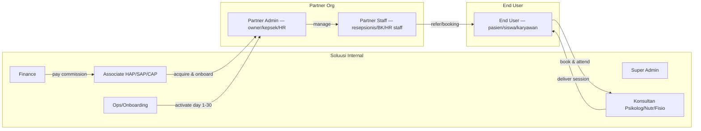

### 4.2 Role & permission matrix

| Role | Akses utama | Tidak boleh akses |
|---|---|---|
| **Super Admin** | Semua — config, vertikal, komisi rate, mitra, audit | — |
| **Associate (HAP/SAP/CAP)** | CRM pipeline sendiri, mitra yang dia akuisisi, weekly report | konten sesi, data individual end-user, finance mitra lain |
| **Partner Admin** | Org profile, staff mgmt, dashboard aggregate org-nya, voucher/campaign org-nya | konten sesi individual, data mitra lain, konfigurasi komisi |
| **Partner Staff** | Refer end-user, lihat jadwal konsultan org-nya, create booking | dashboard aggregate (kecuali yang di-share admin), billing |
| **End User** | Profil sendiri, booking sendiri, riwayat sesi sendiri, voucher sendiri | data user lain, dashboard aggregate |
| **Konsultan** | Jadwal sendiri, notes sesi (confidential), status sesi | data konsultan lain, billing mitra |
| **Finance** | Invoice, komisi payout, revenue share calc, tax | konten sesi, CRM pipeline detail |

> **Aturan confidentiality inti:** konten sesi (notes, recording) **hanya** Konsultan + End User + Super Admin (untuk audit) yang akses. Partner Admin/Staff **tidak** lihat konten, hanya aggregate (jumlah sesi, topik kategori anonim). Ini enforce teknis di §11.

---
---

## 5. Product Scope (MVP vs Phase 2)

### MVP (Q1 — launch 3 vertikal, ~30 mitra)
✅ Must-have:
1. CRM & Pipeline (associate) — prospect → MoU tracking
2. Partner Portal (per vertikal) — org profile, staff mgmt
3. Booking & Scheduling — online + offline, konsultan availability
4. Konsultasi session tracking — confirm sesi (trigger komisi)
5. Commission engine — 3-stage payout auto-calc
6. Voucher & Campaign (basic) — generate & track
7. Reporting dashboards (aggregate, per vertikal)
8. Notification (WA + email) — reminder cadence Playbook §4.15
9. Confidentiality enforcement (RBAC + audit log)

### Phase 2 (Q2–Q3 — scale 300+ mitra)
🔜 Should-have:
- MHCU module (skrining massal + scoring + aggregate dashboard)
- Cross-sell tracking engine
- White-label partner landing page (perusahaan branded)
- HR/BK self-serve aggregate dashboard
- Measurement-based care (MBC) — routine outcome (PHQ-9/GAD-7) integration
- Konsultan pool management (replacement matching, Playbook §4.6 "psikolog resign")

### Phase 3 (later)
- Marketplace B2C funnel integration (soluusi.com → B2B referral)
- AI triage / matching (Spring Health pattern)
- Telehealth video native (sekarang integrate Zoom/Meet)
- Multi-currency / regional expansion

### Out of scope (explicit non-goals)
- E-commerce / pharmacy
- Insurance claim filing (integrate vendor aja)
- Custom assessment builder (pakai instrument licensed: MMCI/MMPI/DISC/PHQ-9/GAD-7)
- Self-serve signup (GTM via associate)

---
---

## 6. System Architecture

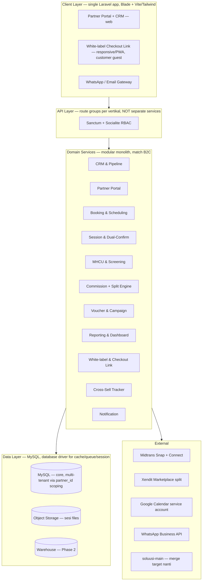

**Prinsip arsitektur**
- Modular monolith Laravel 9 (match B2C), **bukan** microservices — Ponytail: 1 deploy. Pecah kalau throughput bilang lain.
- "BFF per vertikal" = **route group + presenter diff** (`Route::prefix('klinik|sekolah|company')`), bukan service terpisah. Logic shared.
- Multi-tenant: data per mitra di-scope via `partner_id` + app-layer RBAC (role middleware, match B2C). **Bukan** Postgres RLS (MySQL tidak punya); enforce di query scope + policy class.
- **Pisah sekarang, nyatu nanti** — B2B repo Laravel sendiri sekarang; tabel domain identik + typo B2C dipertahankan supaya merge ke `soluusi-main` = no-op skema. B2B-only tabel prefix `klinik_`/domain baru. Detail: Appendix D + E.
- Customer (pasien/siswa/karyawan) booking via **white-label checkout link** (guest, Model C), **bukan** native mobile app — Ponytail: responsive web/PWA.

---
---

## 7. Module Specifications

### M1 — CRM & Pipeline (Associate)
**User:** Associate (HAP/SAP/CAP)
**Tujuan:** track prospek dari first contact → MoU → aktivasi, generate weekly report otomatis.

| Feature | Spec |
|---|---|
| Pipeline stages | Prospect → Contacted → Meeting Scheduled → Discovery Done → Proposal Sent → Negotiation → MoU Signed → Onboarding → Activation (Checkpoint 40) |
| Deal card | nama mitra, vertikal, decision-maker + kontak, stage, nilai deal (rate komisi), last activity, next action + due |
| Auto weekly report | generate dari pipeline state, kirim Jumat 17.00 (Playbook §4.18) |
| Lost-opportunity log | alasan + next action (Playbook §4.18) |
| Referral tracking | mitra aktif refer mitra lain → tag source |
| Deal capacity guard | warn bila associate >5 deal aktif (Playbook §0.4) |

### M2 — Partner Portal (per vertikal)
**User:** Partner Admin + Partner Staff
**Tujuan:** mitra self-manage org & staff, lihat dashboard.

| Feature | Spec |
|---|---|
| Org profile | nama, vertikal, cabang/kelas/departemen, PIC teknis + operasional |
| Staff mgmt | invite staff (resepsionis/BK/HR), assign role Partner Staff |
| Konsultan assignment | lihat konsultan yang assigned ke org-nya, jadwal |
| Voucher/campaign mgmt | generate voucher (Benefit Pasien/Siswa/Karyawan), track usage |
| Dashboard aggregate | sesi used vs target, revenue, topik kategori anonim, NPS |
| Document hub | MoU, laporan MHCU, materi promosi (Playbook §4.13) |

### M3 — Booking & Scheduling
**User:** Customer (via white-label checkout link, **guest — no account**) + Klinik Admin (generate link) + Konsultan
**Tujuan:** admin-generate-link booking — klinik admin pilih konsultan + schedule + package → generate signed white-label checkout link → kirim ke customer → customer isi data + bayar langsung. Mirror B2C `JadwalController` + `KonsumenController` flow, adapt ke link-based + guest customer (Model C, Appendix E.1 #5/#9).

| Feature | Spec |
|---|---|
| Konsultan availability | slot per konsultan (`schedules` table, concrete datetime — match B2C), per klinik/lokasi |
| Admin-generate-link | klinik admin pilih konsultan + schedule + package → generate signed checkout link (`checkout_links`: token + expiry + markup_snapshot) → kirim ke customer |
| Customer checkout | customer buka link → isi data (nama/email/telp/DOB/regency/gender + complaint) → bayar langsung (Snap) → **no account** (Model C) |
| Reschedule & cancel | with reason log |
| Konsultan replacement | bila berhalangan → match dari pool (Phase 2; MVP manual) |
| Online session | **Google Meet link** auto-generated dari gcal event (`link_meeting`); **bukan Zoom** (match B2C) |
| Offline session | lokasi fisik (klinik/sekolah/kantor) |
| Calendar sync | auto-add ke customer Google Calendar via gcal event attendees (`GoogleCalendarService`) |

### M4 — Session & Confirmation
**User:** Konsultan + End User + (audit) Finance
**Tujuan:** confirm sesi terlaksana → trigger komisi (anti-fraud core).

| Feature | Spec |
|---|---|
| Pre-session | check-in End User + Konsultan |
| Session notes | Konsultan input notes (confidential — encrypted), kategori topik (anonim untuk aggregate) |
| Post-session confirm | Konsultan + End User confirm sesi selesai → status `completed` |
| Auto-confirmation fallback | bila tidak confirm dalam X jam → flag ops review (anti fake sesi) |
| Audit trail | siapa confirm kapan, IP, device fingerprint (anti-fraud) |
| Stage trigger | completed count per mitra → auto-evaluate Stage 1/2/3 (§M6) |

### M5 — MHCU & Screening (Phase 2, tapi desain sekarang)
**User:** Konsultan (run) + Partner Admin (view aggregate) + End User (take)
**Tujuan:** skrining massal + laporan aggregate dengan confidentiality strict.

| Feature | Spec |
|---|---|
| Instrument library | MMCI, MMPI, DISC (category-A, run by licensed psikolog), PHQ-9, GAD-7 (routine MBC) |
| Batch skrining | create batch (sekolah angkatan / perusahaan departemen), assign instrumen, kirim link ke partisipan |
| Scoring & flagging | auto-score, flag risk-level (low/moderate/high) → routing sesuai SOP |
| Aggregate report | per kelas/departemen/org — distribusi skor, % flag, topik dominan. **Tidak expose individual ke Partner Admin.** |
| Individual access | hanya Konsultan psikolog + (untuk sekolah) BK yang akses identitas siswa berisiko, dengan consent log |
| Consent management | informed consent flow (orang tua untuk <18) + opt-out |

### M6 — Commission Engine
**User:** Finance + Associate (view own) + Super Admin
**Tujuan:** auto-calc 3-stage payout + team milestone bonus (Playbook §5).

| Feature | Spec |
|---|---|
| Rate config | Total Rate per mitra (set at MoU), vertikal, ukuran deal |
| 3-stage calc | Stage1 = flat; Stage2 = 1/3 × (Rate − Stage1); Stage3 = 2/3 × (Rate − Stage1) |
| Trigger | auto when completed-sesi count per mitra crosses 5 / 25 / 40 (window 90 hari rolling) |
| Bagi hasil calc | klinik: % × harga sesi; sekolah/perusahaan: subscription/flat (no bagi hasil atau komisi referral) |
| Payout SLA | Stage1–3: 7 hari kerja; team bonus: 14 hari kerja |
| Team milestone | 100/200 mitra, Rp300M/Rp600M gross profit → bonus per associate (Playbook §5.3) |
| Tax & rekening | associate rekening from SPK; tax note (self-responsibility) |
| Audit | every payout immutable log |

### M7 — Voucher & Campaign
**User:** Partner Admin (create) + End User (redeem)
**Tujuan:** execute Skema 4 (Benefit Pasien/Siswa/Karyawan).

| Feature | Spec |
|---|---|
| Voucher types | discount 20%, free trial 10 min, flat Rp off, free session |
| Campaign | health day, mental health, gizi, fisio (Playbook §4.13 §4) |
| Targeting | per org, per cabang/kelas/dept, per periode |
| Redemption | End User redeem at booking |
| Usage tracking | redeemed count, conversion |

### M8 — Reporting & Dashboard
**User:** Partner Admin (org), Associate (own pipeline), Finance, Super Admin
**Tujuan:** visibility + decision support, dengan confidentiality boundary.

| Feature | Spec |
|---|---|
| Partner dashboard | sesi vs target, revenue, topik aggregate, NPS, voucher usage |
| Associate dashboard | pipeline funnel, MoU kumulatif, mitra stage, weekly report auto |
| Finance dashboard | payout due, gross profit, team milestone progress |
| Super admin | cross-vertikal, all mitra, system health |
| Confidentiality | aggregate-only untuk Partner; never individual sesi content |

### M9 — Cross-Sell Tracker (Phase 2)
**User:** Associate + Partner Admin
**Tujuan:** track upsell opportunity (1 mitra → 2 vertikal).

| Feature | Spec |
|---|---|
| Cross-sell signal | mitra stabil ≥1 bulan + PIC puas → flag upsell (Playbook §4.14) |
| Opportunity card | "klinik X → upsell For Company (wellbeing staf)" |
| Stage | eligible → pitched → MoU → activated |
| Attribution | original associate dapat komisi cross-sell sesuai aturan (TBD §15) |

### M10 — Notification
**User:** all
**Tujuan:** execute cadence Playbook §4.15 + §4.16 SLA.

| Channels | WA Business API + Email |
|---|---|
| Triggers | meeting reminder (H-1), follow-up cadence (H+1/3/7/14/21/30), MoU review reminder, sesi reminder, komisi payout notification, weekly report send |
| Templating | per vertikal + per persona |
| Opt-out | End User bisa opt-out non-transactional |

---
---

## 8. User Flows (semua flow tergambarkan)

### 8.1 Partner Acquisition Flow (Associate CRM → MoU)
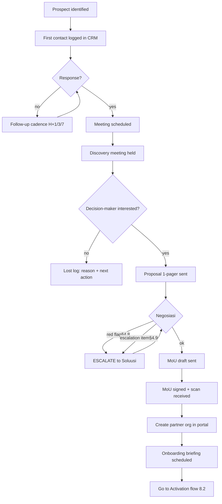

### 8.2 Onboarding & Activation Flow (Hari 1–30)
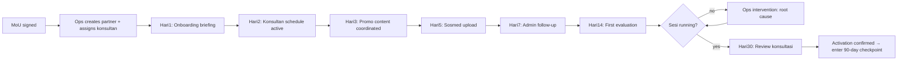

### 8.3 Booking Flow (klinik — admin-generate-link, customer guest)
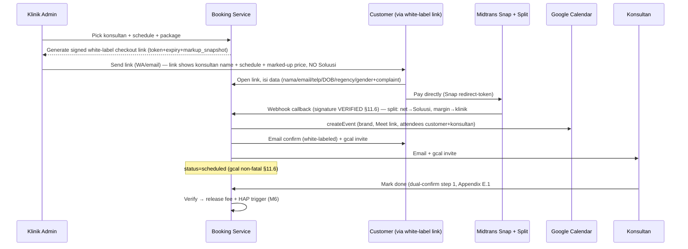

### 8.4 Session Confirmation & Commission Trigger Flow (anti-fraud core)
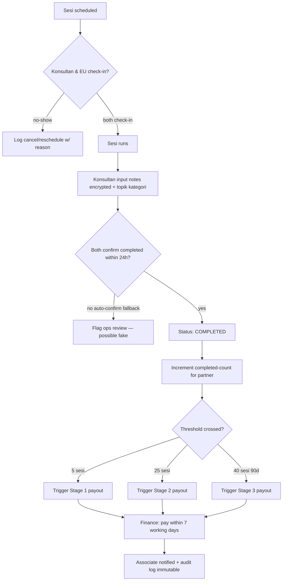

### 8.5 MHCU Skrining Flow (with confidentiality boundary)
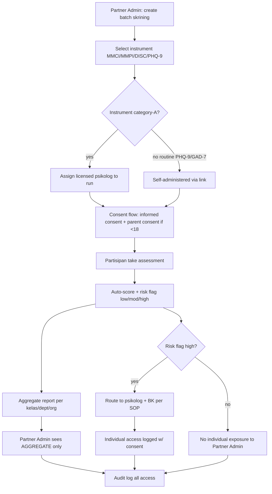

### 8.6 Cross-Sell Flow (1 mitra → 2 vertikal)
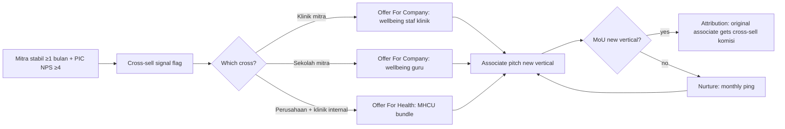

### 8.7 Revenue Calculation Flow (klinik — markup model, senana Spec v1.1 §8)
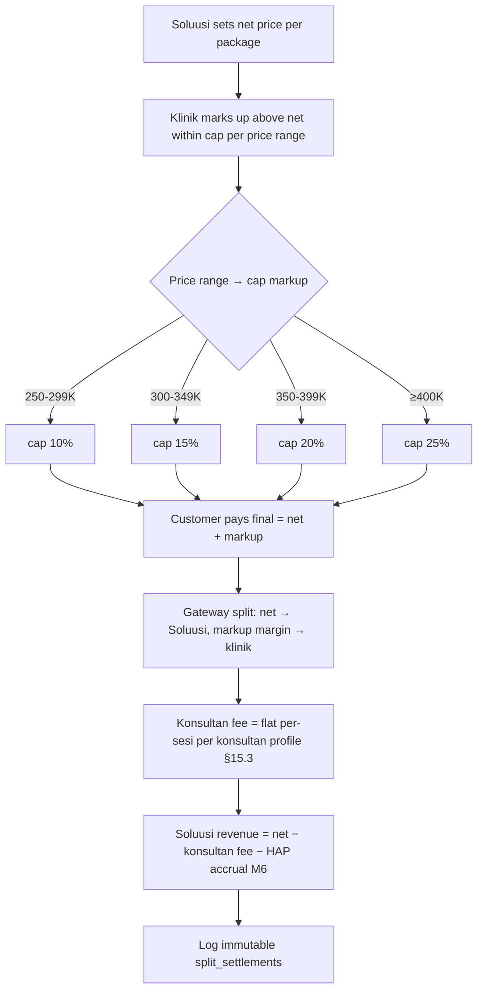
> **Note:** markup model (margin = final − net), BUKAN bagi-hasil % × harga (model lama dihapus — senana Spec v1.1 §8). Cap % per range = batas max markup, bukan % yang dipotong dari harga.

### 8.8 Commission Payout Flow (3-stage, anti-fraud)
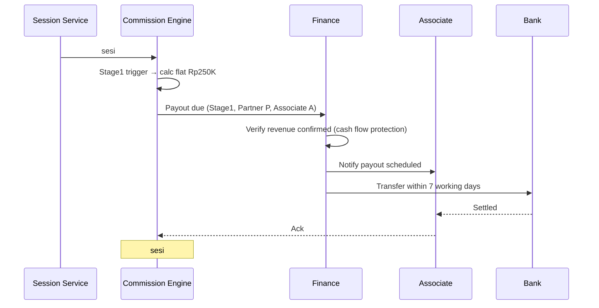

### 8.9 Notification Cadence Flow (Playbook §4.15)
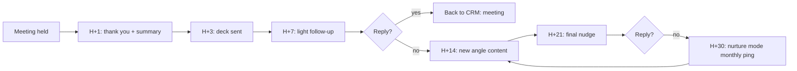

### 8.10 Vertical-Aware Routing (one platform, 3 vertikal)
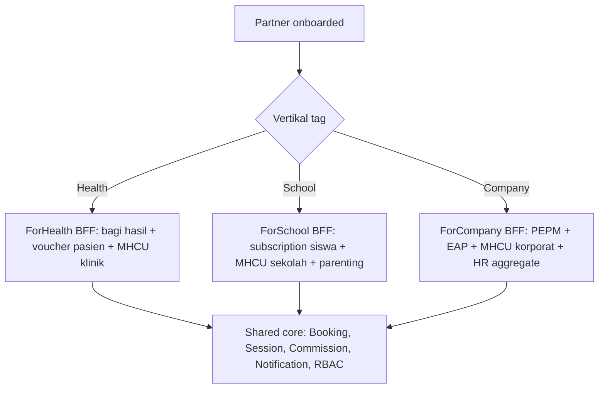

---
---

## 9. Data Model

### 9.1 Core entities (ERD)
```mermaid
erDiagram
    ASSOCIATE ||--o{ PARTNER : acquires
    PARTNER ||--|| ORG : has
    ORG ||--o{ STAFF : employs
    ORG ||--o{ KONSULTAN_ASSIGN : assigns
    KONSULTAN ||--o{ KONSULTAN_ASSIGN : "assigned to"
    STAFF ||--o{ BOOKING : "creates/refer"
    ENDUSER ||--o{ BOOKING : "owns"
    KONSULTAN ||--o{ BOOKING : "delivers"
    BOOKING ||--|| SESSION : "produces"
    SESSION ||--|| SESSION_NOTES : "has (encrypted)"
    PARTNER ||--o{ COMMISSION : "earns"
    ASSOCIATE ||--o{ COMMISSION : "paid to"
    PARTNER ||--o{ VOUCHER : "issues"
    ENDUSER ||--o{ VOUCHER_REDEMPTION : "redeems"
    PARTNER ||--o{ MHCU_BATCH : "runs"
    MHCU_BATCH ||--o{ MHCU_RESULT : "contains"
    PARTNER ||--o{ DASHBOARD_VIEW : "sees aggregate"

    ASSOCIATE { string id string code HAP_SAP_CAP string name }
    PARTNER { string id string vertikal string stage date mou_date int rate_total }
    ORG { string id string name string type string[] cabang_kelas_dept }
    SESSION { string id datetime start string status string topik_kategori }
    SESSION_NOTES { string id blob encrypted_notes string konsultan_id }
    COMMISSION { string id string partner_id string associate_id string stage int amount date paid }
    MHCU_BATCH { string id string instrument string[] partisipan_ids date run }
    MHCU_RESULT { string id string score string risk_flag bool individual_access_logged }
```

### 9.2 Key fields & confidentiality tags
- `SESSION_NOTES.encrypted_notes` — encrypted at rest, KMS key per konsultan+enduser pair. Access only Konsultan + audit.
- `MHCU_RESULT.risk_flag` — drives routing; individual access logged in `ACCESS_LOG`.
- `PARTNER.stage` — enum: prospect/contacted/.../mou/onboarding/activation/stage1/stage2/stage3.
- `COMMISSION.stage` — 1/2/3, immutable once paid.

### 9.3 Map ERD konseptual → tabel real `soluusi-main` (Appendix C.5)
| ERD konseptual | Tabel real B2C (reuse) | B2B-only additive |
|---|---|---|
| ASSOCIATE | `users` (role associate) + CRM pipeline (new) | — |
| PARTNER / ORG | `companies` (reuse) | `kliniks` (brand/domain/logo/gcal_id), `klinik_admins` |
| STAFF | `users` (role klinik_admin/partner_staff) | `klinik_admins` pivot |
| KONSULTAN | `consultants` (reuse verbatim) | — |
| BOOKING / SESSION | `consultation_sessions` + `schedules` + `consultant_packages` (reuse) | `checkout_links` |
| SESSION_NOTES | `consultation_sessions.note`/`solution` (reuse; encrypt at rest §11.1) | — |
| COMMISSION | `payments` (reuse) | `split_settlements`, `hap_commissions`, `markup_rules` |
| VOUCHER | `vouchers` (reuse; tambah `free_trial` type §15.12) | — |
| MHCU_BATCH / RESULT | (Phase 2 — baru) | `mhcu_batches`, `mhcu_results` |
| ENDUSER (customer) | **guest, no `users` row** (Model C) — PII di `consultation_sessions` + `checkout_links` | `checkout_links` |

---
---

## 10. Integrations & API

| Integration | Actual B2C (ground truth) | B2B plan | Phase |
|---|---|---|---|
| Midtrans Snap | Primary; Snap redirect-token; webhook `POST api/midtrans-callback` → `MidtransController@callback` — **NO signature verify** (bug) | Reuse + add split (Connect) + **verify signature (SECURITY §11.6)**; white-label receipt hide Soluusi | MVP |
| Xendit | Dead/stubbed (`XenditController` kosong, callback commented) | Revive for split Marketplace (`for-user`) + associate payout | MVP |
| Google Calendar | OAuth-user (`google/apiclient` 2.15, `soluusi@gmail.com` refresh token); event summary `"Soluusi - {pkg}"` hardcoded; gcal failure leaves session `waiting` (bug) | Start OAuth-user → migrate **service account**; parameterize brand; **gcal failure non-fatal (§11.6)** | MVP |
| Email | 14 mailables (5 client + 9 konsultan), global sender, `"Soluusi - "` prefix | Copas + white-label (prefix→brand, per-mailable from) | MVP |
| Google Meet | `link_meeting` dari gcal event | Match | MVP |
| WhatsApp Business API | B2C: belum ter-audit native WA gateway — verify dulu | Add MVP untuk cadence M10 | MVP |
| Object storage (S3/R2) | local disk / S3 | S3/R2 (sesi files, MoU, materi) | MVP |
| soluusi-main codebase | (merge target) | Merge B2B ke `soluusi-main` nanti; share konsultan pool + domain schema identik | Phase 3 |
| Psychometric instruments (licensed) | — | MMCI/MMPI (category-A, licensed psikolog only per HIMPSI), PHQ-9/GAD-7 | Phase 2 |
| HRIS (Mekari Talenta dll) | — | headcount sync, white-label landing | Phase 2 |

**API design principle:** REST, versioned (`/v1`), BFF per vertikal. Webhook for sesi completion (trigger commission). Idempotency keys for booking + payout.

---
---

## 11. Non-Functional Requirements

### 11.1 Security & Privacy (CRITICAL — UU PDP + HIMPSI)
- **Encryption at rest** — semua sesi notes, MHCU result, PII. AES-256, KMS.
- **Encryption in transit** — TLS 1.3.
- **RBAC** — matrix §4.2 enforced di API + DB row-level security.
- **Audit log** — immutable, siapa akses apa kapan (sesi notes, MHCU individual, payout). Retention 7 tahun.
- **Confidentiality boundary teknis** — Partner Admin/Staff query sesi → DB reject individual content; only aggregate via dedicated aggregate API.
- **Consent management** — informed consent flow, parent consent <18, opt-out, consent log.
- **Data residency** — data Indonesia (UU PDP). Pilih provider dengan region ID/SG.
- **HIMPSI compliance** — MMCI/MMPI (category-A) hanya di-run oleh psikolog berlisensi via platform; non-psikolog tidak bisa trigger.

### 11.2 Scalability
- Modular monolith → scale horizontal. Target MVP 1.000 sesi/bulan, design untuk 100×.
- Read replica untuk dashboard aggregate query.

### 11.3 Availability
- 99.5% MVP, 99.9% Phase 2.
- Notification (WA) tidak boleh single point of failure — fallback email.

### 11.4 Observability
- Structured logging, metrics (booking completion rate, payout latency), tracing (per vertikal).

### 11.5 Localization
- Bahasa Indonesia primary; English UI untuk enterprise/international school.

### 11.6 Security fixes wajib (jangan bawa bug B2C)
- **Webhook signature verify** — B2C `MidtransController@callback` terima callback tanpa `Notification::verifySignature()` (hole: fake settlement). B2B: verify pakai `server_key` sebelum update `payment_status`; reject + log mismatch.
- **gcal failure non-fatal** — B2C: gcal throw → session tetap `waiting` meski pembayaran verified (customer bayar tapi tak ter-schedule = data-loss). B2B: try/catch, status → `scheduled` regardless, `google_calendar_event_id` nullable, retry via queue, log. gcal = best-effort, bukan blocker.

### 11.7 Data residency & compliance specifics
- UU PDP (eff. Okt 2024): data residency Indonesia. Midtrans/Xendit/Google region pilih ID/SG.
- HIMPSI: MMCI/MMPI (category-A) hanya di-run psikolog berlisensi — restrict di role + audit.
- White-label / non-circumvention: customer tidak boleh tahu layanan = Soluusi — domain/brand/receipt/email/gcal hide (Appendix E §10).

---
---

## 12. Tech Stack (Locked — match `soluusi-main`)

> Resolusi §15.1: stack soluusi.com B2C sudah di-audit Agustus 2026 (lihat Appendix C). B2B **match persis** — production, share team/code, akan nyatu ke `soluusi-main` nanti. Spekulasi lama (Next.js/NestJS/PostgreSQL+RLS/Auth0/Redis/Vercel+Fly split) **dihapus**.

### 12.1 Backend & language
| Layer | Locked | Catatan |
|---|---|---|
| Framework | Laravel **9** (`laravel/framework ^9.0`) | modular monolith, match B2C |
| Language | PHP **8.0**+ | jangan 8.1+ exclusive |
| Auth | Sanctum ^2.14 + Socialite ^5.16 (Google SSO) | admin klinik + konsultan login; **customer = guest tanpa akun** (Model C) |
| HTTP client | Guzzle ^7.2 | Midtrans/Xendit/gcal calls |
| Image | intervention/image ^3.11 | avatar/sertif |
| Region | azishapidin/indoregion ^3.0 | prov/kab/kec/desa |
| DBAL | doctrine/dbal ^3.8 | enum + raw SQL alter |
| CORS | fruitcake/laravel-cors ^2.0.5 | match B2C |
| Tinker | laravel/tinker ^2.7 | dev |

### 12.2 Payment
| Gateway | Status B2C (ground truth) | Status B2B |
|---|---|---|
| Midtrans (`midtrans/midtrans-php ^2.5`) | **Primary** — Snap redirect-token, single merchant (Soluusi = merchant of record). Webhook `POST api/midtrans-callback` → `MidtransController@callback`, **NO signature verify** (bug, fix §11.6) | **Primary** — reuse Snap flow + **add split-payment NEW** (Midtrans Connect) atau Xendit Marketplace; **verify signature (SECURITY)**; white-label receipt hide Soluusi |
| Xendit (`xendit/xendit-php ^4.1`) | **Dead/stubbed** — `XenditController` kosong, callback commented; cuma `config/xendit.php` `auth_key` | **Revive for split** — Marketplace `for-user` header: margin→klinik + payout associate. Jangan copas `XenditController` B2C (dead), build fresh |

### 12.3 Google Calendar
| B2C | B2B target |
|---|---|
| `google/apiclient` 2.15, **OAuth-user** (`soluusi@gmail.com` refresh token; `config/services.php` block `google_calendar`), event summary `"Soluusi - {package}"` hardcoded; `link_meeting` = Google Meet URI; gcal failure leaves session `waiting` (bug, fix §11.6) | **Start dari OAuth-user** (copas `GoogleCalendarService`), lalu **migrasi ke service account** + Google Workspace Delegation; satu calendar per klinik atau Soluusi master calendar dgn metadata klinik; parameterize brand |

### 12.4 Frontend
| B2C | B2B |
|---|---|
| Vite ^8, `@tailwindcss/vite ^4`, `tailwindcss ^4`, `laravel-vite-plugin ^3.1`, Blade | **Match** — Blade + Vite/Tailwind 4. **Bukan Next.js** (hapus spekulasi). Customer booking via **white-label checkout link** (responsive web/PWA), **bukan native app** (Ponytail) |

### 12.5 Data & infra
| Layer | B2C actual | B2B |
|---|---|---|
| DB | MySQL (prod) / SQLite (local) | **MySQL** match (hapus proposal PostgreSQL). Multi-tenant via `partner_id` scoping + app-layer RBAC (role middleware, match B2C), **bukan Postgres RLS** (MySQL tidak punya RLS) |
| Cache/Queue/Session | `database` driver semua (`.env.example`: `CACHE_STORE=database`, `QUEUE_CONNECTION=database`, `SESSION_DRIVER=database`) — **no Redis** | **Match** — database driver MVP. Redis Phase 2 jika throughput bilang lain (Ponytail) |
| Object storage | local disk / S3 | S3/R2 MVP (sesi files, MoU, materi) |
| Warehouse | — | Postgres → BigQuery Phase 2 (jangan dulu) |
| WA | B2C: belum ter-audit native WA gateway — verify saat implementasi | WhatsApp Business API MVP untuk cadence M10 |
| Email | 14 mailables (5 client + 9 konsultan), global sender, hardcoded `"Soluusi - "` prefix | **Copas + white-label** — prefix → `{brand} -`, per-mailable `from(config('whitelabel.email'))` (Appendix D §5) |
| Video | Google Meet URI (`link_meeting`), no Zoom | Match — Meet link dari gcal event |
| Infra | single Laravel app (match B2C prod) | Single deploy modular monolith; hapus proposal Vercel/Fly.io split FE-BE |

### 12.6 Dev tooling
phpunit ^9.5.10, spatie/laravel-ignition, fakerphp/faker, laravel/sail, mockery/mockery, nunomaduro/collision. Node 18+.

> **Prinsip Ponytail:** stack identik = merge ke `soluusi-main` nanti = no-op di domain (tabel + model verbatim, typo B2C dipertahankan). B2B-only tabel prefix `klinik_`/domain baru. Detail: Appendix D (copas manifest) + Appendix E (build-new + fix).

---
---

## 13. Roadmap & Phases

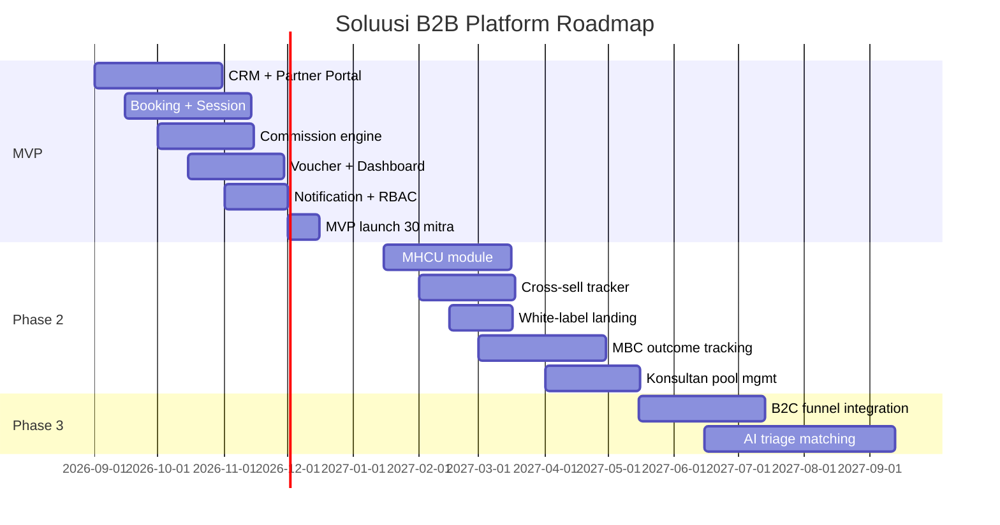

**MVP exit criteria** (Q1 2027):
- 30 mitra live across 3 vertikal
- ≥1.000 sesi completed
- 5 mitra reach Stage 3 (40 sesi)
- 0 confidentiality breach
- Weekly report auto-generated, komisi 100% auto-calc

---
---

## 14. Risks & Mitigations

| Risk | Likelihood | Impact | Mitigation |
|---|---|---|---|
| Confidentiality breach (HR/BK akses individual) | Medium | Critical | teknis RBAC + RLS + audit + aggregate-only API (§11). Tidak bisa di-bypass via UI. |
| Fake sesi (komisi fraud) | Medium | High | dual-confirm (konsultan+enduser) + audit trail + fallback flag + cash-flow-protection (pay after revenue confirmed) (§8.4) |
| MMCI/MMPI misuse by non-psikolog | Medium | High (HIMPSI) | instrument access restricted to licensed psikolog role; audit |
| Search tool flaky → competitor data stale | Low | Low | verify langsung ke situs (Competitor Analysis §8) |
| GTM bottleneck (associate capacity 3–5 deal) | Medium | Medium | CRM capacity guard + cross-sell attribution incentivizes |
| Scale before demand (overbuild) | Medium | Medium | Ponytail: MVP 9 modul, Phase 2 baru MHCU/cross-sell/MBC |
| Regulasi UU PDP enforcement tightening | High | High | data residency ID, consent flow, DPO consult |
| Riliv expand to klinik/sekolah | Medium | High | lock klinik early (HAP running), SAP first-mover, bagi-hasil moat |
| Spring Health/Lyra enter ID | Low (short) | High (long) | adopt MBC pattern Phase 2, local advantage |

---
---

## 15. Open Questions (decisions needed)

### 15.0 PM Decisions (resolusi default — coding agent JANGAN tunggu, ikuti ini kecuali founder override)

> PM (Claude) sudah putuskan setiap [OPEN] di bawah dengan default. Status: **DECIDED** = coding agent langsung jalan pakai ini; **NEEDS FOUNDER** = ada fallback default yang AMAN dipakai untuk dev/MVP, founder konfirm sebelum prod. Tidak ada yang blocking scaffold.

| # | Topik | Status | Keputusan PM (default) | Fallback / catatan blocking |
|---|------|--------|------------------------|------------------------------|
| 15.1 | Stack match | ✅ DECIDED | Match `soluusi-main` persis (§12). | — |
| 15.2 | Cross-sell attribution | ✅ DECIDED | Associate dapat **full commission** vertical pertama yang aktif. Vertical kedua (di dalam 6 bulan) → **50%** (anti-gaming). | Tabel `cross_sell_attributions(associate_id, partner_id, vertical, window_expires_at, commission_rate)`. Phase 2 — hardcode 50% di config untuk MVP, ganti tanpa code. |
| 15.3 | Konsultan fee model | ✅ DECIDED | **Flat net fee per sesi** completed-and-verified, dibayar Soluusi ke konsultan. BUKAN revenue-share %, BUKAN bagi-hasil. (Soluusi set net; klinik markup → margin ke klinik, net ke Soluusi, flat fee ke konsultan dari Soluusi.) | Tabel `consultant_fees(consultant_id, package_id, net_fee, effective_at)`. Mirror B2C `consultant_packages.price` = net. |
| 15.4 | White-label depth (MVP) | ✅ DECIDED | Depth MVP: **logo + brand name + sender email + mail subject prefix + gcal event prefix + finish page**. Custom domain = Phase 2. | Config `whitelabel.{name,logo,email}` per-klinik. |
| 15.5 | MHCU instrument licensing | ⚠️ NEEDS FOUNDER | M5 = Phase 2, jadi **tidak blocking MVP**. Founder konfirm license MMCI/MMPI (Soluusi sendiri vs psikolog partner) sebelum build M5. | Default dev: category-A instruments **disabled** di seeder sampai license confirmed. |
| 15.6 | Self-serve vs associate-only | ✅ DECIDED | **Associate-only** GTM untuk MVP + Phase 2 (match Playbook). Self-serve = Phase 3. | Tidak ada public signup route di MVP. |
| 15.7 | Pricing tiering (PEPM / sekolah) | ⚠️ NEEDS FOUNDER | Pakai angka **indikatif Playbook** sebagai default MVP, **parameterize** via `config/pricing.php` supaya finance ubah tanpa code. | Founder/finance confirm angka final sebelum go-live; dev pakai indikatif. |
| 15.8 | B2C integration scope | ✅ DECIDED | Phase 3. Data model keep `consultant_id` FK **compatible** untuk future pool-share, tapi **no integration code** di MVP/Phase 2. | — |
| 15.9 | `profit_sharing` semantics | ✅ DECIDED | **PRESERVE field** (merge parity, jangan drop), **tapi B2B commission calc TIDAK pakai field ini** (semantics ambigu + B2B pakai markup model, bukan bagi-hasil). B2B pakai field baru eksplisit: `klinik_markup_rate` + `split_settlements`. | Coding agent: grep pemakaian `profit_sharing` di `soluusi-main` controllers untuk dokumentasi, tapi jangan depend on it. |
| 15.10 | Split settlement table | ✅ DECIDED | **Tabel baru `split_settlements`** (additive). FK ke `consultation_sessions` (B2B gak punya `payments` table). Field: `session_id, net_amount, klinik_margin, status, settled_at`. | — |
| 15.11 | gcal service account ownership | ⚠️ NEEDS FOUNDER | **Soluusi ops** pegang service account (`storage/app/gcal-service-account.json`, gitignored). Subject = `calendar@soluusi.com` (Workspace Delegation). MVP dev pakai OAuth-user test creds (§16.2). | Founder: confirm Google Workspace admin + create SA + delegate `…/auth/calendar` scope sebelum prod. Tidak blocking dev. |
| 15.12 | Voucher free-trial | ✅ DECIDED | **YA**, tambah `type = free_trial` (10 min, nominal 0) untuk akuisisi customer klinik (M7). | Extend `vouchers.type` enum: `potongan`/`diskon`/`free_trial`. Mirror logic §17.6. |
| 15.13 | Kategori kesehatan | ✅ DECIDED | **Extend seeder**: klinik categories = Psikolog Klinis, Psikolog Pendidikan, Konselor, Ahli Gizi, Fisioterapis, Terapis Okupasi. **Keep B2C categories** (merge parity). Tambah `vertical` tag (`b2c`/`klinik`/`both`) di `categories`. | Seeder `CategorySkillSeeder` extend (Appendix D.8). |

**Net:** 9 DECIDED, 3 NEEDS FOUNDER (none blocking dev — semua punya fallback dev-safe). Coding agent: jalan pakai kolom "Keputusan PM". Kalau founder override, update row ini + relevant section.

---

### 15.x Detail per item (historical context)

1. **§15.1 Stack match** — ✅ **RESOLVED** (Agustus 2026, audit `soluusi-main`). B2C = Laravel 9 / PHP 8 / Midtrans Snap primary / Xendit dead / gcal OAuth-user / Vite-Tailwind / MySQL / database driver (no Redis). B2B **match persis** (§12 locked). Share team + code; merge ke `soluusi-main` nanti. → **lihat tabel 15.0 row 1.**
2. **§15.2 Cross-sell attribution** — associate yang bawa mitra klinik, kalau mitra itu juga jadi Company vertical, komisi cross-sell ke associate yang sama atau split? (TBD — affects M9 + Commission Engine)
3. **§15.3 Konsultan fee model** — bagaimana konsultan dibayar (per sesi flat? revenue share with Soluusi)? Belum di playbook. Affects revenue equation §8.7.
4. **§15.4 White-label depth** — perusahaan minta branded portal seberapa deep (logo only? custom domain? full white-label app?) Phase 2.
5. **§15.5 MHCU instrument licensing** — Soluusi punya license MMCI/MMPI sendiri atau via psikolog partner? Affects M5.
6. **§15.6 Self-serve vs associate-only** — Phase 2/3 buka self-serve signup untuk PLG, atau tetap associate-led GTM?
7. **§15.7 Pricing tiering** — PEPM rate final per company size? Subscription sekolah final per siswa? (Playbook indikatif, needs finance confirm)
8. **§15.8 B2C integration scope** — seberapa dalam integrate soluusi.com (share konsultan pool, cross-funnel)? Phase 3 tapi data model harus siap.
9. **§15.9 `profit_sharing` semantics** — B2C `consultants.profit_sharing` int, ambigu (% / basis-points / rupiah). Verify pemakaian di controller B2C sebelum decide reuse vs field baru. Affects Commission M6 + split.
10. **§15.10 Split settlement table** — `split_settlements` tabel baru (additive, FK ke `payments`) vs extend `payments`? Recommended: tabel baru.
11. **§15.11 gcal service account ownership** — butuh Google Workspace admin + delegation scope `…/auth/calendar`. Siapa pegang service account? Soluusi ops. Affects §12.3 migration.
12. **§15.12 Voucher free-trial** — B2C voucher = `potongan`(flat)/`diskon`(%), **no free-trial**. B2B butuh free-trial 10 min (M7)? Belum diputuskan.
13. **§15.13 Kategori kesehatan** — B2C seeder = Psikologi/Karir/Bisnis/Keuangan/Hukum/Pajak. Klinik butuh kategori kesehatan (Psikolog Klinis/Pendidikan, Konselor, Gizi, Fisioterapi). Finalize daftar sebelum seed.

---
---

## 16. Running Tech (cara jalanin — exact, untuk coding agent)

### 16.1 Versi terkunci
- PHP **8.0**+ (cli + fpm). Ext: pdo, pdo_sqlite/mysql, mbstring, xml, ctype, json, bcmath, fileinfo, gd, curl.
- Composer 2.x, Node 18+, npm.
- Laravel **9** (`laravel/framework ^9.0`).

### 16.2 Install (first time)
```bash
# 1. Scaffold — pin Laravel 9 (jangan default installer yang mungkin 10+)
composer create-project laravel/laravel:^9.0 soluusi-b2b-klinik
cd soluusi-b2b-klinik

# 2. Replace composer.json (require + require-dev §12.1/12.6) + package.json (§12.4), lalu:
composer install
npm install

# 3. Key + storage link
php artisan key:generate
php artisan storage:link

# 4. Copas file dari /Users/mekari/soluusi-main sesuai Appendix D (manual cp, skip SEO/blog/CMS)

# 5. .env (Appendix F.1) — Midtrans sandbox + gcal OAuth-user test creds dulu

# 6. DB local (SQLite) + migrate + seed
touch database/database.sqlite
php artisan migrate
php artisan db:seed          # CategorySkillSeeder extend kategori kesehatan §15.13

# 7. Run dev
php artisan serve            # http://localhost:8000
npm run dev                   # Vite + Tailwind
```

### 16.3 Dev run (harian)
```bash
php artisan serve & npm run dev          # app + frontend
php artisan queue:work                   # gcal + mail async (wajib — mailables queueable)
php artisan schedule:work                # reminder cadence (M10) + expiry sweep
```

### 16.4 Test
```bash
php artisan test                         # phpunit (incl. ScaffoldSmoke Appendix F.3)
php artisan test --filter=ScaffoldSmokeTest
```

### 16.5 Prod deploy (match B2C)
- Single Laravel app, PHP-FPM + nginx, **MySQL**, `QUEUE_CONNECTION=database` (worker via supervisor), `CACHE_STORE=database`, `SESSION_DRIVER=database`. **Redis Phase 2** jika throughput perlu.
- `.env` prod: Midtrans **live** keys, gcal **service account** (§15.11), `MAIL_MAILER=ses`/postmark, `APP_DEBUG=false`.
- Build: `composer install --no-dev`, `npm run build`, `php artisan migrate --force`, `php artisan config:cache && route:cache && view:cache`.
- Cron: `* * * * * cd /app && php artisan schedule:run` per menit. Queue worker: supervisor/systemd.

### 16.6 Local SQLite caveat
Beberapa migration B2C pakai raw SQL `ALTER ... MODIFY` (MySQL-only) untuk enum change. Di SQLite local: adapt pakai `doctrine/dbal` `->change()`, atau `php artisan migrate --pretend` untuk cek. `ScaffoldSmokeTest` (F.3) akan catch kalau ada yang break.

---

## 17. Engineering Patterns dari `soluusi-main` (mirror + adapt)

> Coding agent: snippet di bawah = **REAL** dari `/Users/mekari/soluusi-main`. Mirror pattern-nya, adapt sesuai catatan **"B2B CHANGE"**. Path source dicantumkan. Jangan re-invent.

### 17.1 Midtrans Snap — create transaction + row
Source: `app/Http/Controllers/MidtransController.php::createVa`
```php
// B2C: auth()->user(). B2B CHANGE: customer = guest (Model C), data dari form checkout link, bukan auth.
$data = [
    'transaction_details' => [
        'order_id' => str_replace('.', '', microtime(true)),   // B2B: pakai order_number konsisten
        'gross_amount' => $package->price + 10000,             // B2B CHANGE: gross = net(Soluusi) + markup(klinik); split via Connect/Marketplace
    ],
    'customer_details' => [
        'first_name' => $customer->firstname,                 // B2B: dari form checkout, bukan auth
        'email' => $customer->email,
        'phone' => $customer->phone,
    ],
    'expiry' => ['start_time' => date("Y-m-d H:i:s O"), 'unit' => 'hour', 'duration' => 1],
    'callbacks' => ['finish' => url('/checkout/done')],       // B2B: white-label finish page
];
\Config::$serverKey = config('midtrans.server_key');
\Config::$isProduction = config('app.env') === 'production';
\Config::$is3ds = config('midtrans.is_3ds');
$tokenUrl = \Midtrans\Snap::getSnapUrl($data);
$snapToken = basename($tokenUrl);
// lalu create ConsultationSession row (mirror field set §17.4) + send Bayar mail (white-labeled §17.5)
```

### 17.2 Midtrans callback — signature verify WAJIB + gcal non-fatal
Source: `app/Http/Controllers/MidtransController.php::callback`
```php
// B2C (BUG — JANGAN MIRROR): langsung lookup order_number, no verify. B2B FIX: verify SEBELUM proses.
use Midtrans\Notification;
$notif = new Notification($request->all(), config('midtrans.server_key'), config('app.env') === 'production'); // throws jika signature invalid
$orderId = $notif->order_id;   // atau $request->order_id setelah verify lolos
$session = ConsultationSession::where('order_number', $orderId)->firstOrFail();

switch ($request->transaction_status) {
    case 'settlement':
    case 'capture': // if fraud_status == 'accept'
        $session->payment_status = 'verified';
        $session->status = 'scheduled';          // B2B CHANGE: scheduled REGARDLESS of gcal (non-fatal §11.6)
        $session->payment_at = $request->transaction_time;
        $session->payment = $request->gross_amount;
        $session->save();
        // gcal best-effort (try/catch, gak block scheduled)
        try {
            $event = app(\App\Services\GoogleCalendarService::class)->createEvent($session);
            if ($event) {
                $session->link_meeting = $event['meet_link'] ?? $event['event_link'];
                $session->google_calendar_event_id = $event['event_id'];
                $session->save();
            }
        } catch (\Exception $e) { \Log::error('gcal: '.$e->getMessage()); }
        // B2B ADD: split_settlements row (net→Soluusi, margin→klinik)
        // B2B ADD: dual-confirm trigger (Appendix E.1 #4) — fee release NANTI setelah verify, bukan di sini
        break;
    case 'pending': $session->payment_status = 'waiting'; break;
    case 'expire': $session->payment_status = 'canceled'; $session->status = 'canceled'; break;
    case 'deny': case 'cancel': case 'failure': $session->payment_status = 'failed'; break;
    default: $session->payment_status = 'waiting';
}
$session->save();
// send white-labeled SudahBayar mails (client + consultant) — §17.5 brand param
```

### 17.3 Google Calendar — create event + Meet (mirror, white-label + service account)
Source: `app/Services/GoogleCalendarService.php`
```php
// B2C: OAuth-user (fetchAccessTokenWithRefreshToken($refreshToken)). B2B MIGRATE: service account + Workspace Delegation:
//   $client->setAuthConfig(storage_path('app/gcal-service-account.json'));
//   $client->setSubject('calendar@klinik-domain.id');   // or soluusi ops account
//   $client->addScope(Google_Service_Calendar::CALENDAR);  (no refresh-token dance)
// B2B CHANGE: brand dari $session->klinik->brand, bukan hardcoded "Soluusi".
$event->setSummary("{$brand} - {$packageName}");                 // B2C: "Soluusi - {$packageName}"
$event->setDescription("...dijadwalkan secara otomatis oleh {$brand}."); // B2C: "...oleh Soluusi."
// Meet conferenceData (mirror as-is — solutionKey type 'hangoutsMeet', requestId Str::uuid())
// attendees: customer email dari checkout form (B2B: customer guest, bukan $session->user->email) + consultant
// reminders: email 60min, popup 30min (mirror)
// insert dengan conferenceDataVersion=1, sendUpdates='all'
```

### 17.4 consultation_sessions schema (mirror verbatim, typo parity)
Source: `database/migrations/2023_11_09_155601_create_consultation_sessions_table.php`
```php
Schema::create('consultation_sessions', function (Blueprint $table) {
    $table->id();
    $table->foreignId('schedule_id')->constrained();
    $table->foreignId('user_id')->constrained();               // B2B: nullable (guest customer Model C) — atau link ke checkout_links
    $table->foreignId('consultant_packages')->constrained();   // ponytail: preserve B2C column name (typo parity, Appendix E.2 #5)
    $table->enum('status', ['waiting','ongoing','done','waiting_summary'])->default('waiting'); // B2B extend via alter: +scheduled, +canceled, +verified
    $table->string('order_number');
    $table->enum('payment_status', ['waiting','verified','canceled'])->default('waiting');      // B2B extend: +failed
    $table->timestampTz('order_at');
    $table->timestamps();
});
// + later B2C alters to mirror: link_meeting, google_calendar_event_id, complaint, note, solution,
//   package_price, voucher_amount, completed_at, expired_at, snaptoken, url_snap, review_text, rating
```

### 17.5 Mailable — white-label parameterize
Source: `app/Mail/Client/Bayar.php`
```php
// B2C: subject hardcoded "Soluusi - ...", no from(). B2B CHANGE: brand dari $session->klinik->brand, from() per-mailable.
class Bayar extends Mailable
{
    use Queueable, SerializesModels;
    public function __construct(public ConsultationSession $session, public string $brand) {}
    public function envelope(): Envelope
    {
        return new Envelope(
            from: config('whitelabel.email'),               // B2B ADD (global sender → per-mailable)
            subject: "{$this->brand} - Satu Langkah Lagi! Segera Selesaikan Pembayaranmu", // B2B: prefix brand
        );
    }
    public function content(): Content
    {
        return new Content(view: 'emails.klinik.bayar', with: ['session' => $this->session, 'brand' => $this->brand]);
    }
}
// caller: Mail::to($customer->email)->send(new Bayar($session, $session->klinik->brand));
// 14 mailables (5 client + 9 konsultan) semua di-parameterize cara yang sama.
```

### 17.6 Voucher logic (mirror verbatim)
Source: `MidtransController::getNominalWithVoucher` — cek `Carbon::now()->between(start_date, end_date)`, `kuota <= 0`, `min_transaction > price`, `max_discount < nominal`; type `diskon` = `price * discount_percentage / 100` capped `max_discount`; type `potongan` = `nominal` flat. B2B: tambah type `free_trial` (§15.12) → nominal 0, durasi 10 min.

### 17.7 Schedule lock + expiry sweep (mirror)
Source: `MidtransController::checkScheduleAvailability` + `updateExpiredPayments` — slot di-lock jika ada `ConsultationSession` `payment_status` in `[verified, waiting]` + `expired_at > now`. Sweep `updateExpiredPayments`: `payment_status=waiting` + `expired_at < now` → `canceled`. B2B mirror as-is (jangan double-book slot).

---

## Appendix A — Traceability: Playbook → PRD

| Playbook section | PRD module/flow |
|---|---|
| §0.5 Partnership Journey | M1 CRM, Flow 8.1 |
| §1.2/2.2/3.2 Skema | M2 Portal, M3 Booking, M5 MHCU, M7 Voucher |
| §1.4/2.4/3.4 Pricing | M6 Commission, Flow 8.7 |
| §4.11 Onboarding Checklist | Flow 8.2 |
| §4.12 Aktivasi Hari 1-30 | Flow 8.2 |
| §4.13 Dukungan | M2 Document hub, M7 Campaign |
| §4.14 Cross-Sell | M9, Flow 8.6 |
| §4.15 Follow-up Cadence | M10, Flow 8.9 |
| §4.18 Weekly Report | M1 auto-report |
| §5.2 Three-Stage Payout | M6, Flow 8.4/8.8 |
| §5.3 Team Milestone | M6 |
| §3.6/4.20 Confidentiality | §11 NFR, M5 Flow 8.5 |

## Appendix B — Glossary
(lihat Master Playbook Lampiran A)

---

## Appendix C — B2C Codebase Audit → B2B Platform Deltas

Ground truth: `/Users/mekari/soluusi-main` (Laravel 9, PHP 8). Audit Agustus 2026. Depth klinik: `Soluusi B2B - Klinik Vertical Spec.md` Appendix C. File-level copas: `Soluusi B2B - Dev Preparation.md` §4.

### C.1 Stack (full → §12)
Laravel 9 / PHP 8 / Sanctum+Socialite / Guzzle / intervention/image / indoregion / doctrine/dbal / Vite-Tailwind 4 / MySQL / database driver (no Redis). B2B = match persis.

### C.2 Payment
| | B2C | B2B |
|---|---|---|
| Primary | Midtrans Snap redirect-token, single merchant (Soluusi = MoR) | Reuse + split-payment NEW |
| Xendit | Dead/stubbed | Revive for split Marketplace `for-user` |
| Split | **None** (grep zero hit) | **BUILD NEW** — Midtrans Connect / Xendit Marketplace |
| Webhook sig | NO verify (bug) | **FIX** verify signature (§11.6) |
| Webhook route | `POST api/midtrans-callback` → `MidtransController@callback` | Reuse route, B2B namespace |

### C.3 Google Calendar
| | B2C | B2B |
|---|---|---|
| Auth | OAuth-user (`soluusi@gmail.com` refresh token) | Migrate → **service account** + Workspace Delegation |
| Event summary | `"Soluusi - {package}"` hardcoded | Parameterize → `"{brand} - {package}"` |
| link_meeting | Google Meet URI | Match |
| Failure | gcal throw → session `waiting` (data-loss bug) | **FIX** non-fatal, scheduled regardless (§11.6) |
| File | `app/Services/GoogleCalendarService.php` | Copas as start, then migrate |

### C.4 Mail (white-label)
14 mailables (5 client + 9 konsultan) + 16 blades. ALL hardcode `"Soluusi - "` subject prefix, global sender, no per-mailable `from()`. B2B: copas → parameterize prefix → `{brand} -`, per-mailable `from(config('whitelabel.email'))`.

### C.5 Key tables (reuse domain identik, B2B-only additive)
**Reuse verbatim** (typo B2C dipertahankan untuk merge parity): `consultants` (`profit_sharing` int, `status` enum accept/reject/pending/interview/payment), `categories` (seeded Psikologi/Karir/Bisnis/Keuangan/Hukum/Pajak), `consultant_packages` (pricing, FK typo `consultan_id`, no online/offline field), `schedules` (concrete datetime slots, not recurring), `vouchers` (`potongan`/flat | `diskon`/%, NO free-trial), `consultant_ratings` (1-5 int, no review text; text on `consultation_sessions.review_text`), `consultation_sessions` (booking row: status waiting/scheduled/done/canceled, payment_status waiting/verified/canceled, `link_meeting`, `google_calendar_event_id`, `complaint`, `note`, `solution`), `payments`, `users` (+gender, +date_of_birth, +regency_id PII), `roles`, `social_accounts`, indoregion (provinces/regencies/districts/villages).

**B2B-only additive** (prefix `klinik_`/domain baru): `kliniks` (brand, domain, logo, from-email, gcal_id), `klinik_admins` (pivot user↔klinik), `split_settlements`, `hap_commissions`, `markup_rules`, `checkout_links` (signed token + expiry + snapshot).

### C.6 B2C flow vs B2B flow
**B2C:** browse category → consultant detail → pick package → `get-jadwal-by-package` (AJAX) → payment page → `create-va` (row + Snap URL) → Snap → callback → gcal+Meet + status=scheduled → consultant `set-note`/`set-done` → review. **No check-in, no no-show, no dual-confirm.**

**B2B (klinik, priority):** admin klinik pick konsultan + schedule → generate **white-label checkout link** → admin sends to customer → customer opens link (sees konsultan name + schedule + marked-up price), isi data (nama/email/telp/DOB/regency/gender + complaint), bayar langsung → gateway split (net→Soluusi, margin→klinik) → auto-confirm + auto-gcal → dual-confirm (konsultan mark-done → verify → release fee + HAP). Customer = guest (Model C), NO account. **Hide Soluusi (non-circumvention).**

### C.7 Summary: B2B-NEW vs B2C-reuse vs B2C-fix
| Kategori | Item |
|---|---|
| **B2B-NEW** (build dari nol) | split-payment, white-label config+param, service-account gcal, dual-confirm, admin-generate-link booking, klinik RBAC+earnings/payout, HAP 3-stage commission, markup+cap, Model C checkout-guest, anti-circumvention, no-show+check-in |
| **B2C-reuse** (copas verbatim) | domain migrations + models, MidtransController Snap flow (adapt), GoogleCalendarService (as start), 14 mailables (then white-label), voucher logic, indoregion, Schedule/Jadwal, role middleware, config midtrans/xendit |
| **B2C-fix** (jangan bawa bug) | webhook signature verify [SECURITY], gcal failure non-fatal [DATA-LOSS], payment_status enum Blueprint, profit_sharing semantics verify, B2C typos preserve-for-parity |

---

## Appendix D — Component Reuse Manifest (copas `soluusi-main` → B2B)

Path source: `/Users/mekari/soluusi-main/`. Status: ✅ verbatim · 🔧 copas+adapt · 🆕 build baru (Appendix E) · ❌ skip. File-level detail: `Soluusi B2B - Dev Preparation.md` §4.

### D.1 Migrations — domain konsultasi (✅), skip SEO/blog/CMS (❌)
**Copas (timeline jaga):** users, password_resets, failed_jobs, personal_access_tokens, consultants + alters, certificates, companies + alters, schedules + alters, roles, categories + alters, skills, social_media, education, departements, benefits, consultant_packages + alters, consultant_skills, consultant_social_media, consultant_education, consultation_sessions + ALL alters, add_relation_each_table, outputs, category_skills, consultant_categories, consultant_ratings, consultant_companies, vouchers + alter, payments, social_accounts, subcategories, consultant_subcategories, indoregion (provinces/regencies/districts/villages) + regency_id/gender/DOB on users, google_calendar_event_id/complaint/package_price/voucher_amount/completed_at/solution on consultation_sessions, sessions + cache table, composite PK consultant_categories, deleted_at consultant_packages.

**❌ Skip (mesin content soluusi.com):** semua migration `2026_04_30_16*`–`2026_08_04_14*` (seo_keywords, seo_keyword_rankings, location_pages, blog_*, user_sessions, seo_daily_summaries, seo_transactions, seo_audits, seo_gsc_summaries, backlink*, article_templates, blog_post_edits, style_guides, blog_comments). Juga user_topses (TOPSIS), banners, campaign1_investasi, manual_reviews (optional), cms_columns_to_consultants, blog_subscription_to_consultants, landing_page_columns_to_categories.

### D.2 Models — ✅
`User`, `Role`, `SocialAccount`, `Consultant`, `ConsultantPackage`, `Schedule`, `ConsultationSession`, `Voucher`, `ConsultantRating`, `Category`, `CategorySkill`, `ConsultantCategory`, `Skill`, `ConsultantSkill`, `SocialMedia`, `ConsultantSocialMedia`, `Education`, `ConsultantEducation`, `Company`, `ConsultantCompany`, `Departement`, `Benefit`, `Certificate`, `Subcategory`, `ConsultantSubcategory`, `Output`, `Payment`, `Province`, `Regency`, `District`, `Village`, `Model` (base). ❌ Skip semua `Seo*`/`Blog*`/`Backlink*`/`ArticleTemplate`/`StyleGuide`/`LocationPage`/`UserSession`/`UserTopsis`/`Banner`/`ManualReview`(optional).

### D.3 Controllers — 🔧
| Controller | Status | Adaptasi |
|---|---|---|
| `MidtransController` | 🔧 | + signature verify (§11.6), + split (Appendix E), white-label receipt |
| `AuthController` | 🔧 | SSO Google untuk admin klinik + konsultan; customer = guest |
| `JadwalController` | 🔧 | reuse slot mgmt; + admin-generate-link endpoint (Appendix E) |
| `ConsultantController` | 🔧 | subset set-note/set-done/set-link-meeting → dual-confirm (Appendix E) |
| `HomeController` | 🔧 | subset dashboard/transaction/payroll → klinik earnings/payout |
| `VoucherController` | ✅ | voucher CRUD + `getNominalWithVoucher` |
| `KategoriController` | 🔧 | category CRUD; seeder extend kategori kesehatan (§15.13) |
| `KonsumenController` | 🔧 | checkout B2C → white-label checkout link flow |
| `XenditController` | ❌ | dead, build fresh jika pakai Xendit Marketplace |

❌ Skip: BlogController, SitemapController, CampaignController, FrontController, TopsisController, LocationController, BannerController, ExperienceController, EducationController, CompanyController, (Consultant)SubcategoryController.

### D.4 Services — 🔧
`GoogleCalendarService` 🔧 (copas as start → migrate service account, parameterize brand, non-fatal). ❌ Skip semua SEO/AI services (AiContentService, Ga4Service, GscService, BlogCommentService, SeoScoringService, DynamicPromptBuilder, PatternExtractionService, SchemaService, EditCaptureService).

### D.5 Mail — 🔧 (14 mailables + 16 blades)
Copas ke `app/Mail/Klinik/` + `resources/views/emails/klinik/`. White-label: subject `"Soluusi - "` → `"{brand} - "`, global sender → per-mailable `from(config('whitelabel.email'))`. Brand di-resolve dari `klinik_id` context → `App\Models\Klinik::brand`.

### D.6 Config — ✅/🔧
✅ `config/midtrans.php` (verbatim; key `merchat_id` pertahankan untuk parity — verify controller baca key mana sebelum fix). ✅ `config/xendit.php`. 🔧 `config/services.php` — copas **hanya** block `google` + `google_calendar`; ❌ drop postmark/resend/ses/slack/zhipu_ai/deepseek/gemini/ga4/gsc (mesin content/AI/SEO). 🆕 `config/klinik.php`, `config/whitelabel.php`, `config/split.php`.

### D.7 Helpers & middleware — ✅/🔧
✅ `app/Helpers/CStr.php`. 🔧 `CheckRole.php` (tambah role `klinik_admin`). ✅ `Authenticate.php`, `RedirectIfAuthenticated.php`.

### D.8 indoregion + seeders — 🔧
✅ package + migrations + models. 🔧 `CategorySkillSeeder` — copas lalu extend kategori kesehatan (§15.13). 🔧 `DatabaseSeeder` — skip seed blog/SEO.

---

## Appendix E — Build-NEW, Fix-List & Merge Architecture

### E.1 Build-NEW (B2B-specific, tidak ada di B2C)
| # | Komponen | PRD module | Spec ref |
|---|---|---|---|
| 1 | Split-payment gateway (Midtrans Connect / Xendit Marketplace `for-user`) | M6 + §10 | Spec §10.3 |
| 2 | White-label config + parameterization (brand, domain, receipt, email, gcal) | M2/WLB | Spec §10.8 |
| 3 | Service-account Google Calendar (migrate dari OAuth-user) | §12.3 | Spec §10.5 |
| 4 | Dual-confirm anti-fraud (konsultan mark-done → verify → release fee + HAP) | M4 §8.4 | Spec §9 |
| 5 | Admin-generate-link booking flow (admin pick konsultan+schedule → generate signed white-label checkout link → send to customer) | M3 | Spec §7.1 |
| 6 | Klinik RBAC + earnings/payout dashboard (role `klinik_admin`, aggregate-only) | M2/M8 | Spec §11 |
| 7 | HAP 3-stage commission engine (Rp1M: 250k@5, 250k@25, 500k@40/90d) | M6 | Spec §12 |
| 8 | Markup + cap per price range (Soluusi set net, klinik mark up, cap per range) | M6 §8.7 | Spec §8 |
| 9 | Pasien Model C checkout-guest (no account, transactional PII: nama/email/telp/DOB/regency/gender + complaint) | M3 | Spec §6 |
| 10 | Anti-circumvention (MoU + teknis: hide Soluusi, neutral domain, no link to soluusi.com) | §11.7 | Spec §10.10 |
| 11 | No-show + check-in (B2C: tidak ada; B2B: check-in window, no-show policy TBD §15) | M4 | Spec §9 |

**Tabel B2B baru (additive, prefix `klinik_`/domain):** `kliniks`, `klinik_admins`, `split_settlements`, `hap_commissions`, `markup_rules`, `checkout_links` (signed token + expiry + klinik_id + konsultan_id + schedule_id + package_uuid + markup_snapshot).

### E.2 Fix-List (jangan bawa bug B2C)
| # | Bug B2C | Fix di B2B | Sifat |
|---|---|---|---|
| 1 | Webhook NO signature verify (`MidtransController@callback`) | Tambah `Midtrans\Notification` verify pakai `server_key` sebelum update `payment_status`; reject+log mismatch | 🔒 SECURITY — wajib |
| 2 | gcal failure fatal (session `waiting` meski paid) | try/catch; status→`scheduled` regardless; `google_calendar_event_id` nullable; retry via queue; log | 🔒 DATA-LOSS — wajib |
| 3 | `payment_status` enum loose (raw SQL alter) | Blueprint `$table->enum('payment_status', ['waiting','verified','canceled'])` di migration awal B2B | 📐 clean |
| 4 | `profit_sharing` int ambigu (% / bps / rupiah) | Verify di controller B2C; **preserve field** (merge parity) tapi B2B commission calc pakai field baru `klinik_markup_rate` + `split_settlements` (§15.9, §15.0) | ❓ VERIFY → ✅ DECIDED (§15.0) |
| 5 | Typos `consultan_id`/`INTERVIEW`/`discount_precentage`/`merchat_id` | **Pertahankan** di tabel copas (merge parity); ejaan benar di tabel B2B baru | 📐 parity |

### E.3 Merge Architecture (pisah sekarang, nyatu nanti)
| Komponen | Strategi |
|---|---|
| Tabel domain identik | Copas migration + model verbatim (typo B2C dipertahankan) → merge = no-op skema |
| Tabel B2B-only | Nama distinktif prefix `klinik_`, tidak collide → additive merge |
| Model domain | Namespace `App\Models\` sama → merge = reuse file sama |
| Model B2B-only | `App\Models\Klinik\...` sub-namespace |
| Route | B2B route group `Route::prefix('klinik')->middleware('klinik.auth')` → merge = tambah 1 route group |
| Config | B2B config sendiri (`klinik.php`, `whitelabel.php`, `split.php`) + copas midtrans/xendit → tambah, gak modifikasi B2C |
| Mail | `App\Mail\Klinik\...` + `resources/views/emails/klinik/` → gak collide dgn 14 mailable B2C |

`// ponytail: preserve B2C typo for schema parity on merge` — rename typo = cleanup join terpisah di soluusi-main belakangan, bukan tanggung jawab B2B sekarang.

---

## Appendix F — Env Vars, Setup Checklist & Smoke Check

### F.1 Env vars (B2B `.env`)
```env
APP_NAME="Klinik Konsultan"          # neutral, NOT "Soluusi"
APP_ENV=local  APP_KEY=  APP_DEBUG=true  APP_URL=http://localhost:8000
DB_CONNECTION=sqlite                   # local; prod=mysql
SESSION_DRIVER=database  QUEUE_CONNECTION=database  CACHE_STORE=database
MIDTRANS_SERVER_KEY=  MIDTRANS_CLIENT_KEY=  MIDTRANS_MERCHANT_ID=  MIDTRANS_IS_3DS=true
SECRET_KEY_XENDIT=                     # for split Marketplace
GOOGLE_CALENDAR_CLIENT_ID=  GOOGLE_CALENDAR_CLIENT_SECRET=  GOOGLE_CALENDAR_REFRESH_TOKEN=  GOOGLE_CALENDAR_ID=primary
GOOGLE_CLIENT_ID=  GOOGLE_CLIENT_SECRET=  GOOGLE_REDIRECT_URL=   # Socialite SSO admin+konsultan
MAIL_MAILER=log  MAIL_FROM_ADDRESS="no-reply@klinik-brand.id"  MAIL_FROM_NAME="${APP_NAME}"
WHITE_LABEL_DEFAULT_BRAND="Klinik Konsultan"  WHITE_LABEL_DOMAIN=checkout.klinik-brand.id
SPLIT_PROVIDER=midtrans_connect  SPLIT_ON=true
```

### F.2 Setup checklist (urutan)
1. `composer create-project laravel/laravel:^9.0 soluusi-b2b-klinik`
2. Replace `composer.json` require/require-dev + `package.json` (§12); `composer install` + `npm install`
3. `php artisan key:generate`
4. Copas Appendix D sesuai manifest (migrations skip SEO/blog/CMS, models, controllers adapt, services, mail+blades, config, helpers, indoregion, seeders)
5. Bikin config baru `klinik.php`/`whitelabel.php`/`split.php`
6. Isi `.env` (F.1); Midtrans sandbox; gcal OAuth-user test creds dulu (service account nanti)
7. `php artisan migrate` (resolve MySQL-only raw SQL alter untuk SQLite local — beberapa `alter enum` B2C raw)
8. `php artisan db:seed` (CategorySkillSeeder extend kategori kesehatan §15.13)
9. `php artisan serve` + `npm run dev`
10. Jalankan smoke F.3

### F.3 Smoke check (satu runnable — Ponytail: smallest thing that fails if logic breaks)
`tests/Feature/ScaffoldSmokeTest.php` (phpunit native, no framework tambahan):
```php
// ponytail: one smoke per Ponytail rule. Framework: phpunit (already in deps).
public function test_scaffold_boots_and_core_domain_writes()
{
    $this->assertNotNull(config('midtrans.server_key'));
    $konsultan = Consultant::factory()->create(['status' => 'accept']);
    $pkg = ConsultantPackage::factory()->create(['consultan_id' => $konsultan->id]); // typo parity
    $sched = Schedule::factory()->create(['consultant_id' => $konsultan->id]);
    $ses = ConsultationSession::create([
        'consultant_id' => $konsultan->id, 'schedule_id' => $sched->id,
        'package_uuid' => $pkg->uuid, 'payment_status' => 'waiting', 'status' => 'waiting',
        // + complaint, DOB, regency_id, gender per Model C
    ]);
    $this->assertDatabaseHas('consultation_sessions', ['id' => $ses->id]);
}
```
Plus 3 manual (perlu live creds): Midtrans Snap URL generate sandbox + buka; gcal event create test calendar; webhook signature — kirim callback signature salah → reject (§11.6).

---

*Soluusi · B2B Platform PRD · Confidential · Internal Use Only*
*Versi 1.1 · Agustus 2026 · Draft for review*
