# ERD Delta — Perusahaan Mission (W1–W8)

Mermaid. Hanya TABEL/KOLOM yang berubah atau baru di mission ini (base:
`upgrade/laravel-12` sebelum 2026-11-20). Sumber: migrasi
`2026_11_20_000001..000007` + `2026_11_22_*`. Latar abu = tabel existing yang
mendapat kolom baru.

```mermaid
erDiagram
    PACKAGES {
        int id PK
        string name
        tinyint monthly_quota "default 2"
        boolean is_active
    }
    EMPLOYEE_PACKAGES {
        int id PK
        int perusahaan_employee_id FK
        int package_id FK
        int perusahaan_id FK
        date starts_at
        date ends_at "nullable"
        string status "default active"
    }
    CONSULTATION_QUOTA_LEDGER {
        int id PK
        int employee_package_id FK
        int perusahaan_session_id FK "nullable"
        string period_ym "YYYY-MM"
        string event "reserved|used|forfeited|refunded|released"
        text reason "nullable"
        int actor_id FK "nullable users"
    }
    CONSULTANT_POOLS {
        int id PK
        int perusahaan_id FK
        int consultant_id FK
        string status "default active"
        date contract_start "nullable"
        date contract_end "nullable"
    }
    CONSULTANT_WORK_HOURS {
        int id PK
        int consultant_pool_id FK
        tinyint weekday
        time start_time
        time end_time
        json consultation_types "nullable = semua"
        int slot_minutes "default 60"
    }
    CONSULTANT_AVAILABILITY_EXCEPTIONS {
        int id PK
        int consultant_id FK
        date date
        time start_time "nullable NULL=full day"
        time end_time "nullable"
    }
    PERUSAHAANS {
        int id PK
        string name
        boolean is_active
        boolean consultant_request_enabled "default false"
        int sessions_per_employee_month
    }
    PERUSAHAAN_SESSIONS {
        int id PK
        int perusahaan_id FK
        int employee_id FK
        int consultant_id FK
        string konsultan_type
        string consultation_type "chat|online_meeting|one_on_one default chat"
        string meeting_url "nullable override"
        int room_id FK "nullable"
        string status
        boolean quota_consumed
        int rating "legacy W3"
    }
    ROOMS {
        int id PK
        int perusahaan_id FK
        string name
        string status "default active"
    }
    CHAT_MESSAGES {
        int id PK
        int perusahaan_session_id FK
        int sender_id FK
        string sender_role "employee|consultant"
        text body
    }
    CONSULTATION_NOTES {
        int id PK
        int perusahaan_session_id FK "UNIQUE"
        int consultant_id FK
        text body "encrypted cast"
    }
    CONSULTATION_RESULTS {
        int id PK
        int perusahaan_session_id FK "UNIQUE"
        text summary
        text recommendation "nullable"
    }
    CONSULTATION_REVIEWS {
        int id PK
        int perusahaan_session_id FK "UNIQUE"
        int perusahaan_employee_id FK
        tinyint rating "1-5"
        text comment "nullable"
    }
    AUDIT_LOGS {
        int id PK
        int actor_id "nullable tanpa FK"
        string action "max 100"
        string subject_type "nullable"
        bigint subject_id "nullable"
        json meta
        string ip "45"
    }
    ASSESSMENT_INSTRUMENTS {
        int id PK
        string code UK "who5|phq9|gad7|cbi"
        string name
        string version "default 1"
        string scoring_type "sum|sum_x4|mean_x25"
        json bands
        text interpretation "nullable"
        string license_note "nullable"
        json escalate_items "nullable"
        boolean is_active
    }
    SCREENING_QUESTIONS {
        int id PK
        string instrument_code FK "nullable"
        string version
        int weight
    }
    PERUSAHAAN_ASSESSMENTS {
        int id PK
        int perusahaan_id FK
        int employee_id FK
        string instrument_code "FK nullable, index"
        boolean escalated "default false"
        json answers
        tinyint score
    }
    USERS ||--o{ EMPLOYEE_PACKAGES : "via perusahaan_employees"
    EMPLOYEE_PACKAGES }o--|| PACKAGES : ""
    EMPLOYEE_PACKAGES ||--o{ CONSULTATION_QUOTA_LEDGER : ""
    PERUSAHAAN_SESSIONS ||--o{ CONSULTATION_QUOTA_LEDGER : "0..1 event per jenis"
    PERUSAHAANS ||--o{ CONSULTANT_POOLS : ""
    CONSULTANTS ||--o{ CONSULTANT_POOLS : ""
    CONSULTANT_POOLS ||--o{ CONSULTANT_WORK_HOURS : ""
    CONSULTANTS ||--o{ CONSULTANT_AVAILABILITY_EXCEPTIONS : ""
    PERUSAHAANS ||--o{ PERUSAHAAN_SESSIONS : ""
    PERUSAHAAN_EMPLOYEES ||--o{ PERUSAHAAN_SESSIONS : ""
    CONSULTANTS ||--o{ PERUSAHAAN_SESSIONS : ""
    ROOMS ||--o{ PERUSAHAAN_SESSIONS : "0..1 per sesi one_on_one"
    PERUSAHAAN_SESSIONS ||--o{ CHAT_MESSAGES : ""
    USERS ||--o{ CHAT_MESSAGES : "sender"
    PERUSAHAAN_SESSIONS ||--o| CONSULTATION_NOTES : "1 catatan per sesi"
    PERUSAHAAN_SESSIONS ||--o| CONSULTATION_RESULTS : "1 hasil per sesi"
    PERUSAHAAN_SESSIONS ||--o| CONSULTATION_REVIEWS : "1 review per sesi"
    PERUSAHAAN_EMPLOYEES ||--o{ CONSULTATION_REVIEWS : ""
    USERS ||--o{ AUDIT_LOGS : "actor, tanpa FK"
    ASSESSMENT_INSTRUMENTS ||--o{ SCREENING_QUESTIONS : "instrument_code"
    ASSESSMENT_INSTRUMENTS ||--o{ PERUSAHAAN_ASSESSMENTS : "instrument_code"
    PERUSAHAANS ||--o{ PERUSAHAAN_ASSESSMENTS : ""
    PERUSAHAAN_EMPLOYEES ||--o{ PERUSAHAAN_ASSESSMENTS : ""
    PERUSAHAANS ||--o{ ROOMS : ""
    PERUSAHAANS ||--o{ EMPLOYEE_PACKAGES : ""
```

## Catatan kardinalitas

- `consultation_quota_ledger` → `perusahaan_session_id` **nullable** (sesi
  pre-mission tanpa ledger) + UNIQUE(perusahaan_session_id, event) =
  idempotensi event.
- `consultation_notes/results/reviews`: UNIQUE(perusahaan_session_id) = max
  1 row per sesi (update-in-place, bukan append).
- `rooms` → sesi: hanya terisi untuk `consultation_type = one_on_one`
  (pickFreeRoom anti-konflik waktu).
- `audit_logs.actor_id` sengaja TANPA FK (log harus tetap hidup walau user
  dihapus).
- `screening_questions.instrument_code` nullable = item legacy pre-mission.

## Deviasi dari target ERD MASTER-PLAN

- Tidak ada tabel `consultant_requests` terpisah: request konsultasi
  karyawan diimplement sebagai `perusahaan_sessions` berstatus `scheduled`
  + `scheduled_at NULL` (gate ACC) — sudah ada di base, dipakai ulang (K8).
